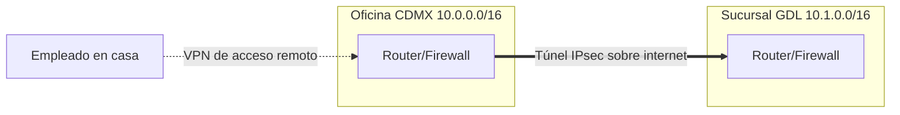

# VPN (sitio a sitio y acceso remoto, IPsec y SSL)

Parte de: [[19-Redes/07 Seguridad de redes/_Índice Seguridad de redes|Seguridad de redes]]

> [!info] Cómo avanzar
> `progreso`: **pendiente** → **viendo** (estudiando) → **visto** (contestaste la autoevaluación sin abrir las respuestas) → **dominado** (hiciste el laboratorio o lo aplicaste de verdad).

## Contenido

### Qué es
Una **VPN** (Virtual Private Network) crea un **túnel cifrado** a través de una red no confiable, normalmente internet, para que dos redes o un usuario y una red se comuniquen como si estuvieran conectados de forma privada. Aporta **confidencialidad** (nadie lee el tráfico), **integridad** (nadie lo modifica sin que se note) y **autenticación** (sabes con quién hablas). Esta nota da el panorama; los detalles están en [[VPN sitio a sitio]], [[VPN de acceso remoto]], [[IPsec]] y [[VPN SSL]].

### Cómo funciona
El equipo VPN toma el paquete original, lo **cifra y lo encapsula** dentro de un paquete nuevo con las IP públicas de los extremos del túnel. En el otro extremo se desencapsula, se verifica y se descifra, y el paquete original continúa por la red interna. Para la red de en medio solo hay tráfico cifrado entre dos IP públicas.

**Dos grandes tipos según quién se conecta**:
- **Sitio a sitio**: une **redes completas** (una sucursal con la oficina central, la oficina con una VNet de Azure). El túnel lo establecen dos equipos de borde (routers o firewalls) y es **transparente** para los usuarios: sus PCs no tienen software VPN.
- **Acceso remoto**: conecta a **un usuario o dispositivo** individual (un empleado desde casa o el aeropuerto) con la red de la empresa, mediante un cliente de software en su equipo.

**Tecnologías habituales**:

| Uso | Tecnología típica |
|---|---|
| Sitio a sitio | **IPsec** (con IKEv2), a veces GRE sobre IPsec, DMVPN o SD-WAN |
| Acceso remoto | **VPN SSL/TLS** (Cisco Secure Client, OpenVPN), **IPsec IKEv2** (nativo en Windows, iOS, macOS), WireGuard |
| Nube | VPN Gateway de Azure (IPsec/IKE sitio a sitio; punto a sitio con IKEv2 u OpenVPN) |



### Ejemplo
La empresa tiene:
- Oficina en CDMX y sucursal en Guadalajara unidas por un túnel **IPsec sitio a sitio** entre sus firewalls. Las PCs de Guadalajara acceden al SQL Server de CDMX sin saber que hay un túnel.
- Un túnel IPsec de la oficina a la **VNet de Azure** donde corre Itzamna.Dionisio, configurado con un VPN Gateway y un "Local Network Gateway" que representa la oficina.
- Los desarrolladores en casa usan una **VPN de acceso remoto** con MFA para llegar a los servidores de desarrollo.

Verificación típica en un router Cisco con IPsec:

```text
R1# show crypto ikev2 sa
R1# show crypto ipsec sa
R1# show crypto session
```

En `show crypto ipsec sa`, los contadores `#pkts encaps` y `#pkts decaps` deben crecer en ambos sentidos cuando hay tráfico.

### Cuándo usarlo y cuándo no
- **Sitio a sitio**: unir oficinas o la nube a bajo costo sobre internet; para requisitos de latencia y ancho de banda garantizados, enlaces dedicados (MPLS, ExpressRoute) o SD-WAN.
- **Acceso remoto**: trabajo remoto; cada vez más se complementa o reemplaza con **ZTNA**, que da acceso por aplicación en lugar de a toda la red (ver [[Zero Trust en redes]]).
- No uses una VPN como excusa para no cifrar las aplicaciones: TLS de extremo a extremo sigue siendo necesario.

### Errores comunes
- **Redes traslapadas** en ambos extremos (las dos con 192.168.1.0/24): el enrutamiento no funciona.
- **MTU no ajustado**: los encabezados de la VPN reducen el espacio y los paquetes grandes fallan.
- **Acceso remoto sin MFA**.
- **Dar a la VPN acceso a toda la red** cuando el usuario solo necesita dos aplicaciones.

### Para profundizar
- [RFC 4301: arquitectura de seguridad para IP (IPsec)](https://www.rfc-editor.org/rfc/rfc4301)
- [Microsoft Learn: ¿Qué es Azure VPN Gateway?](https://learn.microsoft.com/azure/vpn-gateway/vpn-gateway-about-vpngateways)
- [NIST SP 800-77 Rev. 1: guía de VPN IPsec](https://csrc.nist.gov/pubs/sp/800/77/r1/final)

## Subtemas

- [[VPN sitio a sitio]]
- [[VPN de acceso remoto]]
- [[IPsec]]
- [[VPN SSL]]

## Autoevaluación

Contesta primero en voz alta o en papel; luego despliega la respuesta.

> [!question]- ¿Qué es una VPN?
> Un túnel cifrado sobre una red no confiable (Internet) que ofrece confidencialidad, integridad y autenticación.

> [!question]- ¿Qué diferencia hay entre VPN sitio a sitio y de acceso remoto?
> **Sitio a sitio**: une redes completas entre gateways (los usuarios no instalan nada). **Acceso remoto**: un usuario individual se conecta con un cliente o el navegador.

> [!question]- ¿Qué tecnologías se usan normalmente en cada caso?
> Sitio a sitio: **IPsec** (a veces con GRE o DMVPN). Acceso remoto: **SSL/TLS** o IPsec con IKEv2.

## Progreso de los subtemas

```base
filters:
  and:
    - file.inFolder("19-Redes/07 Seguridad de redes/VPN (sitio a sitio y acceso remoto, IPsec y SSL)")
    - file.name != "VPN (sitio a sitio y acceso remoto, IPsec y SSL)"
views:
  - type: table
    name: Progreso
    order:
      - file.name
      - progreso
      - nivel
```
