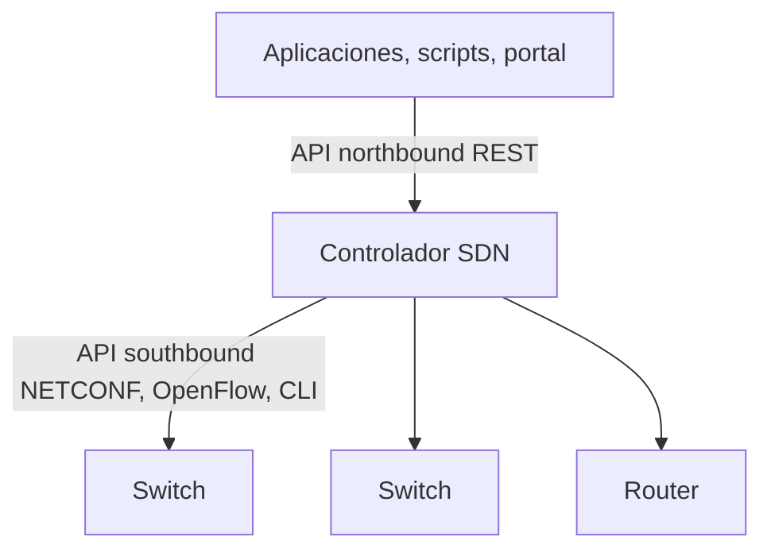

# SDN (redes definidas por software)

Parte de: [[19-Redes/09 Avanzado/_Índice Avanzado|Avanzado]]

> [!info] Cómo avanzar
> `progreso`: **pendiente** → **viendo** (estudiando) → **visto** (contestaste la autoevaluación sin abrir las respuestas) → **dominado** (hiciste el laboratorio o lo aplicaste de verdad).

## Contenido

### Qué es
**SDN** (Software-Defined Networking, redes definidas por software) es una arquitectura que **separa el plano de control** (las decisiones: qué rutas usar, qué políticas aplicar) **del plano de datos** (el reenvío de paquetes) y centraliza el control en un **controlador** de software. En lugar de configurar cada equipo por separado, defines la intención en el controlador y este programa a los equipos. Es uno de los conceptos de automatización del CCNA.

### Cómo funciona
**Los planos de un equipo de red**:
- **Plano de datos** (data plane o forwarding plane): reenvía paquetes según tablas ya calculadas (MAC, rutas, ACL). Tiene que ser rapidísimo y suele estar en hardware (ASIC).
- **Plano de control**: calcula esas tablas (OSPF, STP, ARP).
- **Plano de gestión**: cómo lo administras (SSH, SNMP, APIs).

En la red tradicional cada equipo tiene sus tres planos y decide por sí mismo (control **distribuido**). En SDN, el controlador concentra parte o toda la lógica de control y los equipos se dedican sobre todo a reenviar.

**APIs del controlador**:
- **Northbound (hacia el norte)**: las que el controlador ofrece **hacia arriba**, a las aplicaciones, scripts y portales. Normalmente APIs REST con JSON. Con ellas tu código le pide "crea esta red virtual" o "dame el estado de todos los switches".
- **Southbound (hacia el sur)**: las que el controlador usa **hacia abajo** para programar los equipos: OpenFlow, NETCONF, RESTCONF, gRPC, SSH/CLI, SNMP.



**Underlay y overlay**:
- **Underlay**: la red física que da conectividad IP básica entre los equipos (enlaces, routing con OSPF o IS-IS). Debe ser simple y robusta.
- **Overlay**: redes **virtuales** construidas encima con túneles (por ejemplo, **VXLAN**, que encapsula tramas de capa 2 en UDP). Permiten tener segmentos lógicos independientes de la topología física: dos VM en racks distintos pueden estar en la misma "VLAN" virtual.
- **Fabric**: el conjunto underlay + overlay administrado como un todo.

Ejemplos de SDN en la industria: **Cisco Catalyst Center** (antes DNA Center) con **SD-Access** para campus (overlay VXLAN con LISP y políticas por grupo), **Cisco ACI** para centros de datos, **SD-WAN** para la WAN (ver [[WAN y SD-WAN]]) y las propias redes de la nube: cuando creas una VNet en Azure, un controlador programa el overlay sobre la red física de Microsoft.

### Ejemplo
Con un controlador de campus, en lugar de entrar a 50 switches para crear la VLAN del nuevo equipo de QA y sus ACL, defines en el controlador: "grupo QA, puede acceder a los servidores de pruebas, no a Finanzas". El controlador genera y empuja la configuración a todos los switches del fabric.

Consumir la API northbound desde Python (patrón típico: obtener token y consultar inventario):

```python
import os, requests

base = "https://catalyst-center.itzamna.local"
token = requests.post(f"{base}/dna/system/api/v1/auth/token",
                      auth=(os.environ["CC_USER"], os.environ["CC_PASS"])).json()["Token"]
equipos = requests.get(f"{base}/dna/intent/api/v1/network-device",
                       headers={"X-Auth-Token": token}).json()["response"]
for e in equipos:
    print(e["hostname"], e["managementIpAddress"], e["softwareVersion"])
```

(Los nombres de los endpoints corresponden a la API publicada por Cisco para Catalyst Center; revísalos en la documentación de DevNet de tu versión.)

### Cuándo usarlo y cuándo no
SDN aporta en redes grandes, con cambios frecuentes y necesidad de políticas consistentes (campus grandes, centros de datos, WAN con muchas sucursales). En una oficina con tres switches, el costo y la complejidad de un controlador no se justifican: basta una buena configuración y algo de automatización.

### Errores comunes
- **Pensar que SDN elimina por completo el control en los equipos**: muchas implementaciones son híbridas.
- **Confundir northbound y southbound**.
- **Descuidar el underlay**: si la red física falla, todo el overlay cae.
- **Tratar al controlador como un punto único de falla** sin redundancia.

### Para profundizar
- [RFC 7426: SDN, capas y terminología de arquitectura](https://www.rfc-editor.org/rfc/rfc7426)
- [RFC 7348: VXLAN](https://www.rfc-editor.org/rfc/rfc7348)
- [Cisco DevNet](https://developer.cisco.com/)

## Autoevaluación

Contesta primero en voz alta o en papel; luego despliega la respuesta.

> [!question]- ¿Qué separa SDN?
> El **plano de control** (decide rutas, centralizado en un controlador) del **plano de datos** (reenvía paquetes en los equipos). El plano de gestión administra y monitorea.

> [!question]- ¿Qué son las API northbound y southbound?
> **Northbound**: entre aplicaciones y el controlador (normalmente REST). **Southbound**: entre el controlador y los equipos (OpenFlow, NETCONF, etc.).

> [!question]- ¿Qué son underlay y overlay?
> **Underlay**: la red física IP que transporta todo. **Overlay**: redes virtuales encima (túneles VXLAN, por ejemplo) que define el controlador.

