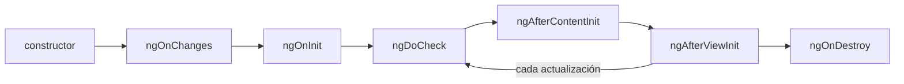

# Ciclo de vida de componentes

Parte de: [[20-Angular/01 Básico/_Índice Básico|Básico]]

> [!info] Cómo avanzar
> `progreso`: **pendiente** → **viendo** (estudiando) → **visto** (contestaste la autoevaluación sin abrir las respuestas) → **dominado** (hiciste el laboratorio o lo aplicaste de verdad).

## Contenido

### Qué es
El **ciclo de vida** son las etapas por las que pasa un componente: se crea, recibe inputs, se dibuja, se actualiza y se destruye. Angular ofrece *hooks* (métodos con nombre fijo) y funciones para ejecutar código en esos momentos. En React todo esto se concentra en `useEffect` y sus dependencias; en Angular hay puntos explícitos, aunque con signals necesitas muchos menos.

### Cómo funciona
Orden de los hooks de clase (los que más usarás en negritas):

| Hook | Cuándo se ejecuta |
|---|---|
| `constructor` | Al crear la instancia; los inputs aún no tienen valor |
| `ngOnChanges(changes)` | Antes de `ngOnInit` y cada vez que cambia un input |
| **`ngOnInit`** | Una vez, después de recibir los primeros inputs |
| `ngDoCheck` | En cada ciclo de detección de cambios (evítalo) |
| `ngAfterContentInit` / `Checked` | Tras proyectar el contenido `<ng-content>` |
| **`ngAfterViewInit`** / `Checked` | Tras crear la vista propia y la de los hijos |
| **`ngOnDestroy`** | Justo antes de destruir el componente |



#### Constructor contra `ngOnInit`
- **Constructor / inicializadores de campo**: inyección de dependencias (`inject()`), crear señales y `computed`, registrar `effect`. No leas inputs aquí: todavía no llegan.
- **`ngOnInit`**: lógica que depende de inputs, como pedir datos al API con el `id` recibido. Con inputs de señal y `computed`/`resource` cada vez necesitas menos este hook, pero sigue siendo válido.

#### Limpieza: `DestroyRef` y `takeUntilDestroyed()`
En lugar de implementar `ngOnDestroy`, puedes inyectar `DestroyRef` y registrar callbacks: `inject(DestroyRef).onDestroy(() => ...)`. Funciona también en servicios y directivas. Para Observables, `takeUntilDestroyed()` (de `@angular/core/rxjs-interop`) completa la suscripción cuando el componente se destruye; dentro de un contexto de inyección no necesita argumentos.

#### Hooks de renderizado: `afterNextRender` y `afterEveryRender`
Se ejecutan **después** de que Angular actualizó el DOM y **solo en el navegador** (nunca en SSR). `afterNextRender` corre una vez tras el siguiente render: ideal para inicializar una librería que necesita el DOM real (un gráfico, un mapa, medir un elemento). `afterEveryRender` corre después de cada render (antes se llamaba `afterRender`); úsalo con cautela.

### Ejemplo
```ts
import { Component, DestroyRef, ElementRef, OnInit, afterNextRender,
         inject, input, signal, viewChild } from '@angular/core';
import { takeUntilDestroyed } from '@angular/core/rxjs-interop';
import { interval } from 'rxjs';
import { PedidosApi } from '../pedidos-api';

@Component({
  selector: 'app-detalle-pedido',
  template: `<h2>Pedido {{ id() }}</h2><canvas #grafica></canvas><p>{{ segundos() }} s</p>`,
})
export class DetallePedido implements OnInit {
  id = input.required<number>();
  private api = inject(PedidosApi);         // constructor/inicializador: DI
  private destroyRef = inject(DestroyRef);
  protected segundos = signal(0);
  private grafica = viewChild.required<ElementRef<HTMLCanvasElement>>('grafica');

  constructor() {
    // Se limpia sola al destruir el componente
    interval(1000).pipe(takeUntilDestroyed()).subscribe(() => this.segundos.update(s => s + 1));

    afterNextRender(() => {
      // El canvas ya existe en el DOM; aquí inicializarías Chart.js
      const ctx = this.grafica().nativeElement.getContext('2d');
      ctx?.fillRect(0, 0, 10, 10);
    });
  }

  ngOnInit() {
    // El input ya tiene valor
    this.api.obtener(this.id()).pipe(takeUntilDestroyed(this.destroyRef)).subscribe();
  }
}
```

Nota: fuera del constructor (como en `ngOnInit`) hay que pasarle `this.destroyRef` a `takeUntilDestroyed`, porque ya no hay contexto de inyección.

### Cuándo usarlo y cuándo no
- `ngOnInit`: carga inicial dependiente de inputs.
- `DestroyRef`/`takeUntilDestroyed`: toda suscripción manual de larga vida.
- `afterNextRender`: integración con librerías del DOM y código que solo debe correr en navegador.
- Evita `ngDoCheck` y los `...Checked`: corren muchísimas veces.
- Para reaccionar a cambios de inputs, prefiere `computed()` sobre `ngOnChanges`.

### Errores comunes
- **Leer inputs en el constructor.** Están vacíos; Angular 21 agregó un diagnóstico para inputs requeridos leídos antes de tiempo.
- **Suscripciones sin limpieza.** `interval`, `valueChanges` o WebSockets siguen vivos tras salir de la página: fugas de memoria y peticiones duplicadas.
- **Tocar el DOM en `ngOnInit`.** La vista aún no existe; usa `afterNextRender` o `viewChild` en hooks posteriores.
- **Usar `window` o `document` en el constructor con SSR.** Falla en el servidor; ponlo en `afterNextRender`.

### Para profundizar
- [Angular: ciclo de vida de componentes](https://angular.dev/guide/components/lifecycle)
- [Angular: interoperabilidad con RxJS](https://angular.dev/guide/signals/rxjs-interop)
- [API de afterNextRender](https://angular.dev/api/core/afterNextRender)

## Autoevaluación

Contesta primero en voz alta o en papel; luego despliega la respuesta.

> [!question]- Nombra los hooks de ciclo de vida más usados y cuándo se ejecutan.
> `ngOnInit` (una vez, tras recibir los inputs iniciales) · `ngOnChanges` (cada vez que cambia un input con decorador) · `ngAfterViewInit` (la vista y sus hijos ya existen) · `ngOnDestroy` (antes de destruir el componente).

> [!question]- ¿Qué pones en el constructor y qué en `ngOnInit`?
> Constructor: solo inyección de dependencias e inicialización simple. `ngOnInit`: lógica que depende de los inputs (por ejemplo, cargar datos).

> [!question]- ¿Para qué sirven `DestroyRef` y `takeUntilDestroyed()`?
> Para limpiar recursos al destruir el componente sin implementar `ngOnDestroy`: `obs$.pipe(takeUntilDestroyed()).subscribe(...)` cancela la suscripción automáticamente.

> [!question]- ¿Cuándo usarías `afterNextRender`?
> Para código que necesita el DOM real del navegador (medir un elemento, iniciar una librería de gráficas). Además no se ejecuta en el servidor con SSR.

