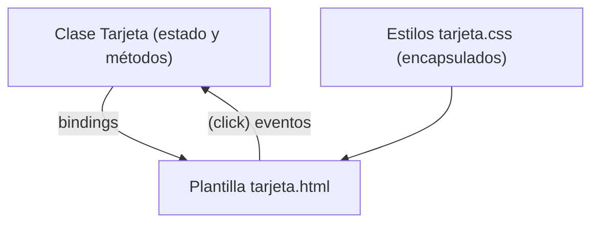

# Componentes en Angular

Parte de: [[20-Angular/01 Básico/_Índice Básico|Básico]]

> [!info] Cómo avanzar
> `progreso`: **pendiente** → **viendo** (estudiando) → **visto** (contestaste la autoevaluación sin abrir las respuestas) → **dominado** (hiciste el laboratorio o lo aplicaste de verdad).

## Contenido

### Qué es
Un **componente** es la pieza básica de la interfaz: una clase TypeScript con el decorador `@Component` que une una **plantilla** (HTML), unos **estilos** (CSS) y una **lógica** (propiedades, métodos, señales). Se usa en otras plantillas como si fuera una etiqueta HTML propia, por ejemplo `<app-tarjeta>`. Es el equivalente a un componente de función en React, pero como clase que vive mientras está en pantalla.

### Cómo funciona
Las propiedades básicas de `@Component`:

| Propiedad | Para qué |
|---|---|
| `selector` | Nombre de la etiqueta con que se usa (`app-tarjeta`) |
| `template` / `templateUrl` | Plantilla en línea o en archivo `.html` |
| `styles` / `styleUrl` | Estilos en línea o en archivo `.css`/`.scss` |
| `imports` | Otros componentes, directivas y pipes que usa la plantilla |
| `changeDetection` | Estrategia; en v22 `OnPush` ya es el valor por defecto |
| `host` | Atributos, clases y eventos del elemento anfitrión |



#### Encapsulación de estilos
Por defecto (`ViewEncapsulation.Emulated`), Angular agrega atributos únicos (por ejemplo `_ngcontent-abc-c12`) a los elementos de cada componente y reescribe su CSS para que solo apliquen ahí. Así, un `h2 { color: red }` dentro de `tarjeta.css` no afecta a los `h2` del resto de la app. Es parecido a CSS Modules en React, pero automático. Otras opciones: `ShadowDom` (usa Shadow DOM real) y `None` (estilos globales). Para estilar el propio elemento anfitrión usas el selector `:host`.

#### Usar un componente dentro de otro
Una plantilla solo conoce los componentes que la clase lista en `imports`. Si escribes `<app-tarjeta>` sin importar `Tarjeta`, el compilador marca que `app-tarjeta` "no es un elemento conocido". En React bastaba con importar el símbolo en el archivo; en Angular además hay que declararlo en `imports` del decorador.

### Ejemplo
Tarjeta de producto y su uso en una lista:

```ts
// productos/tarjeta/tarjeta.ts
import { Component, input } from '@angular/core';
import { CurrencyPipe } from '@angular/common';
import { Producto } from '../producto';

@Component({
  selector: 'app-tarjeta',
  imports: [CurrencyPipe],
  template: `
    <h3>{{ producto().nombre }}</h3>
    <p class="precio">{{ producto().precio | currency: 'MXN' }}</p>
  `,
  styles: `
    :host { display: block; border: 1px solid #ddd; padding: 1rem; }
    .precio { font-weight: bold; }
  `,
})
export class Tarjeta {
  producto = input.required<Producto>();
}
```

```ts
// productos/lista/lista.ts
import { Component, signal } from '@angular/core';
import { Tarjeta } from '../tarjeta/tarjeta';
import { Producto } from '../producto';

@Component({
  selector: 'app-lista',
  imports: [Tarjeta], // sin esto, <app-tarjeta> no es conocido
  template: `
    @for (p of productos(); track p.id) {
      <app-tarjeta [producto]="p" />
    }
  `,
})
export class Lista {
  protected productos = signal<Producto[]>([
    { id: 1, nombre: 'Teclado', precio: 899 },
    { id: 2, nombre: 'Mouse', precio: 349 },
  ]);
}
```

Recibir datos con `input()` se ve a fondo en [[Input y Output]]; la sintaxis de la plantilla en [[Templates y data binding (interpolación, propiedades y eventos)]].

### Cuándo usarlo y cuándo no
- Crea un componente cuando un trozo de UI tiene identidad propia, se repite o tiene estado propio.
- Separa componentes "de presentación" (reciben inputs y emiten outputs) de componentes "contenedores" (piden datos a servicios).
- Si solo necesitas agregar comportamiento a un elemento existente (resaltar, tooltip), usa una [[Directivas|directiva]] en lugar de un componente.
- Si solo transformas un valor para mostrarlo, usa un [[Pipes|pipe]].

### Errores comunes
- **Olvidar `imports`.** Error "is not a known element"; agrega el componente, directiva o pipe al arreglo.
- **Prefijo de selector inconsistente.** Usa siempre el prefijo del proyecto (`app-`) con guion; evita choques con elementos HTML estándar.
- **Componentes gigantes.** Más de unas 300 líneas suele indicar que hay que dividir.
- **Estilos que "no aplican" a hijos.** Por la encapsulación, el CSS del padre no llega al interior de un hijo; estila desde el hijo o con variables CSS.

### Para profundizar
- [Angular: anatomía de un componente](https://angular.dev/guide/components)
- [Estilos de componentes y encapsulación](https://angular.dev/guide/components/styling)
- [API de @Component](https://angular.dev/api/core/Component)

## Autoevaluación

Contesta primero en voz alta o en papel; luego despliega la respuesta.

> [!question]- ¿Qué es un componente?
> Una clase TypeScript con el decorador `@Component` que une **lógica** (la clase), **plantilla** (HTML) y **estilos**. Es la pieza básica de la interfaz.

> [!question]- ¿Qué propiedades básicas lleva `@Component`?
> `selector` (etiqueta HTML, p. ej. `app-producto`), `template` o `templateUrl`, `styles` o `styleUrl`, e `imports` (otros componentes, directivas o pipes que usa la plantilla).

> [!question]- ¿Qué significa que los estilos estén encapsulados?
> Por defecto (`ViewEncapsulation.Emulated`) Angular agrega atributos únicos para que los estilos del componente **no se filtren** a otros componentes.

> [!question]- Error común: usas `<app-tarjeta>` en una plantilla y Angular dice que no es un elemento conocido. ¿Qué falta?
> Agregar el componente `Tarjeta` al arreglo `imports` del componente que lo usa (y revisar que el `selector` coincida).

## Práctica

- [[Lab 1 - Componentes standalone y data binding en Angular]]

