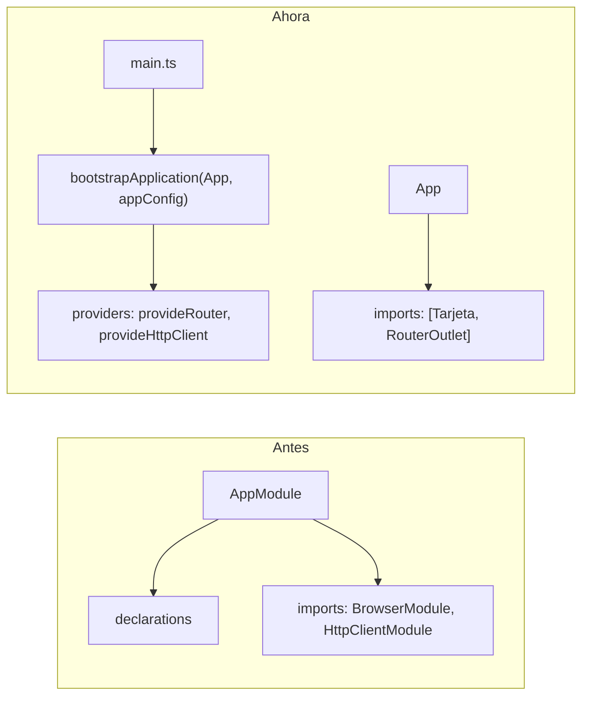

# Componentes standalone

Parte de: [[20-Angular/01 Básico/_Índice Básico|Básico]]

> [!info] Cómo avanzar
> `progreso`: **pendiente** → **viendo** (estudiando) → **visto** (contestaste la autoevaluación sin abrir las respuestas) → **dominado** (hiciste el laboratorio o lo aplicaste de verdad).

## Contenido

### Qué es
Un **componente standalone** es un componente que declara directamente sus dependencias en `imports` y no necesita pertenecer a un `NgModule`. Durante años, Angular obligaba a agrupar componentes en módulos (`@NgModule` con `declarations`, `imports` y `exports`); standalone eliminó esa capa. Desde **Angular 19** `standalone` es `true` por defecto, así que **ya no hace falta escribir `standalone: true`**. Directivas y pipes funcionan igual.

Para quien viene de React es lo natural: cada componente importa lo que usa, sin un registro central.

### Cómo funciona
1. Cada componente, directiva o pipe lista en `imports` lo que su plantilla necesita.
2. La aplicación arranca con `bootstrapApplication()` en lugar de `platformBrowserDynamic().bootstrapModule(AppModule)`.
3. Los servicios globales y la configuración (router, HTTP, animaciones) se registran como **providers** en `app.config.ts` usando funciones `provideXxx()`.
4. Las rutas pueden cargar componentes perezosamente con `loadComponent`, sin módulos intermedios.



### Ejemplo
Arranque completo sin `NgModule`:

```ts
// src/main.ts
import { bootstrapApplication } from '@angular/platform-browser';
import { App } from './app/app';
import { appConfig } from './app/app.config';

bootstrapApplication(App, appConfig).catch(err => console.error(err));
```

```ts
// src/app/app.config.ts
import { ApplicationConfig, provideBrowserGlobalErrorListeners } from '@angular/core';
import { provideRouter } from '@angular/router';
import { provideHttpClient, withInterceptors } from '@angular/common/http';
import { routes } from './app.routes';
import { authInterceptor } from './core/auth.interceptor';

export const appConfig: ApplicationConfig = {
  providers: [
    provideBrowserGlobalErrorListeners(),
    provideRouter(routes),
    provideHttpClient(withInterceptors([authInterceptor])),
  ],
};
```

```ts
// src/app/app.ts
import { Component } from '@angular/core';
import { RouterOutlet, RouterLink } from '@angular/router';

@Component({
  selector: 'app-root',
  imports: [RouterOutlet, RouterLink], // sin standalone: true, ya es el default
  template: `
    <nav><a routerLink="/productos">Productos</a></nav>
    <router-outlet />
  `,
})
export class App {}
```

#### Cómo se veía antes
Para entender código heredado conviene reconocer el patrón viejo. Un componente vivía "declarado" en un módulo, y ese módulo importaba lo que necesitaban *todos* sus componentes:

```ts
// Estilo anterior (Angular 14 y antes)
@NgModule({
  declarations: [ListaComponent, TarjetaComponent],
  imports: [CommonModule, FormsModule],
  exports: [ListaComponent],
})
export class ProductosModule {}
```

El problema era la indirección: al leer `ListaComponent` no sabías de dónde salía `<app-tarjeta>` sin abrir el módulo, y cualquier cambio de dependencias tocaba un archivo compartido. Con standalone, cada archivo es autosuficiente: la clase dice exactamente qué usa su plantilla, lo que también facilita el *tree shaking* (el build descarta lo que nadie importa) y la carga perezosa por componente. Es la misma sensación que en React con los `import` de cada archivo.

Si una librería antigua solo ofrece un `NgModule`, puedes importarlo igual en `imports` del componente; standalone y módulos conviven. Para registrar los providers de un módulo viejo a nivel de aplicación existe `importProvidersFrom(ModuloViejo)`.

### Cuándo usarlo y cuándo no
- **Proyecto nuevo:** siempre standalone; es lo que genera el CLI.
- **Proyecto existente con módulos:** migra de forma gradual con `ng g @angular/core:standalone`, que convierte declaraciones, elimina módulos innecesarios y cambia el arranque.
- **Mantén `NgModule`** solo si dependes de una librería que lo requiere o si migrar no aporta valor inmediato.
- Ojo con el código viejo: si ves `standalone: false`, ese componente sí pertenece a un módulo.

### Errores comunes
- **Agregar `standalone: true` por costumbre.** No rompe nada, pero es ruido; en Angular 19+ es el valor por defecto.
- **Importar `CommonModule` completo.** Antes se hacía para `*ngIf`; hoy el control de flujo es nativo y conviene importar solo lo que usas (`DatePipe`, `CurrencyPipe`). Existe una migración opcional `common-to-standalone`.
- **Buscar dónde "declarar" un componente.** Ya no se declara; se importa donde se usa.
- **Registrar servicios en `imports`.** `imports` es para cosas de plantilla; los servicios van en `providers` o con `@Service()`/`providedIn: 'root'`.

### Para profundizar
- [Angular: importar y usar componentes](https://angular.dev/guide/components/importing)
- [Migración a standalone](https://angular.dev/reference/migrations/standalone)
- [API de bootstrapApplication](https://angular.dev/api/platform-browser/bootstrapApplication)

## Autoevaluación

Contesta primero en voz alta o en papel; luego despliega la respuesta.

> [!question]- ¿Qué es un componente standalone?
> Un componente que declara directamente sus dependencias en `imports` y no necesita pertenecer a un `NgModule`. Hoy es la forma predeterminada de trabajar.

> [!question]- ¿Cómo se arranca una aplicación sin NgModule?
> ```ts
> bootstrapApplication(App, appConfig);
> ```
> con los providers en `appConfig` (`provideRouter`, `provideHttpClient`, …).

> [!question]- ¿Hace falta escribir `standalone: true`?
> En versiones actuales no: los componentes, directivas y pipes son standalone por defecto. En proyectos antiguos sí aparece. Para migrar existe el schematic `ng generate @angular/core:standalone`.

## Práctica

- [[Lab 1 - Componentes standalone y data binding en Angular]]

