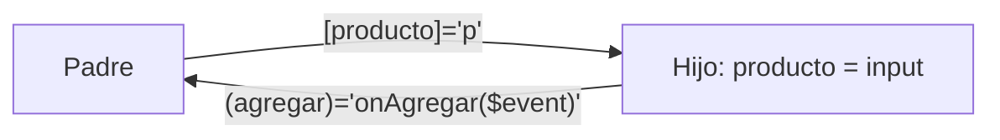

# Input y Output

Parte de: [[20-Angular/01 Básico/_Índice Básico|Básico]]

> [!info] Cómo avanzar
> `progreso`: **pendiente** → **viendo** (estudiando) → **visto** (contestaste la autoevaluación sin abrir las respuestas) → **dominado** (hiciste el laboratorio o lo aplicaste de verdad).

## Contenido

### Qué es
Son el mecanismo de comunicación entre un componente padre y uno hijo:

- **Input**: el padre le pasa datos al hijo (como las *props* de React).
- **Output**: el hijo avisa al padre que algo pasó (como pasar un callback `onAlgo` en React, pero con eventos).

En Angular moderno se declaran con las funciones `input()`, `input.required()` y `output()`. Las versiones con decorador `@Input()` y `@Output()` siguen funcionando, pero las funciones son la forma recomendada.

### Cómo funciona


#### Inputs basados en señales
```ts
producto = input.required<Producto>(); // obligatorio
mostrarPrecio = input(true);           // opcional con valor por defecto
descuento = input(0, { transform: numberAttribute }); // convierte "10" a 10
```
`input()` devuelve una **`InputSignal`**: se lee como cualquier señal (`this.producto()`), puedes usarla dentro de `computed()` y Angular la actualiza cuando el padre cambia el valor. Es de **solo lectura**: no tiene `set` ni `update`, porque el dueño del dato es el padre. Si el hijo necesita una copia editable, usa `linkedSignal(() => this.producto())`, y si debe devolver el cambio al padre, usa `model()` (ver [[Two-way binding]]).

#### Outputs
```ts
agregar = output<Producto>();
// ...
this.agregar.emit(this.producto());
```
`output()` devuelve un `OutputEmitterRef`; el padre se suscribe con `(agregar)="..."` y recibe el valor en `$event`. No es un Observable completo como el viejo `EventEmitter`, solo emite.

#### Diferencias con `@Input()` / `@Output()`
| `@Input()` / `@Output()` | `input()` / `output()` |
|---|---|
| Propiedad normal, se lee sin paréntesis | Señal, se lee con `()` |
| Para reaccionar a cambios: `ngOnChanges` o setter | `computed()` o `effect()` directamente |
| Requerido con `{ required: true }` | `input.required()` con tipo no nulo |
| `@Output() x = new EventEmitter<T>()` | `x = output<T>()` |

Existe una migración automática: `ng g @angular/core:signal-input-migration` (y la de outputs).

#### Opciones útiles de `input()`
- **`alias`**: el nombre público difiere del nombre en la clase (`input(0, { alias: 'cantidadInicial' })`). Úsalo con moderación; suele confundir.
- **`transform`**: convierte el valor recibido. Angular trae `booleanAttribute` y `numberAttribute`, que permiten escribir `<app-x deshabilitado>` (sin valor) y recibir `true`.
- **Requeridos tipados**: con `input.required<T>()` el tipo dentro del hijo nunca es `undefined`, y el compilador se queja si el padre olvida pasarlo.

#### Quién es dueño del dato
La regla es la misma que en React: el estado vive en un solo lugar. El padre es dueño de `productos`; el hijo solo lo muestra y **pide** cambios mediante outputs. Así cada cambio tiene un único punto de entrada y es fácil de depurar y de probar.

### Ejemplo
```ts
// tarjeta-producto.ts
import { Component, computed, input, output } from '@angular/core';
import { CurrencyPipe } from '@angular/common';
import { Producto } from '../producto';

@Component({
  selector: 'app-tarjeta-producto',
  imports: [CurrencyPipe],
  template: `
    <h3>{{ producto().nombre }}</h3>
    @if (mostrarPrecio()) {
      <p>{{ precioFinal() | currency: 'MXN' }}</p>
    }
    <button (click)="agregar.emit(producto())">Agregar</button>
  `,
})
export class TarjetaProducto {
  producto = input.required<Producto>();
  mostrarPrecio = input(true);
  descuento = input(0); // porcentaje
  agregar = output<Producto>();

  protected precioFinal = computed(
    () => this.producto().precio * (1 - this.descuento() / 100),
  );
}
```

```html
<!-- padre -->
@for (p of productos(); track p.id) {
  <app-tarjeta-producto [producto]="p" [descuento]="10" (agregar)="carrito.agregar($event)" />
}
```

Con el router también puedes recibir parámetros de ruta como inputs si activas `withComponentInputBinding()` (ver [[Router de Angular]]).

### Cuándo usarlo y cuándo no
- **Inputs/outputs**: comunicación directa padre-hijo de uno o dos niveles.
- **Servicio con señales**: cuando los datos cruzan muchos niveles o los comparten componentes hermanos (evita el *prop drilling*, igual que en React usarías Context).
- **`model()`**: cuando el hijo edita un valor que pertenece al padre.
- Mantén los componentes de presentación "tontos": reciben inputs, emiten outputs y no llaman al API.

### Errores comunes
- **`this.producto.set(...)` en un input.** Falla en compilación porque `InputSignal` no tiene `set`: el valor pertenece al padre. Emite un output o usa `linkedSignal`/`model`.
- **Leer un input requerido en el constructor.** Aún no tiene valor; léelo en plantilla, `computed`, o desde `ngOnInit` en adelante.
- **Mutar un objeto recibido.** Cambiar `producto().precio` no avisa a nadie y con OnPush la vista no se actualiza; crea un objeto nuevo en el dueño del dato.
- **Olvidar los corchetes.** `producto="p"` pasa la cadena `"p"`, no la variable.

### Para profundizar
- [Angular: inputs de componentes](https://angular.dev/guide/components/inputs)
- [Angular: outputs personalizados](https://angular.dev/guide/components/outputs)
- [Angular: linkedSignal](https://angular.dev/guide/signals/linked-signal)

## Autoevaluación

Contesta primero en voz alta o en papel; luego despliega la respuesta.

> [!question]- ¿Cómo recibe datos un componente hijo?
> Con un input de señal: `producto = input.required<Producto>()` o `titulo = input('Sin título')`. En la plantilla se lee como `producto()`. El padre lo pasa con `[producto]="p"`.

> [!question]- ¿Cómo avisa el hijo al padre?
> Con un output: `eliminar = output<number>()` y `this.eliminar.emit(id)`. El padre escucha con `(eliminar)="borrar($event)"`.

> [!question]- ¿Qué diferencia hay con `@Input()` y `@Output()`?
> Son la forma con decoradores (y `EventEmitter`). Siguen funcionando; `input()` y `output()` son la forma moderna basada en señales, con mejor tipado y sin necesitar `ngOnChanges`.

> [!question]- Error común: intentar hacer `this.producto.set(...)` en un input. ¿Por qué falla?
> Los inputs son **de solo lectura** para el hijo: los controla el padre. Si el hijo necesita modificarlo, usa `model()` o una señal local derivada.

## Práctica

- [[Lab 1 - Componentes standalone y data binding en Angular]]
- [[Lab 1 - Pruebas unitarias y de componentes en Angular]]

