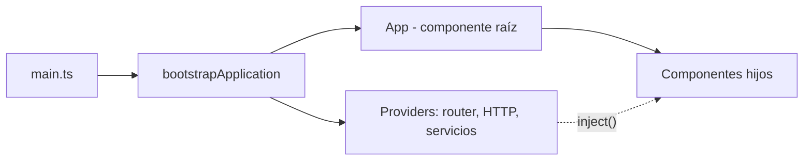

# Qué es Angular y en qué se diferencia de React

Parte de: [[20-Angular/01 Básico/_Índice Básico|Básico]]

> [!info] Cómo avanzar
> `progreso`: **pendiente** → **viendo** (estudiando) → **visto** (contestaste la autoevaluación sin abrir las respuestas) → **dominado** (hiciste el laboratorio o lo aplicaste de verdad).

## Contenido

### Qué es
Angular es un **framework de front-end** mantenido por Google para construir aplicaciones web de una sola página (SPA) con **TypeScript**. A diferencia de React, que es una biblioteca enfocada en la capa de vista, Angular trae en el mismo paquete casi todo lo que necesita una aplicación empresarial: componentes, plantillas, router, formularios, cliente HTTP, inyección de dependencias (DI), herramientas de pruebas y un CLI que genera, compila y actualiza el proyecto.

La versión mayor vigente es **Angular 22** (publicada en junio de 2026, con 22.1 en julio). A partir de la v22 el equipo pasó de una versión mayor cada seis meses a **una por año**: la v23 está planeada para junio de 2027 (fecha aproximada). En esta área estudias el Angular "moderno": componentes standalone, **signals**, el control de flujo `@if`/`@for`/`@switch`, aplicaciones **zoneless** y `OnPush` como estrategia predeterminada.

### Cómo funciona
Una aplicación Angular es un árbol de componentes. Cada componente es una clase TypeScript con un decorador `@Component` que le asocia una plantilla HTML y estilos. El compilador de Angular (AOT) transforma esas plantillas en instrucciones JavaScript eficientes durante el build; no se interpretan en el navegador.



Comparación rápida con lo que ya conoces de React:

| Concepto | React | Angular |
|---|---|---|
| Vista | JSX dentro de TS | Plantilla HTML con sintaxis propia |
| Estado local | `useState` | `signal()` |
| Derivados | `useMemo` | `computed()` |
| Efectos | `useEffect` | `effect()` (uso más limitado) |
| Props | props de función | `input()` |
| Callbacks al padre | props `onAlgo` | `output()` |
| Contexto/servicios | Context, hooks | Servicios + DI con `inject()` |
| Router, formularios, HTTP | librerías externas | incluidos oficialmente |
| Re-render | la función del componente se vuelve a ejecutar | se actualizan solo los bindings afectados |

La diferencia mental más importante: en React el componente es una **función que se re-ejecuta** en cada render; en Angular el componente es una **instancia de clase que vive** mientras está en pantalla, y Angular actualiza el DOM a partir de lo que cambió (con signals sabe con precisión qué cambió).

### Ejemplo
El mismo contador en ambos mundos. En React:

```tsx
export function Contador() {
  const [n, setN] = useState(0);
  return <button onClick={() => setN(n + 1)}>Clics: {n}</button>;
}
```

En Angular 22:

```ts
import { Component, signal } from '@angular/core';

@Component({
  selector: 'app-contador',
  template: `<button (click)="incrementar()">Clics: {{ n() }}</button>`,
})
export class Contador {
  protected n = signal(0);

  incrementar() {
    this.n.update(v => v + 1);
  }
}
```

Fíjate en tres cosas: la plantilla es HTML (no JSX), los eventos se escriben `(click)` y la señal se **lee llamándola**: `n()`.

### Cuándo usarlo y cuándo no
Elige Angular cuando:
- El equipo es grande o rota mucho y conviene que todos los proyectos se vean igual (el CLI y la guía de estilo imponen convenciones).
- Es una aplicación empresarial con muchos formularios, roles y pantallas CRUD, como el back-office de Itzamna.Dionisio.
- Vienes de .NET: la DI, los decoradores, los servicios y el tipado fuerte se sienten familiares.
- Quieres actualizaciones guiadas: `ng update` aplica migraciones automáticas entre versiones.

Prefiere React (o algo más ligero) cuando:
- Es un sitio pequeño, un widget embebido o necesitas máxima libertad para elegir piezas.
- El equipo ya domina el ecosistema React (como en Itzamna.Clio) y no hay motivo para cambiar.
- Necesitas una librería concreta que solo existe para React.

### Errores comunes
- **Pensar en "re-render" como en React.** En Angular no hay que memorizar callbacks ni preocuparse por dependencias de hooks; el componente no se vuelve a ejecutar entero.
- **Aprender con tutoriales viejos.** Mucho material usa `NgModule`, `*ngIf` y `*ngFor`. Sigue funcionando, pero hoy lo recomendado es standalone y `@if`/`@for`; verifica la versión del tutorial.
- **Pelearse con el framework.** Angular es opinado: usar su router, sus formularios y su DI suele ser más productivo que reemplazarlos.
- **Ignorar TypeScript.** En Angular no es opcional; repasa [[TypeScript para Angular]] antes de avanzar.

### Para profundizar
- [Documentación oficial de Angular](https://angular.dev/overview)
- [Essentials de Angular](https://angular.dev/essentials)
- [Versiones y calendario de soporte](https://angular.dev/reference/releases)

## Autoevaluación

Contesta primero en voz alta o en papel; luego despliega la respuesta.

> [!question]- ¿Qué es Angular?
> Un framework de front-end de Google, basado en TypeScript, para construir aplicaciones de una sola página (SPA). Trae de serie componentes, router, formularios, HttpClient, inyección de dependencias, pruebas y un CLI.

> [!question]- ¿Cuál es la diferencia principal con React?
> React es una **biblioteca de UI**: eliges tú el router, el manejo de estado, los formularios, etc. Angular es un **framework completo y opinado**: casi todo viene incluido y con una forma recomendada de hacerlo.

> [!question]- ¿Cómo se escribe la vista en cada uno?
> Angular usa **plantillas HTML** con sintaxis propia (`{{ }}`, `[prop]`, `(evento)`, `@if`, `@for`). React usa **JSX** dentro de JavaScript/TypeScript.

> [!question]- ¿Cuándo elegirías Angular?
> En equipos grandes o aplicaciones empresariales donde conviene una estructura uniforme, TypeScript obligatorio, DI integrada y herramientas oficiales para todo (actualizaciones con `ng update`).

