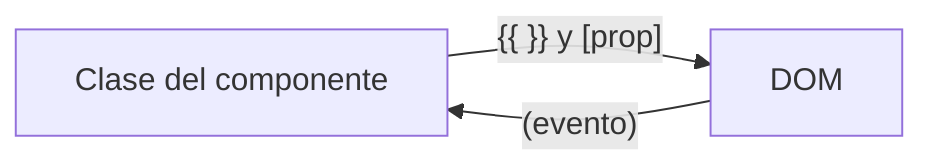

# Templates y data binding (interpolación, propiedades y eventos)

Parte de: [[20-Angular/01 Básico/_Índice Básico|Básico]]

> [!info] Cómo avanzar
> `progreso`: **pendiente** → **viendo** (estudiando) → **visto** (contestaste la autoevaluación sin abrir las respuestas) → **dominado** (hiciste el laboratorio o lo aplicaste de verdad).

## Contenido

### Qué es
La **plantilla** es el HTML de un componente, extendido con sintaxis de Angular para conectar la vista con la clase. Ese "cableado" se llama **data binding**. Hay tres formas de una sola vía:

1. **Interpolación** `{{ expresión }}`: de la clase al texto.
2. **Property binding** `[propiedad]="expresión"`: de la clase a una propiedad del DOM, de un componente o de una directiva.
3. **Event binding** `(evento)="sentencia"`: de la vista a la clase.

Además existen bindings de atributo (`[attr.aria-label]`), de clase (`[class.activo]`) y de estilo (`[style.width.px]`). La combinación de propiedad + evento da el [[Two-way binding]].

### Cómo funciona


Comparado con JSX: `{{ nombre() }}` equivale a `{nombre}`, `[disabled]="x"` a `disabled={x}` y `(click)="f()"` a `onClick={f}`. La diferencia es que en Angular la expresión es un pequeño lenguaje de plantilla (no JavaScript arbitrario) que el compilador revisa con los tipos del componente.

#### Interpolación contra property binding
`src="{{ url }}"` y `[src]="url"` producen lo mismo cuando el valor es texto, porque la interpolación siempre **convierte a cadena**. Pero `[prop]` conserva el **tipo real** del valor: booleanos, números, objetos o arreglos. Por eso para pasar un objeto a un input (`[producto]="p"`) o un booleano (`[disabled]="guardando()"`) necesitas corchetes.

#### Atributo HTML contra propiedad DOM
Sin corchetes, `disabled="false"` es un **atributo HTML** con el texto `"false"`; para el navegador, la sola presencia de `disabled` deshabilita el botón. Con corchetes, `[disabled]="false"` asigna el booleano `false` a la propiedad DOM y el botón queda habilitado.

#### `$event`
En un event binding, `$event` es el objeto que emite el evento: para eventos del DOM, el `Event` nativo (`KeyboardEvent`, `MouseEvent`...); para un `output()` de un componente, el valor que el hijo emitió con `emit()`.

### Ejemplo
```ts
import { Component, signal } from '@angular/core';

@Component({
  selector: 'app-buscador',
  template: `
    <h2>Hola, {{ usuario() }}</h2>
    

    <input
      [value]="texto()"
      (input)="alEscribir($event)"
      (keyup.enter)="buscar()" />

    <button [disabled]="texto().length < 3" [class.primario]="texto().length >= 3"
            (click)="buscar()">
      Buscar
    </button>
    <p [style.color]="error() ? 'crimson' : 'inherit'">{{ mensaje() }}</p>
  `,
})
export class Buscador {
  protected usuario = signal('Ana');
  protected avatarUrl = signal('/img/ana.png');
  protected texto = signal('');
  protected mensaje = signal('');
  protected error = signal(false);

  alEscribir(e: Event) {
    this.texto.set((e.target as HTMLInputElement).value);
  }

  buscar() {
    this.mensaje.set(`Buscando "${this.texto()}"...`);
  }
}
```

Notas: `(keyup.enter)` es un filtro de tecla integrado; `[attr.alt]` se usa para atributos que no tienen propiedad DOM equivalente (como `aria-*` o `colspan`); `[class.primario]` agrega o quita una clase. Para varias clases a la vez puedes usar `[class]="{ activo: a(), error: e() }"`; la guía de estilo actual recomienda estos bindings en lugar de `ngClass`/`ngStyle`.

### Cuándo usarlo y cuándo no
- Usa `{{ }}` para texto y `[prop]` para todo lo demás, sobre todo cuando el tipo importa.
- Mantén las expresiones cortas: lógica compleja va en un método o, mejor, en un `computed()` de la clase.
- No llames funciones costosas desde la plantilla; las señales y `computed` evitan recalcular de más.
- Para valores intermedios en la plantilla existe `@let total = precio() * cantidad();`.

### Errores comunes
- **`disabled="false"` sin corchetes.** El botón queda deshabilitado porque el atributo existe; usa `[disabled]="false"` o la expresión real.
- **Olvidar los paréntesis de la señal.** `{{ nombre }}` muestra la función, no el valor; debe ser `{{ nombre() }}`.
- **Interpolar objetos.** `{{ producto() }}` muestra `[object Object]`; usa propiedades o el pipe `json` para depurar.
- **Mezclar `[src]` y `{{ }}` en el mismo atributo.** Elige uno; no se combinan.

### Para profundizar
- [Angular: binding dinámico de texto, propiedades y atributos](https://angular.dev/guide/templates/binding)
- [Angular: event listeners en plantillas](https://angular.dev/guide/templates/event-listeners)
- [Angular: sintaxis de plantillas](https://angular.dev/guide/templates)

## Autoevaluación

Contesta primero en voz alta o en papel; luego despliega la respuesta.

> [!question]- Nombra los tipos de binding de una sola vía.
> **Interpolación** `{{ valor }}` (texto) · **Propiedad** `[src]="url"` · **Atributo** `[attr.aria-label]` · **Clase** `[class.activo]="esActivo"` · **Estilo** `[style.width.px]="ancho"` · **Evento** `(click)="guardar()"`.

> [!question]- ¿Qué diferencia hay entre `src="{{url}}"` y `[src]="url"`?
> Para cadenas el resultado es igual, pero `[src]` es la forma idiomática y funciona con cualquier tipo de valor (booleanos, objetos). La interpolación siempre convierte a texto.

> [!question]- ¿Qué es `$event`?
> El objeto del evento DOM (o el valor que emite un `output`). Ej.: `(input)="buscar($any($event.target).value)"`.

> [!question]- Error común: escribir `[disabled]="false"` como `disabled="false"`. ¿Qué pasa?
> Sin corchetes es un atributo HTML con el texto `"false"`; el botón queda **deshabilitado** porque basta con que el atributo exista. Con `[disabled]="false"` se asigna el booleano.

## Práctica

- [[Lab 1 - Componentes standalone y data binding en Angular]]

