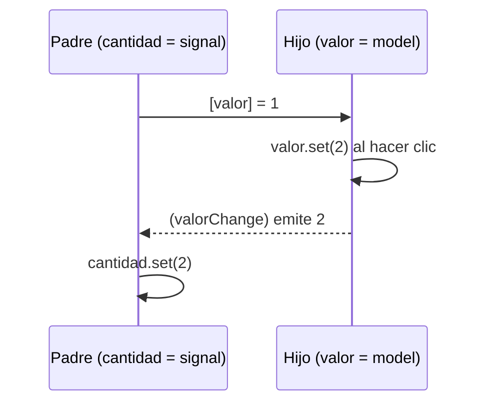

# Two-way binding

Parte de: [[20-Angular/01 Básico/_Índice Básico|Básico]]

> [!info] Cómo avanzar
> `progreso`: **pendiente** → **viendo** (estudiando) → **visto** (contestaste la autoevaluación sin abrir las respuestas) → **dominado** (hiciste el laboratorio o lo aplicaste de verdad).

## Contenido

### Qué es
El **two-way binding** sincroniza un valor en ambas direcciones: si cambia en la clase, se actualiza la vista; si el usuario lo cambia en la vista, se actualiza la clase. La sintaxis es la "caja de plátanos" `[( )]`, que combina un property binding `[valor]` y un event binding `(valorChange)`. En React lo haces a mano con `value={x}` más `onChange={e => setX(...)}`; Angular lo resume en un solo binding.

### Cómo funciona
`[(algo)]="x"` es azúcar sintáctica. El compilador lo expande así:

```html
<!-- Lo que escribes -->
<app-contador [(valor)]="cantidad" />
<!-- Lo que Angular entiende -->
<app-contador [valor]="cantidad()" (valorChange)="cantidad.set($event)" />
```

Para que funcione, el componente o directiva destino debe exponer un input `algo` y un output `algoChange`. Hay dos casos principales:

1. **Elementos de formulario con `ngModel`**: la directiva `NgModel` (de `FormsModule`) aporta el input `ngModel` y el output `ngModelChange`. Por eso `[(ngModel)]` necesita importar `FormsModule` en el componente.
2. **Tus propios componentes con `model()`**: la función `model()` crea a la vez un input y su output `xxxChange`, y devuelve una señal escribible dentro del hijo.

Del lado del padre puedes enlazar una **señal escribible** (`[(valor)]="cantidad"`, sin paréntesis) o una propiedad normal. Con señal, Angular hace el `set` por ti.



### Ejemplo
Campo de texto con `ngModel` enlazado a una señal:

```ts
import { Component, signal } from '@angular/core';
import { FormsModule } from '@angular/forms';

@Component({
  selector: 'app-saludo',
  imports: [FormsModule], // necesario para [(ngModel)]
  template: `
    <input [(ngModel)]="nombre" placeholder="Tu nombre" />
    <p>Hola, {{ nombre() || 'desconocido' }}</p>
  `,
})
export class Saludo {
  protected nombre = signal('');
}
```

Componente propio con two-way binding gracias a `model()`:

```ts
// selector-cantidad.ts
import { Component, model } from '@angular/core';

@Component({
  selector: 'app-selector-cantidad',
  template: `
    <button (click)="valor.update(v => Math.max(1, v - 1))">-</button>
    <span>{{ valor() }}</span>
    <button (click)="valor.update(v => v + 1)">+</button>
  `,
})
export class SelectorCantidad {
  valor = model(1); // input "valor" + output "valorChange"
  protected Math = Math;
}
```

```html
<!-- en el padre -->
<app-selector-cantidad [(valor)]="cantidad" />
<p>Llevas {{ cantidad() }} piezas</p>
```

Si el hijo solo necesita leer el valor, basta un `input()`; usa `model()` cuando el hijo también lo modifica y el padre debe enterarse.

### Cuándo usarlo y cuándo no
- **Úsalo** en controles sencillos: un campo de búsqueda, un switch, un selector de cantidad, un diálogo con `[(abierto)]`.
- **Úsalo con cuidado** en formularios completos: para validación, campos dinámicos y pruebas conviene [[Formularios reactivos]] o Signal Forms (estables en Angular 22), que también enlazan en ambos sentidos con su propia directiva `[formField]`.
- **Evítalo** cuando el padre necesita controlar o validar cada cambio antes de aceptarlo: ahí es más claro un input más un output explícitos.
- Recuerda que un `model()` es la "fuente de verdad" compartida: si muchos componentes escriben el mismo valor, considera un servicio con señales.

### Errores comunes
- **Olvidar `FormsModule`.** El error dice que no puede enlazar `ngModel` porque no es una propiedad conocida de `input`.
- **Escribir `[(ngModel)]="nombre()"`.** Con paréntesis le pasas el valor leído, no la señal; el compilador lo rechaza porque no puede asignar a una llamada. Enlaza la señal sin llamarla.
- **Nombrar mal el output.** Si haces el two-way a mano, el output debe llamarse exactamente `<input>Change`.
- **Usar `ngModel` dentro de un formulario reactivo.** Mezclar ambos enfoques sobre el mismo control causa comportamientos confusos; elige uno.

### Para profundizar
- [Angular: two-way binding](https://angular.dev/guide/templates/two-way-binding)
- [Angular: model inputs](https://angular.dev/guide/components/inputs#model-inputs)
- [Angular: formularios template-driven](https://angular.dev/guide/forms/template-driven-forms)

## Autoevaluación

Contesta primero en voz alta o en papel; luego despliega la respuesta.

> [!question]- ¿Qué es el two-way binding?
> Sincronización en ambos sentidos entre una propiedad y un control: la vista muestra el valor y los cambios del usuario lo actualizan. Sintaxis "banana in a box": `[( )]`.

> [!question]- ¿Qué necesitas para usar `[(ngModel)]`?
> Importar `FormsModule` en el componente. Dentro de un `<form>`, el control además necesita atributo `name`.

> [!question]- ¿Cómo creas tu propio two-way binding en un componente hijo?
> Con `model()`:
> ```ts
> valor = model(0);
> ```
> y el padre usa `<app-contador [(valor)]="cantidad" />`. Por debajo es un input `valor` + un output `valorChange`.

## Práctica

- [[Lab 1 - Componentes standalone y data binding en Angular]]

