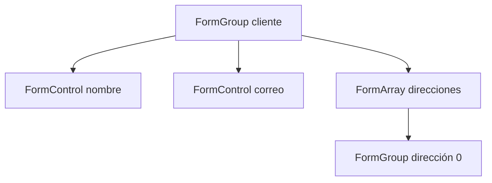

# Formularios reactivos

Parte de: [[20-Angular/02 Intermedio/_Índice Intermedio|Intermedio]]

> [!info] Cómo avanzar
> `progreso`: **pendiente** → **viendo** (estudiando) → **visto** (contestaste la autoevaluación sin abrir las respuestas) → **dominado** (hiciste el laboratorio o lo aplicaste de verdad).

## Contenido

### Qué es
Los **formularios reactivos** definen el modelo del formulario **en TypeScript**, de forma explícita, con objetos `FormControl`, `FormGroup` y `FormArray`. La plantilla solo se conecta a ese modelo con directivas (`[formGroup]`, `formControlName`). Son síncronos, totalmente tipados desde Angular 14, fáciles de probar y exponen sus cambios como Observables (`valueChanges`). Viven en `ReactiveFormsModule`.

Comparado con React, es parecido a usar React Hook Form con un esquema: el estado del formulario está fuera del JSX y la vista solo se "registra".

### Cómo funciona
Piezas principales:

| Pieza | Qué representa |
|---|---|
| `FormControl<T>` | Un campo: valor, estado y validadores |
| `FormGroup` | Un objeto de controles con nombre |
| `FormArray` | Una lista de controles o grupos (renglones dinámicos) |
| `FormBuilder` / `NonNullableFormBuilder` | Atajo para crear todo lo anterior |
| `Validators` | Validadores integrados: `required`, `email`, `minLength`, `min`, `pattern`... |
| Directivas | `[formGroup]`, `formControlName`, `formGroupName`, `formArrayName`, `[formControl]` |



#### Leer y escribir valores
- **`setValue(obj)`** exige **todas** las propiedades del grupo; si falta una, lanza error. Útil cuando cargas un registro completo.
- **`patchValue(obj)`** actualiza **solo** las que le pasas y deja las demás.
- **`form.value`** devuelve los valores de los controles **habilitados**: los deshabilitados no aparecen (por eso su tipo es `Partial`).
- **`form.getRawValue()`** devuelve **todos**, incluidos los deshabilitados (por ejemplo, un `id` que muestras pero no se edita).
- `reset()` vuelve al valor inicial; con controles `nonNullable` regresa al valor por defecto en lugar de `null`.

#### Estado
Igual que en template-driven: `valid`, `invalid`, `touched`, `dirty`, `errors`, `pending` (validación asíncrona en curso). `markAllAsTouched()` sirve para mostrar todos los errores al intentar enviar.

### Ejemplo
Formulario de alta de cliente para Itzamna.Dionisio:

```ts
import { Component, inject } from '@angular/core';
import { NonNullableFormBuilder, ReactiveFormsModule, Validators } from '@angular/forms';
import { ClientesApi } from './clientes-api';

@Component({
  selector: 'app-cliente-form',
  imports: [ReactiveFormsModule],
  template: `
    <form [formGroup]="form" (ngSubmit)="guardar()">
      <input formControlName="nombre" placeholder="Nombre" />
      @if (form.controls.nombre.hasError('required') && form.controls.nombre.touched) {
        <small>El nombre es obligatorio.</small>
      }

      <input formControlName="correo" type="email" placeholder="Correo" />
      @if (form.controls.correo.invalid && form.controls.correo.touched) {
        <small>Correo obligatorio y válido.</small>
      }

      <button type="submit">Guardar</button>
    </form>
  `,
})
export class ClienteForm {
  private fb = inject(NonNullableFormBuilder);
  private api = inject(ClientesApi);

  protected form = this.fb.group({
    id: [{ value: 0, disabled: true }],
    nombre: ['', Validators.required],
    correo: ['', [Validators.required, Validators.email]],
  });

  cargar(c: { id: number; nombre: string; correo: string }) {
    this.form.setValue(c);           // todas las propiedades
    // this.form.patchValue({ nombre: c.nombre }); // solo algunas
  }

  guardar() {
    if (this.form.invalid) {
      this.form.markAllAsTouched();
      return;
    }
    const dto = this.form.getRawValue(); // incluye id deshabilitado, tipado
    this.api.guardar(dto).subscribe();
  }
}
```

Con `NonNullableFormBuilder` los tipos son `string` en lugar de `string | null`.

#### Campos dinámicos con `FormArray`
Para listas de renglones (teléfonos, partidas de una factura) se usa un `FormArray`: `telefonos: this.fb.array([this.fb.control('')])`. En la plantilla lo recorres con `formArrayName="telefonos"` y `@for (c of form.controls.telefonos.controls; track $index) { <input [formControlName]="$index" /> }`, y agregas o quitas renglones con `push()` y `removeAt(i)`. Esta flexibilidad es la razón principal para elegir reactivos frente a template-driven.

#### Signal Forms
Angular 22 estabilizó **Signal Forms** (`@angular/forms/signals`): el modelo es una señal y la validación se declara en un esquema.

```ts
import { form, FormField, required, email } from '@angular/forms/signals';

modelo = signal({ nombre: '', correo: '' });
clienteForm = form(this.modelo, s => {
  required(s.nombre, { message: 'El nombre es obligatorio' });
  required(s.correo);
  email(s.correo, { message: 'Correo no válido' });
});
// plantilla: <input [formField]="clienteForm.nombre" />  (importa FormField)
```

Para proyectos nuevos vale la pena considerarlos; los reactivos siguen siendo mayoría en código existente.

### Cuándo usarlo y cuándo no
- **Reactivos**: formularios medianos o grandes, dinámicos, con reglas complejas o que necesitas probar unitariamente.
- **Signal Forms**: código nuevo que ya trabaja con señales.
- **Template-driven**: formularios pequeños y simples ([[Formularios template-driven]]).

### Errores comunes
- **Usar `setValue` con un objeto incompleto**: error "Must supply a value for form control". Usa `patchValue`.
- **Enviar `form.value` y perder campos deshabilitados**: usa `getRawValue()`.
- **Olvidar `ReactiveFormsModule`**: `formGroup` no es una propiedad conocida.
- **Suscribirse a `valueChanges` sin limpiar**: fuga de memoria; usa `takeUntilDestroyed()` o `toSignal`.
- **Validar solo en el cliente**: repite las reglas en el API con FluentValidation.

### Para profundizar
- [Angular: formularios reactivos](https://angular.dev/guide/forms/reactive-forms)
- [Angular: formularios tipados](https://angular.dev/guide/forms/typed-forms)
- [Angular: Signal Forms](https://angular.dev/guide/forms/signals/overview)

## Autoevaluación

Contesta primero en voz alta o en papel; luego despliega la respuesta.

> [!question]- ¿Qué piezas tiene un formulario reactivo?
> `FormControl` (un campo), `FormGroup` (grupo de campos), `FormArray` (lista dinámica) y `FormBuilder` para crearlos. Requiere `ReactiveFormsModule`.

> [!question]- Crea con `FormBuilder` un formulario con nombre (requerido) y correo (requerido y válido).
> ```ts
> private fb = inject(NonNullableFormBuilder);
> form = this.fb.group({
>   nombre: ['', Validators.required],
>   correo: ['', [Validators.required, Validators.email]],
> });
> ```
> En la plantilla: `<form [formGroup]="form" (ngSubmit)="enviar()">` y `formControlName="nombre"`.

> [!question]- ¿Qué diferencia hay entre `setValue` y `patchValue`?
> `setValue` exige **todos** los campos del grupo; `patchValue` acepta solo algunos.

> [!question]- ¿Qué diferencia hay entre `form.value` y `form.getRawValue()`?
> `value` excluye los controles deshabilitados; `getRawValue()` los incluye.

## Práctica

- [[Lab 4 - Formularios reactivos con validación en Angular]]

