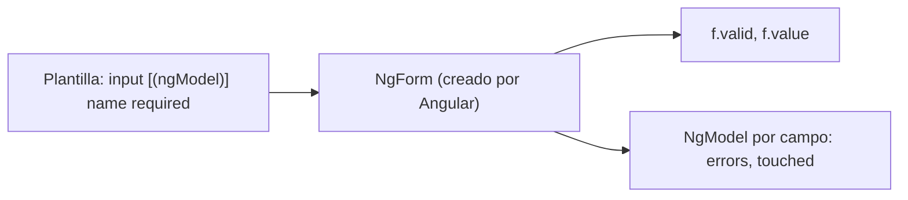

# Formularios template-driven

Parte de: [[20-Angular/02 Intermedio/_Índice Intermedio|Intermedio]]

> [!info] Cómo avanzar
> `progreso`: **pendiente** → **viendo** (estudiando) → **visto** (contestaste la autoevaluación sin abrir las respuestas) → **dominado** (hiciste el laboratorio o lo aplicaste de verdad).

## Contenido

### Qué es
Los **formularios template-driven** (dirigidos por la plantilla) se construyen principalmente en el HTML: cada campo usa la directiva `ngModel` y las validaciones se escriben como atributos (`required`, `minlength`, `email`). Angular crea por debajo el modelo del formulario a partir de la plantilla. Viven en `FormsModule`. Son el estilo más cercano a un formulario HTML clásico o a un formulario controlado sencillo en React.

Angular tiene hoy tres enfoques: template-driven, [[Formularios reactivos]] y **Signal Forms** (estables desde Angular 22, basados en señales). Este es el más simple.

### Cómo funciona
1. Importas `FormsModule` en el componente.
2. Envuelves los campos en `<form>`; Angular le aplica automáticamente la directiva `NgForm`.
3. Cada campo con `[(ngModel)]` y un atributo `name` se registra como un control dentro de ese `NgForm`.
4. Los atributos de validación agregan validadores.
5. Con **variables de plantilla** accedes al estado: `#f="ngForm"` para el formulario completo y `#correo="ngModel"` para un campo.

Estado disponible en el formulario y en cada control:

| Propiedad | Significado |
|---|---|
| `valid` / `invalid` | Pasa o no todas las validaciones |
| `touched` / `untouched` | El usuario entró y salió del campo |
| `dirty` / `pristine` | El valor cambió o no desde el inicio |
| `errors` | Objeto con los errores (`{ required: true }`, `{ minlength: {...} }`) |
| `value` | Valores actuales (en el formulario, un objeto por `name`) |

Angular también agrega clases CSS (`ng-invalid`, `ng-touched`, `ng-dirty`) que puedes usar para estilos.



### Ejemplo
Formulario de contacto con validación y señales como modelo:

```ts
import { Component, signal } from '@angular/core';
import { FormsModule, NgForm } from '@angular/forms';

@Component({
  selector: 'app-contacto',
  imports: [FormsModule],
  template: `
    <form #f="ngForm" (ngSubmit)="enviar(f)">
      <label>Nombre
        <input name="nombre" [(ngModel)]="nombre" required minlength="3" #n="ngModel" />
      </label>
      @if (n.invalid && n.touched) {
        <small>
          @if (n.errors?.['required']) { El nombre es obligatorio. }
          @if (n.errors?.['minlength']) { Mínimo 3 caracteres. }
        </small>
      }

      <label>Correo
        <input name="correo" type="email" [(ngModel)]="correo" required email #c="ngModel" />
      </label>
      @if (c.invalid && c.touched) { <small>Escribe un correo válido.</small> }

      <button [disabled]="f.invalid">Enviar</button>
    </form>
  `,
})
export class Contacto {
  protected nombre = signal('');
  protected correo = signal('');

  enviar(f: NgForm) {
    if (f.invalid) return;
    console.log(f.value); // { nombre: '...', correo: '...' }
    f.resetForm();
  }
}
```

#### Envío y reinicio
`(ngSubmit)` se dispara al enviar el formulario (botón `submit` o Enter) y evita la recarga de la página. `f.submitted` indica si ya se intentó enviar, útil para mostrar todos los errores en ese momento. `f.resetForm()` limpia valores y estados (`touched`, `dirty`, `submitted`). Para cargar un registro existente basta con asignar las señales enlazadas a cada `ngModel`.

### Cuándo usarlo y cuándo no
Prefiere template-driven cuando:
- El formulario es pequeño y estático (login, contacto, un filtro).
- Las validaciones son las estándar de HTML.

Prefiere [[Formularios reactivos]] (o Signal Forms) cuando:
- Hay campos dinámicos (agregar renglones, `FormArray`).
- Necesitas validaciones personalizadas, entre campos o asíncronas (ver [[Validaciones personalizadas]]).
- Quieres reaccionar a cambios con RxJS (`valueChanges`) o probar la lógica sin la plantilla.
- El formulario es grande o lo comparten varios desarrolladores: el modelo explícito en TypeScript es más fácil de mantener y tipar.

Para código nuevo, evalúa Signal Forms: combinan la sencillez de un modelo en señal con validación declarativa en TypeScript.

### Errores comunes
- **Olvidar `name`** en un input con `ngModel` dentro de un `<form>`: error en consola y el campo no se registra.
- **Olvidar `FormsModule`**: `ngModel` no se reconoce.
- **Mostrar errores desde el primer render**: el usuario ve todo en rojo antes de escribir. Condiciona con `touched` o con `f.submitted`.
- **Lógica compleja en la plantilla**: si empiezas a escribir condiciones largas, es momento de pasar a reactivos.

### Para profundizar
- [Angular: formularios template-driven](https://angular.dev/guide/forms/template-driven-forms)
- [Angular: introducción a formularios](https://angular.dev/guide/forms)
- [Angular: validación de formularios](https://angular.dev/guide/forms/form-validation)

## Autoevaluación

Contesta primero en voz alta o en papel; luego despliega la respuesta.

> [!question]- ¿Qué son los formularios template-driven?
> Formularios definidos en la plantilla con `ngModel` y atributos de validación (`required`, `minlength`, `email`). Requieren `FormsModule`.

> [!question]- ¿Cómo accedes al estado del formulario?
> Con una variable de plantilla: `<form #f="ngForm" (ngSubmit)="guardar(f.value)">` y `f.valid`, `f.touched`. Para un campo: `#correo="ngModel"` y `correo.errors`.

> [!question]- ¿Cuándo prefieres reactivos sobre template-driven?
> Con validaciones complejas o dinámicas, campos que se agregan en tiempo de ejecución, pruebas unitarias del formulario o lógica que reacciona a cambios (`valueChanges`).

## Práctica

- [[Lab 4 - Formularios reactivos con validación en Angular]]

