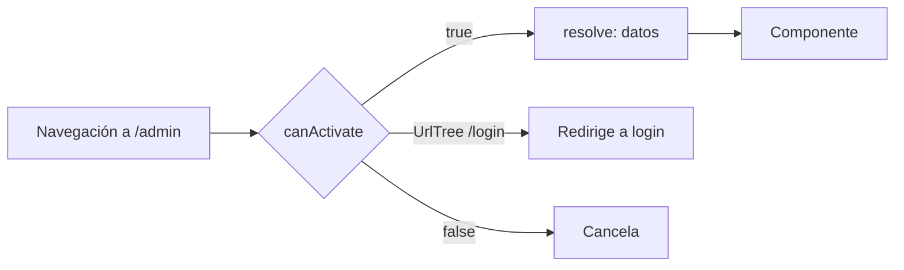

# Guards y resolvers

Parte de: [[20-Angular/02 Intermedio/_Índice Intermedio|Intermedio]]

> [!info] Cómo avanzar
> `progreso`: **pendiente** → **viendo** (estudiando) → **visto** (contestaste la autoevaluación sin abrir las respuestas) → **dominado** (hiciste el laboratorio o lo aplicaste de verdad).

## Contenido

### Qué es
- Un **guard** es una función que el router ejecuta **antes** de activar (o abandonar) una ruta, para decidir si la navegación continúa, se cancela o se redirige.
- Un **resolver** es una función que obtiene datos **antes** de mostrar la ruta, para que el componente ya los tenga al aparecer.

En React harías esto con un componente envoltorio `<RequireAuth>` o con los *loaders* de React Router; en Angular se declaran en la configuración de la ruta.

### Cómo funciona
#### Tipos de guard
| Propiedad en la ruta | Tipo | Pregunta que responde |
|---|---|---|
| `canActivate` | `CanActivateFn` | ¿Puede entrar a esta ruta? |
| `canActivateChild` | `CanActivateChildFn` | ¿Puede entrar a las rutas hijas? |
| `canDeactivate` | `CanDeactivateFn<T>` | ¿Puede salir? (cambios sin guardar) |
| `canMatch` | `CanMatchFn` | ¿Esta definición de ruta aplica? Si no, el router prueba la siguiente; también evita descargar el código perezoso |

Un guard puede devolver `true`/`false`, un **`UrlTree`** (redirigir), un `RedirectCommand`, o un Observable/Promise de cualquiera de ellos.



#### Por qué devolver `UrlTree`
Si dentro del guard llamas `router.navigate(['/login'])` y devuelves `false`, inicias una navegación nueva mientras la actual sigue resolviéndose: pueden competir, el orden de los eventos se vuelve confuso y otros guards siguen ejecutándose. Al devolver `router.createUrlTree(['/login'])`, el router **cancela la navegación actual y redirige de forma controlada**, en un solo paso. Además el guard queda como una función pura, fácil de probar.

#### Un guard no es seguridad
Los guards solo controlan la **interfaz**. Todo el código del front-end está en el navegador del usuario y se puede modificar; cualquiera puede llamar a tu API con Postman. **La autorización real vive en el API** (`[Authorize]`, políticas y validación del JWT en ASP.NET Core). El guard mejora la experiencia, no protege datos.

### Ejemplo
Guard de sesión que redirige a `/login` conservando a dónde quería ir el usuario:

```ts
// core/sesion.guard.ts
import { CanActivateFn, Router } from '@angular/router';
import { inject } from '@angular/core';
import { AuthService } from './auth.service';

export const sesionGuard: CanActivateFn = (route, state) => {
  const auth = inject(AuthService);
  const router = inject(Router);
  return auth.autenticado()
    ? true
    : router.createUrlTree(['/login'], { queryParams: { volver: state.url } });
};
```

Guard por rol y guard de salida:

```ts
export const rolGuard = (rol: string): CanActivateFn => () =>
  inject(AuthService).tieneRol(rol) || inject(Router).createUrlTree(['/sin-permiso']);

export interface ConCambios { hayCambios(): boolean; }
export const cambiosGuard: CanDeactivateFn<ConCambios> = comp =>
  !comp.hayCambios() || confirm('Tienes cambios sin guardar. ¿Salir?');
```

Resolver que carga el pedido antes de mostrar la pantalla:

```ts
export const pedidoResolver: ResolveFn<Pedido> = route =>
  inject(PedidosApi).obtener(Number(route.paramMap.get('id')));
```

Configuración:

```ts
{
  path: 'admin',
  canActivate: [sesionGuard, rolGuard('Admin')],
  children: [
    {
      path: 'pedidos/:id',
      component: EditarPedido,
      resolve: { pedido: pedidoResolver }, // llega como input "pedido" con withComponentInputBinding
      canDeactivate: [cambiosGuard],
    },
  ],
}
```

### Cuándo usarlo y cuándo no
- **`canActivate`/`canMatch`**: sesión y roles. Prefiere `canMatch` en rutas perezosas para no descargar el código de quien no puede entrar.
- **`canDeactivate`**: formularios largos con cambios sin guardar.
- **Resolver**: datos imprescindibles y rápidos. Si la carga es lenta, el usuario ve que "no pasa nada" al hacer clic; en ese caso es mejor navegar de inmediato y mostrar un estado de carga con `httpResource` o `@defer`.

### Errores comunes
- **Creer que el guard protege el API**: valida siempre en el servidor.
- **`router.navigate()` dentro del guard**: navegaciones que compiten; devuelve un `UrlTree`.
- **Resolvers lentos sin indicador**: parece que la app se congeló.
- **Leer la sesión solo de memoria**: al recargar la página se pierde; restaura el estado (token, cookie) antes de evaluar el guard.

### Para profundizar
- [Angular: route guards](https://angular.dev/guide/routing/route-guards)
- [ASP.NET Core: autorización basada en roles](https://learn.microsoft.com/aspnet/core/security/authorization/roles)

## Autoevaluación

Contesta primero en voz alta o en papel; luego despliega la respuesta.

> [!question]- ¿Qué tipos de guard existen?
> `CanActivateFn` (entrar a una ruta), `CanActivateChildFn` (rutas hijas), `CanDeactivateFn` (salir, p. ej. cambios sin guardar), `CanMatchFn` (si la ruta siquiera aplica) y `ResolveFn` (cargar datos antes de entrar).

> [!question]- Escribe un guard que mande a `/login` si no hay sesión.
> ```ts
> export const authGuard: CanActivateFn = (route, state) => {
>   const auth = inject(AuthService);
>   return auth.logueado()
>     ? true
>     : inject(Router).createUrlTree(['/login'], { queryParams: { returnUrl: state.url } });
> };
> ```

> [!question]- ¿Un guard protege los datos de tu API?
> **No.** Solo controla la navegación en el navegador; cualquiera puede llamar al API directamente. La autorización real se valida en el backend.

> [!question]- ¿Por qué devolver un `UrlTree` en lugar de llamar a `router.navigate()` dentro del guard?
> Porque el router cancela la navegación actual y redirige de forma limpia, sin navegaciones en competencia.

## Práctica

- [[Lab 3 - Router con guards y lazy loading en Angular]]

