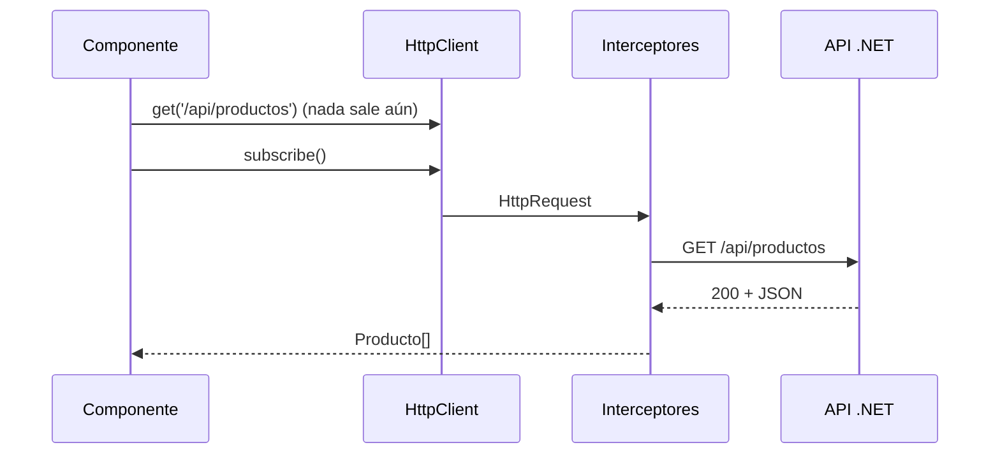

# HttpClient en Angular

Parte de: [[20-Angular/02 Intermedio/_Índice Intermedio|Intermedio]]

> [!info] Cómo avanzar
> `progreso`: **pendiente** → **viendo** (estudiando) → **visto** (contestaste la autoevaluación sin abrir las respuestas) → **dominado** (hiciste el laboratorio o lo aplicaste de verdad).

## Contenido

### Qué es
`HttpClient` es el cliente HTTP oficial de Angular (paquete `@angular/common/http`). Hace peticiones al backend y devuelve **Observables** tipados, con soporte para encabezados, parámetros de consulta, interceptores, cancelación y pruebas con un backend simulado. Es el equivalente a usar `fetch` o axios en React, pero integrado con la DI. Desde Angular 22 usa la API **Fetch** del navegador como implementación por defecto.

### Cómo funciona
#### Habilitarlo
Desde Angular 21, `HttpClient` ya está **provisto en el inyector raíz**: puedes inyectarlo sin configurar nada. Sigues necesitando `provideHttpClient()` en `app.config.ts` cuando quieres personalizarlo, sobre todo para registrar interceptores:

```ts
providers: [provideHttpClient(withInterceptors([authInterceptor, errorInterceptor]))]
```

En versiones anteriores (y en muchos proyectos existentes) `provideHttpClient()` es obligatorio; si ves el error "No provider for HttpClient", agrégalo.

#### Peticiones frías
`http.get(url)` **no** envía nada: devuelve un Observable *frío* que describe la petición. La petición sale cuando alguien se suscribe (con `subscribe`, el pipe `async`, `toSignal` o `firstValueFrom`), y **cada suscripción hace otra petición**. Es la diferencia con `fetch`, que dispara en cuanto lo llamas.



#### Parámetros, encabezados y respuesta completa
```ts
this.http.get<Producto[]>('/api/productos', {
  params: { categoria: 'teclados', pagina: 1 },  // ?categoria=teclados&pagina=1
  headers: { 'X-Version': '2' },
  observe: 'response',                            // HttpResponse completo
}).subscribe(resp => {
  console.log(resp.status, resp.headers.get('X-Total-Count'), resp.body);
});
```
Por defecto obtienes solo el cuerpo ya convertido desde JSON; con `observe: 'response'` recibes un `HttpResponse<T>` con `status`, `headers` y `body`. También existen `responseType: 'blob'` (descargar un Excel de Wee.Reporteria) y `'text'`.

#### Errores y `status` 0
Una respuesta 4xx/5xx llega como `HttpErrorResponse` en el canal de error. Un **`status` 0** significa que **no hubo respuesta HTTP**: el servidor está apagado, el certificado falló, no hay red o el navegador bloqueó la respuesta por **CORS**. Revisa la consola del navegador y [[Angular con un API .NET (autenticación y CORS)]].

### Ejemplo
Servicio de productos para el API de Itzamna.Dionisio:

```ts
import { Service, inject } from '@angular/core';
import { HttpClient, HttpParams } from '@angular/common/http';
import { Observable } from 'rxjs';

export interface Producto { id: number; nombre: string; precio: number; }
export interface Pagina<T> { items: T[]; total: number; }

@Service()
export class ProductosApi {
  private http = inject(HttpClient);
  private base = '/api/productos';

  listar(filtro: string, pagina = 1): Observable<Pagina<Producto>> {
    const params = new HttpParams().set('q', filtro).set('pagina', pagina);
    return this.http.get<Pagina<Producto>>(this.base, { params });
  }

  obtener(id: number) {
    return this.http.get<Producto>(`${this.base}/${id}`);
  }

  crear(p: Omit<Producto, 'id'>) {
    return this.http.post<Producto>(this.base, p);
  }

  eliminar(id: number) {
    return this.http.delete<void>(`${this.base}/${id}`);
  }
}
```

En un componente, la forma más simple de leer datos es convertir a señal o usar `httpResource` (estable desde v22):

```ts
protected productos = toSignal(inject(ProductosApi).listar(''), { initialValue: { items: [], total: 0 } });
// o, reactivo a un input:
id = input.required<number>();
producto = httpResource<Producto>(() => `/api/productos/${this.id()}`);
```

#### Cancelación y concurrencia
Como la petición es un Observable, si te desuscribes antes de que llegue la respuesta, Angular **aborta** la petición en el navegador. Esto es lo que aprovecha `switchMap` en una búsqueda: al teclear de nuevo, la petición anterior se cancela y no pisa los resultados nuevos. Con `fetch` puro tendrías que manejar un `AbortController` a mano.

### Cuándo usarlo y cuándo no
- **Servicios con `HttpClient`**: centraliza URLs y tipos; los componentes no deberían construir URLs.
- **`httpResource`**: lecturas que dependen de señales (detalle por id, filtros).
- **Métodos que devuelven Observable**: escrituras (`post`, `put`, `delete`), donde controlas cuándo se envía.
- Para descargas grandes o *streaming* considera `responseType: 'blob'` y el progreso con `reportDownloadProgress`.

### Errores comunes
- **No suscribirse** a un `post` o `delete`: nunca se envía.
- **Suscribirse varias veces** (dos `async` en la plantilla): peticiones duplicadas.
- **Tipar y confiar**: el genérico `get<T>` no valida el JSON; si el API usa PascalCase y tú camelCase, verás `undefined`. ASP.NET Core serializa en camelCase por defecto.
- **URLs absolutas repetidas** por todo el código: usa un `InjectionToken` o el proxy de desarrollo con rutas relativas `/api`.

### Para profundizar
- [Angular: HTTP client](https://angular.dev/guide/http)
- [Angular: hacer peticiones](https://angular.dev/guide/http/making-requests)
- [Angular: httpResource](https://angular.dev/guide/http/http-resource)

## Autoevaluación

Contesta primero en voz alta o en papel; luego despliega la respuesta.

> [!question]- ¿Cómo se habilita HttpClient?
> Con `provideHttpClient()` en `app.config.ts` (opcionalmente `withInterceptors([...])` y `withFetch()`). Luego `inject(HttpClient)` en un servicio.

> [!question]- ¿Por qué no se hace la petición si solo llamas a `http.get(url)`?
> Porque devuelve un Observable **frío**: la petición sale hasta que alguien se suscribe (`subscribe`, `async`, `toSignal`).

> [!question]- ¿Cómo envías parámetros de consulta y lees el status?
> ```ts
> this.http.get<Post[]>(url, {
>   params: { userId: 1 },
>   observe: 'response',
> }).subscribe(r => console.log(r.status, r.body));
> ```

> [!question]- ¿Qué significa un `HttpErrorResponse` con `status` 0?
> La petición no obtuvo respuesta: sin red, servidor apagado o **bloqueo de CORS**. Revisa la consola y la pestaña Network del navegador.

## Práctica

- [[Lab 2 - Servicio, HttpClient e interceptor en Angular]]
- [[Lab 1 - Pruebas unitarias y de componentes en Angular]]

