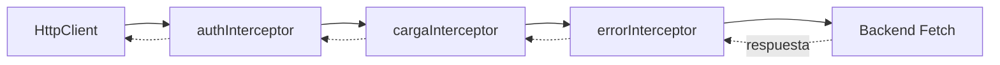

# Interceptores HTTP

Parte de: [[20-Angular/02 Intermedio/_Índice Intermedio|Intermedio]]

> [!info] Cómo avanzar
> `progreso`: **pendiente** → **viendo** (estudiando) → **visto** (contestaste la autoevaluación sin abrir las respuestas) → **dominado** (hiciste el laboratorio o lo aplicaste de verdad).

## Contenido

### Qué es
Un **interceptor** es una función que se ejecuta en medio de **todas** las peticiones de `HttpClient`: puede modificar la petición antes de salir y la respuesta antes de llegar a quien la pidió. Se usa para lo transversal: agregar el token `Authorization`, mostrar un indicador de carga global, registrar tiempos, reintentar, traducir errores. Es el mismo concepto que un *middleware* de ASP.NET Core o un interceptor de axios en React.

### Cómo funciona
Un interceptor funcional tiene la firma `HttpInterceptorFn`: recibe la petición (`req`) y una función `next` que pasa la petición al siguiente eslabón. Devuelve un Observable de eventos.

```ts
export const miInterceptor: HttpInterceptorFn = (req, next) => {
  // antes de enviar
  return next(req).pipe(/* después de recibir */);
};
```

Se registran en orden:

```ts
provideHttpClient(withInterceptors([authInterceptor, cargaInterceptor, errorInterceptor]))
```



#### El orden importa
Las **peticiones** pasan por los interceptores **en el orden del arreglo**, y las **respuestas** regresan en **orden inverso**. Por eso el interceptor de errores suele ir al final (más cerca del backend, ve la respuesta primero) o al principio si quieres que vea también los errores que generan otros interceptores. Pon el de autenticación antes que el de logging si quieres registrar la petición ya con encabezados.

#### Inmutabilidad: `req.clone()`
`HttpRequest` es **inmutable**: no puedes hacer `req.headers.set(...)` y esperar que cambie. Esto evita efectos raros cuando una petición se reintenta (el reintento debe partir de la original, no de una ya modificada). Para cambiarla creas una copia:

```ts
const conToken = req.clone({ setHeaders: { Authorization: `Bearer ${token}` } });
return next(conToken);
```

`clone` acepta `setHeaders`, `setParams`, `url`, `body`, `withCredentials`, etc.

#### Inyección dentro del interceptor
Como es una función ejecutada en contexto de inyección, puedes usar `inject()` directamente: `const auth = inject(AuthService);`.

### Ejemplo
Interceptor de token para las llamadas al API, sin enviarlo a dominios externos:

```ts
// core/auth.interceptor.ts
import { HttpInterceptorFn } from '@angular/common/http';
import { inject } from '@angular/core';
import { AuthService } from './auth.service';

export const authInterceptor: HttpInterceptorFn = (req, next) => {
  const token = inject(AuthService).token(); // señal con el access token
  const esNuestroApi = req.url.startsWith('/api');

  if (!token || !esNuestroApi) {
    return next(req);
  }
  return next(req.clone({ setHeaders: { Authorization: `Bearer ${token}` } }));
};
```

Interceptor que redirige a login ante un 401 y deja pasar el resto de errores:

```ts
// core/error.interceptor.ts
import { HttpErrorResponse, HttpInterceptorFn } from '@angular/common/http';
import { inject } from '@angular/core';
import { Router } from '@angular/router';
import { catchError, throwError } from 'rxjs';

export const errorInterceptor: HttpInterceptorFn = (req, next) => {
  const router = inject(Router);
  return next(req).pipe(
    catchError((err: HttpErrorResponse) => {
      if (err.status === 401) {
        router.navigateByUrl('/login');
      }
      return throwError(() => err); // el llamador decide qué mostrar
    }),
  );
};
```

Para pasar datos a un interceptor desde una petición concreta (por ejemplo, "no mostrar spinner") usa `HttpContext` con un `HttpContextToken`, en lugar de encabezados falsos.

### Cuándo usarlo y cuándo no
- **Sí**: tokens, encabezados comunes (`X-Correlation-Id`), spinner global, logging, reintentos con `retry`, manejo de 401/403.
- **No**: lógica de una sola pantalla o transformar el cuerpo de una respuesta específica; eso va en el servicio.
- Si usas cookies HttpOnly con un BFF, quizá no necesites interceptor de token, solo `withCredentials` (ver [[Angular con un API .NET (autenticación y CORS)]]).
- Existen interceptores basados en clases (`HTTP_INTERCEPTORS` con `withInterceptorsFromDi()`), que verás en código antiguo; para código nuevo usa los funcionales.

### Errores comunes
- **Mutar la petición** en lugar de clonarla: no compila o no tiene efecto.
- **Enviar el token a cualquier URL** (CDN, APIs de terceros): fuga de credenciales. Filtra por dominio.
- **Tragarse errores** con `catchError(() => EMPTY)`: el componente nunca se entera. Relanza.
- **Olvidar registrarlo** en `withInterceptors`: el archivo existe, pero nunca se ejecuta.
- **Inyectar `HttpClient` dentro del interceptor** para hacer peticiones: puede causar ciclos; usa un servicio con cuidado (por ejemplo, para refrescar el token una sola vez).

### Para profundizar
- [Angular: interceptores](https://angular.dev/guide/http/interceptors)
- [API de HttpInterceptorFn](https://angular.dev/api/common/http/HttpInterceptorFn)
- [Angular: configurar HttpClient](https://angular.dev/guide/http/setup)

## Autoevaluación

Contesta primero en voz alta o en papel; luego despliega la respuesta.

> [!question]- ¿Qué es un interceptor?
> Una función que se ejecuta en **todas** las peticiones de HttpClient para modificarlas o reaccionar a la respuesta: agregar el token, medir tiempos, manejar errores globales.

> [!question]- Escribe un interceptor que agregue `Authorization: Bearer <token>`.
> ```ts
> export const authInterceptor: HttpInterceptorFn = (req, next) => {
>   const token = inject(AuthService).token();
>   return next(token
>     ? req.clone({ setHeaders: { Authorization: `Bearer ${token}` } })
>     : req);
> };
> ```
> Se registra con `provideHttpClient(withInterceptors([authInterceptor]))`.

> [!question]- ¿Por qué hay que usar `req.clone()`?
> Las peticiones son **inmutables**; para cambiarlas se crea una copia modificada.

> [!question]- ¿Importa el orden de los interceptores?
> Sí: se ejecutan en el orden del arreglo para la petición y en orden inverso para la respuesta.

## Práctica

- [[Lab 2 - Servicio, HttpClient e interceptor en Angular]]
- [[Lab 1 - Pruebas unitarias y de componentes en Angular]]

