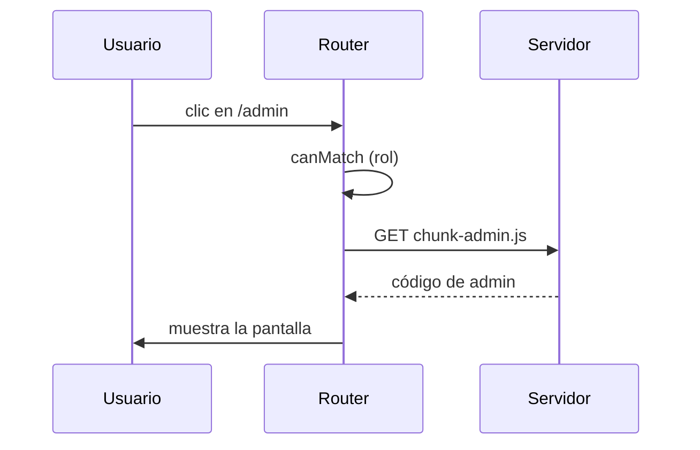

# Lazy loading de rutas

Parte de: [[20-Angular/02 Intermedio/_Índice Intermedio|Intermedio]]

> [!info] Cómo avanzar
> `progreso`: **pendiente** → **viendo** (estudiando) → **visto** (contestaste la autoevaluación sin abrir las respuestas) → **dominado** (hiciste el laboratorio o lo aplicaste de verdad).

## Contenido

### Qué es
El **lazy loading** de rutas divide la aplicación en varios archivos JavaScript (*chunks*) y descarga el código de una sección **solo cuando el usuario navega a ella**. El bundle inicial queda más pequeño y la primera carga es más rápida. Es el equivalente de `React.lazy(() => import('./Admin'))` con `Suspense`, pero declarado en la configuración del router.

### Cómo funciona
En lugar de referenciar el componente con `component`, usas una función que hace un **`import()` dinámico**. El builder (esbuild) ve ese `import()` y genera un chunk separado.

- **`loadComponent`**: carga un componente.
- **`loadChildren`**: carga un arreglo de rutas hijas completo (toda una feature).

```ts
export const routes: Routes = [
  { path: '', component: Inicio }, // en el bundle inicial
  {
    path: 'reportes',
    loadComponent: () => import('./reportes/reportes').then(m => m.Reportes),
  },
  {
    path: 'admin',
    canMatch: [rolGuard('Admin')],
    loadChildren: () => import('./admin/admin.routes').then(m => m.ADMIN_ROUTES),
  },
];
```

Si el archivo usa `export default`, puedes simplificar: `loadComponent: () => import('./reportes/reportes')`.



#### Estrategias de precarga
Por defecto el chunk se descarga al navegar. Con `provideRouter(routes, withPreloading(PreloadAllModules))` Angular descarga los chunks en segundo plano después de la carga inicial, para que la navegación sea instantánea. Hay que balancear: precargar todo gasta datos en móviles.

#### Providers por ruta
Una ruta perezosa puede tener `providers: [...]`: los servicios se crean en un inyector propio de esa sección y solo existen cuando se carga. Para servicios con `providedIn: 'root'` o `@Service()`, el código viaja en el chunk de quien los usa. Angular 22 agregó `injectAsync()` para cargar servicios pesados de forma perezosa también fuera del router.

### Ejemplo
Feature de administración con sus propias rutas:

```ts
// admin/admin.routes.ts
import { Routes } from '@angular/router';

export const ADMIN_ROUTES: Routes = [
  { path: '', loadComponent: () => import('./tablero/tablero').then(m => m.Tablero) },
  { path: 'usuarios', loadComponent: () => import('./usuarios/usuarios').then(m => m.Usuarios) },
];
```

#### Cómo comprobar que funciona
1. Ejecuta `ng build` y revisa la salida: el CLI lista los **Initial chunk files** y, aparte, los **Lazy chunk files** con nombres como `chunk-XXXX.js` o el nombre del componente.
2. Abre las DevTools del navegador, pestaña **Network** filtrada por JS, recarga la página de inicio y luego navega a `/admin`: debe aparecer un archivo nuevo en ese momento.
3. Compara el tamaño inicial antes y después; los presupuestos (`budgets`) de `angular.json` te avisan si crece demasiado.

### Cuándo usarlo y cuándo no
- **Siempre** para secciones grandes o de uso ocasional: administración, reportes, configuración.
- **Combínalo con `canMatch`** para que quien no tiene permiso ni siquiera descargue el código.
- **No** cargues perezosamente la pantalla de inicio ni componentes diminutos: agregas una petición extra sin beneficio.
- Para partes de una misma pantalla (un gráfico pesado bajo el pliegue) usa [[Deferrable views (@defer)]].

### Errores comunes
- **El chunk no se separa**: casi siempre porque el componente también se importa de forma **estática** en otro lugar (en las rutas con `component: Reportes` además del `loadComponent`, en el `imports` de otro componente o por un archivo *barrel* `index.ts` que reexporta todo). Si hay un `import` normal, el código entra al bundle inicial.
- **Rutas hijas que se cargan dos veces** por definir el mismo `path` en el padre y en `ADMIN_ROUTES`.
- **Errores de red al cargar un chunk** después de un despliegue (el usuario tenía la versión vieja abierta): maneja el error de navegación y recarga.
- **Precargar todo** en apps enormes: el beneficio de lazy loading se diluye.

### Para profundizar
- [Angular: estrategias de carga de rutas](https://angular.dev/guide/routing/loading-strategies)
- [Angular: definir rutas](https://angular.dev/guide/routing/define-routes)
- [MDN: import() dinámico](https://developer.mozilla.org/es/docs/Web/JavaScript/Reference/Operators/import)

## Autoevaluación

Contesta primero en voz alta o en papel; luego despliega la respuesta.

> [!question]- ¿Qué es lazy loading de rutas?
> Cargar el código de una sección solo cuando el usuario navega a ella; el CLI lo separa en *chunks* y la carga inicial es más ligera.

> [!question]- ¿Cómo se define?
> ```ts
> { path: 'admin', loadComponent: () => import('./admin/admin').then(m => m.Admin) },
> { path: 'productos', loadChildren: () => import('./productos/productos.routes').then(m => m.PRODUCTOS_ROUTES) },
> ```

> [!question]- ¿Cómo compruebas que funciona?
> `ng build` (y `ng serve`) listan los *lazy chunk files*; en la pestaña Network el archivo se descarga solo al navegar a la ruta.

> [!question]- Error común: el chunk no se separa. ¿Por qué?
> Porque el componente lazy también se importa de forma normal (estática) en otro archivo que ya está en el bundle inicial.

## Práctica

- [[Lab 3 - Router con guards y lazy loading en Angular]]

