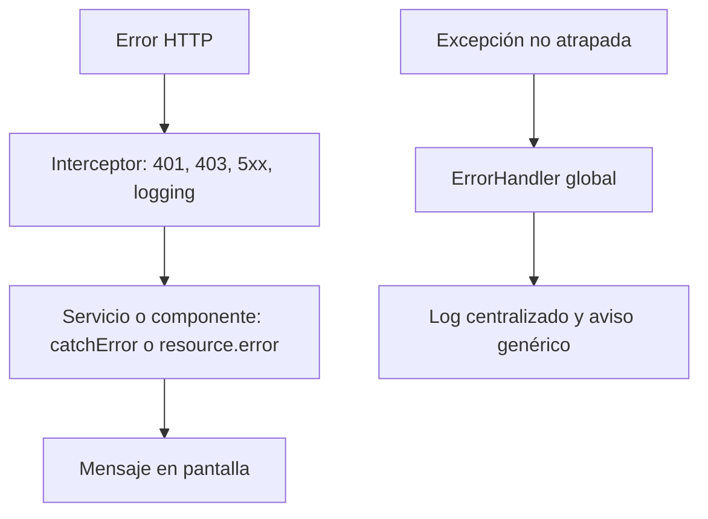

# Manejo de errores en Angular

Parte de: [[20-Angular/02 Intermedio/_Índice Intermedio|Intermedio]]

> [!info] Cómo avanzar
> `progreso`: **pendiente** → **viendo** (estudiando) → **visto** (contestaste la autoevaluación sin abrir las respuestas) → **dominado** (hiciste el laboratorio o lo aplicaste de verdad).

## Contenido

### Qué es
Manejar errores en Angular significa decidir **dónde** se atrapa cada tipo de fallo y **qué** ve el usuario: errores HTTP del API, excepciones de JavaScript, fallos al navegar o al cargar un chunk. Angular ofrece varias capas: `catchError` en flujos RxJS, interceptores HTTP, el estado `error()` de `resource`/`httpResource` y el **`ErrorHandler`** global para lo que nadie atrapó.

### Cómo funciona


#### Errores HTTP: tres niveles
1. **Interceptor**: lo transversal. Redirigir a login en 401, mostrar "sin permiso" en 403, un aviso genérico en 5xx, enviar a un log. Debe **relanzar** el error (`throwError(() => err)`) para que la pantalla decida qué más hacer.
2. **Servicio**: traducir el error a algo del dominio (por ejemplo, convertir un 404 en `null`), reintentar con `retry`.
3. **Componente**: mostrar el mensaje específico, por ejemplo, junto al formulario.

#### Qué trae `HttpErrorResponse`
- `status`: código HTTP (0 si no hubo respuesta: red, CORS, servidor caído).
- `statusText`: texto del estado.
- `url`: a dónde se hizo la petición.
- `error`: **el cuerpo de la respuesta**. Si tu API ASP.NET Core devuelve **ProblemDetails**, aquí llegan `title`, `status`, `detail`, `errors` (validación) y tu extensión `codigo`. Si el error fue del lado del cliente, puede ser un `ProgressEvent` o `Error`.
- `message`: texto técnico generado por Angular; no lo muestres tal cual al usuario.

#### `ErrorHandler`
Es la clase que Angular llama ante cualquier excepción no atrapada (en plantillas, en eventos, en effects). La implementación por defecto escribe en consola. Puedes reemplazarla para enviar a Application Insights u otro servicio de logs. `provideBrowserGlobalErrorListeners()` (incluido en proyectos nuevos desde v20) hace que también se reporten errores globales del navegador, como promesas rechazadas sin `catch`.

Angular 22.2 agregó además el bloque `@boundary` para límites de error en plantillas (similar a los *Error Boundaries* de React): si algo falla dentro del bloque, se muestra un contenido alternativo en lugar de romper la pantalla. Llegó como API nueva en vista previa (Pendiente de confirmar si ya es estable); revisa la guía de *error boundaries* antes de usarlo en producción.

### Ejemplo
Leer ProblemDetails del API y mostrar el mensaje correcto:

```ts
// core/problem-details.ts
import { HttpErrorResponse } from '@angular/common/http';

export interface ProblemDetails {
  title?: string; status?: number; detail?: string;
  codigo?: string; errors?: Record<string, string[]>;
}

export function mensajeDeError(err: unknown): string {
  if (err instanceof HttpErrorResponse) {
    if (err.status === 0) return 'No se pudo contactar al servidor. Revisa tu conexión.';
    const pd = err.error as ProblemDetails | null;
    if (pd?.codigo === 'CLIENTE_DUPLICADO') return 'Ya existe un cliente con ese RFC.';
    return pd?.detail ?? pd?.title ?? `Error ${err.status}`;
  }
  return 'Ocurrió un error inesperado.';
}
```

`ErrorHandler` personalizado:

```ts
// core/global-error-handler.ts
import { ErrorHandler, Injectable, inject } from '@angular/core';
import { Avisos } from './avisos';

@Injectable()
export class GlobalErrorHandler implements ErrorHandler {
  private avisos = inject(Avisos);
  handleError(error: unknown): void {
    console.error(error);              // o enviar a Application Insights
    this.avisos.mostrar('Algo salió mal. Intenta de nuevo.');
  }
}
// app.config.ts
providers: [{ provide: ErrorHandler, useClass: GlobalErrorHandler }]
```

En el componente, con `httpResource`:

```html
@if (pedido.error(); as e) {
  <p class="error">{{ mensaje(e) }}</p>
} @else if (pedido.isLoading()) {
  <p>Cargando…</p>
}
```

### Cuándo usarlo y cuándo no
- **Interceptor** para políticas comunes; **componente** para mensajes contextuales; **ErrorHandler** como red de seguridad y log.
- Usa `catchError` con un valor de reemplazo solo cuando la pantalla puede seguir funcionando con él (lista vacía, valor por defecto) y avisa al usuario.
- No muestres trazas ni mensajes técnicos al usuario final.

### Errores comunes
- **`catchError(() => EMPTY)` en todas partes**: el Observable completa sin emitir, la pantalla se queda en "cargando" o vacía, el usuario no sabe que falló y tú no lo ves en los logs. Silenciar errores esconde bugs; relanza o devuelve un estado de error explícito.
- **Mostrar `err.message`**: texto técnico en inglés con la URL.
- **No distinguir `status` 0** de un 500: son problemas distintos (red/CORS contra error del servidor).
- **Manejar el 401 en cada componente**: duplicación; centralízalo en un interceptor.

### Para profundizar
- [API de ErrorHandler](https://angular.dev/api/core/ErrorHandler)
- [ASP.NET Core: manejo de errores y ProblemDetails](https://learn.microsoft.com/aspnet/core/web-api/handle-errors)

## Autoevaluación

Contesta primero en voz alta o en papel; luego despliega la respuesta.

> [!question]- ¿Dónde manejas los errores HTTP?
> En el servicio o el componente con `catchError` (para mostrar un mensaje o un valor por defecto) y, para lo global (401, 500), en un **interceptor**.

> [!question]- ¿Para qué sirve `ErrorHandler`?
> Captura errores no controlados de toda la app. Puedes proveer tu implementación (`{ provide: ErrorHandler, useClass: MiErrorHandler }`) para registrarlos en un servicio de logs.

> [!question]- Error común: `catchError(() => EMPTY)` en todas partes. ¿Por qué es mala idea?
> Oculta el error: el usuario no ve nada y tú no te enteras. Muestra un mensaje, regístralo o relánzalo con `throwError(() => err)`.

> [!question]- ¿Qué información útil trae `HttpErrorResponse`?
> `status`, `statusText`, `url`, `message` y `error` (el cuerpo que devolvió el servidor, p. ej. un ProblemDetails de .NET).

## Práctica

- [[Lab 2 - Servicio, HttpClient e interceptor en Angular]]

