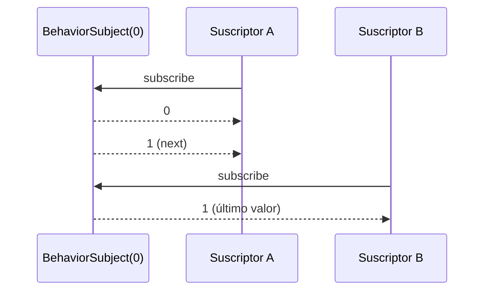

# RxJS - Observables

Parte de: [[20-Angular/02 Intermedio/_Índice Intermedio|Intermedio]]

> [!info] Cómo avanzar
> `progreso`: **pendiente** → **viendo** (estudiando) → **visto** (contestaste la autoevaluación sin abrir las respuestas) → **dominado** (hiciste el laboratorio o lo aplicaste de verdad).

## Contenido

### Qué es
**RxJS** es la librería de programación reactiva que Angular usa para manejar valores que llegan **a lo largo del tiempo**: respuestas HTTP, eventos del router, cambios de un formulario, WebSockets. Su pieza central es el **Observable**: un flujo que puede emitir cero, uno o muchos valores, terminar con éxito (*complete*) o con error. Aunque las señales cubren el estado síncrono, `HttpClient`, el router y los formularios reactivos siguen exponiendo Observables, así que necesitas entenderlos.

### Cómo funciona
Un Observable es **perezoso**: describe cómo producir valores, pero no hace nada hasta que alguien se **suscribe**.

```ts
import { Observable } from 'rxjs';

const reloj$ = new Observable<number>(suscriptor => {
  let n = 0;
  const id = setInterval(() => suscriptor.next(n++), 1000);
  return () => clearInterval(id); // limpieza al desuscribirse
});

const sub = reloj$.subscribe({
  next: v => console.log(v),
  error: e => console.error(e),
  complete: () => console.log('fin'),
});
sub.unsubscribe(); // detiene el intervalo
```

Por convención, las variables Observable terminan en `$`.

#### Observable contra Promise
| Promise | Observable |
|---|---|
| Un solo valor | Cero a muchos valores |
| Se ejecuta al crearse (*eager*) | Se ejecuta al suscribirse (*lazy*) |
| No se puede cancelar | Se cancela con `unsubscribe()` |
| `.then()` | Operadores con `.pipe()` |
| Compartida entre quienes esperan | Cada suscripción ejecuta de nuevo (si es *cold*) |

Puedes convertir: `firstValueFrom(obs$)` devuelve una Promise; `from(promesa)` crea un Observable.

#### Subjects
Un **Subject** es a la vez Observable y emisor: puedes llamar `next()` desde fuera y varios suscriptores reciben lo mismo (*multicast*).
- **`Subject`**: solo emite a quienes ya están suscritos.
- **`BehaviorSubject`**: requiere valor inicial, **guarda el último valor** y se lo entrega de inmediato a cada nuevo suscriptor; tiene `.value`. Antes de las señales era la forma estándar de guardar estado en servicios.
- **`ReplaySubject(n)`**: reenvía los últimos `n` valores a nuevos suscriptores.



#### ¿Hay que desuscribirse de `http.get()`?
Los Observables de `HttpClient` emiten **una respuesta y completan**, así que la suscripción se libera sola; no es obligatorio desuscribirse. Aun así, desuscribirse sirve para **cancelar** una petición en curso si el usuario sale de la pantalla. Lo que sí debes limpiar siempre son flujos infinitos: `interval`, `valueChanges`, `router.events`, WebSockets o un `Subject` de larga vida. Usa `takeUntilDestroyed()`, el pipe `async` o `toSignal()`, que limpian automáticamente.

### Ejemplo
Servicio de notificaciones con un `BehaviorSubject` y su consumo:

```ts
import { Service } from '@angular/core';
import { BehaviorSubject, map } from 'rxjs';

@Service()
export class NotificacionesService {
  private readonly _mensajes = new BehaviorSubject<string[]>([]);
  readonly mensajes$ = this._mensajes.asObservable(); // solo lectura
  readonly cantidad$ = this.mensajes$.pipe(map(m => m.length));

  agregar(msg: string) {
    this._mensajes.next([...this._mensajes.value, msg]);
  }
}
```

```ts
import { toSignal } from '@angular/core/rxjs-interop';

@Component({
  selector: 'app-campana',
  template: `🔔 {{ cantidad() }}`,
})
export class Campana {
  private notif = inject(NotificacionesService);
  protected cantidad = toSignal(this.notif.cantidad$, { initialValue: 0 });
}
```

Hoy este mismo servicio podría escribirse con una señal; el patrón con `BehaviorSubject` lo encontrarás en mucho código existente.

### Cuándo usarlo y cuándo no
- **Observables**: eventos repetidos en el tiempo, peticiones que se cancelan, combinación de varias fuentes asíncronas.
- **Señales**: estado actual que la vista muestra.
- **Promise / `async-await`**: operaciones únicas fuera de Angular o cuando una API ya devuelve Promise.
- Los operadores con que transformas flujos están en [[RxJS - operadores más usados]].

### Errores comunes
- **No suscribirse** y esperar que algo pase: el Observable es perezoso.
- **Suscribirse dos veces** al mismo Observable HTTP: hace dos peticiones. Comparte el resultado (`shareReplay`) o conviértelo a señal una vez.
- **Suscripciones anidadas** (`subscribe` dentro de `subscribe`): difíciles de cancelar y de leer; usa `switchMap`.
- **Exponer el `Subject`** desde un servicio en lugar de `asObservable()`: cualquiera puede emitir.

### Para profundizar
- [RxJS: Observable](https://rxjs.dev/guide/observable)
- [RxJS: Subjects](https://rxjs.dev/guide/subject)
- [Angular: interoperabilidad RxJS y señales](https://angular.dev/guide/signals/rxjs-interop)

## Autoevaluación

Contesta primero en voz alta o en papel; luego despliega la respuesta.

> [!question]- ¿Qué es un Observable?
> Un flujo de valores en el tiempo (cero, uno o muchos) que solo empieza cuando alguien se **suscribe**. Puede emitir `next`, terminar con `error` o con `complete`.

> [!question]- ¿Qué diferencia hay entre un Observable y una Promise?
> La Promise es *eager* (empieza al crearse), resuelve **un** valor y no se cancela. El Observable es *lazy*, puede emitir varios valores y se cancela con `unsubscribe()`.

> [!question]- ¿Qué es un `BehaviorSubject`?
> Un Subject que guarda el **último valor** y lo entrega de inmediato a cada nuevo suscriptor. Se usaba mucho para estado en servicios (hoy las señales cubren ese caso).

> [!question]- ¿Hay que desuscribirse de `http.get()`?
> No es estrictamente necesario porque completa tras una respuesta, pero si el componente se destruye antes de que llegue, conviene cancelar (`takeUntilDestroyed()`, `async` o `toSignal`). Los flujos infinitos (`interval`, eventos) **siempre** se deben cancelar.

## Práctica

- [[Lab 2 - Servicio, HttpClient e interceptor en Angular]]

