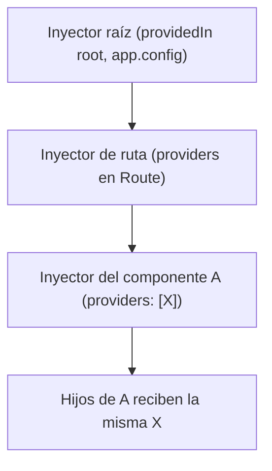

# Servicios e inyección de dependencias en Angular

Parte de: [[20-Angular/02 Intermedio/_Índice Intermedio|Intermedio]]

> [!info] Cómo avanzar
> `progreso`: **pendiente** → **viendo** (estudiando) → **visto** (contestaste la autoevaluación sin abrir las respuestas) → **dominado** (hiciste el laboratorio o lo aplicaste de verdad).

## Contenido

### Qué es
Un **servicio** es una clase que concentra lógica que no pertenece a la vista: llamar al API, guardar estado compartido, registrar logs, calcular reglas de negocio. La **inyección de dependencias (DI)** es el mecanismo con que Angular crea esas clases y se las entrega a quien las pide. Si vienes de ASP.NET Core es la misma idea que `builder.Services.AddScoped<...>()` y la inyección por constructor; si vienes de React, reemplaza a los Context y a los hooks personalizados que comparten estado.

### Cómo funciona
1. **Declaras** el servicio y dónde se provee.
2. **Pides** la dependencia con `inject(Clase)` en un componente, directiva, pipe, guard, interceptor u otro servicio.
3. El **inyector** busca un proveedor, crea la instancia (una sola por inyector) y la reutiliza.

#### Declarar el servicio
La forma clásica, vigente en todo el código existente:

```ts
@Injectable({ providedIn: 'root' })
export class CarritoService {}
```

`providedIn: 'root'` significa que el servicio se registra en el **inyector raíz**: hay **una sola instancia (singleton) para toda la aplicación**, se crea la primera vez que alguien la pide y, si nadie la usa, el build la elimina (*tree-shakable*).

Angular 22 agregó el decorador **`@Service()`**, que es una forma corta de lo mismo: se provee en la raíz automáticamente y exige usar `inject()` en lugar de parámetros del constructor. `ng generate service` ya lo usa; con `--injectable` obtienes el estilo anterior. Desde 22.1 hay una migración `ng g @angular/core:service`. Ambas formas conviven.

#### Inyectar
```ts
private carrito = inject(CarritoService);
```
`inject()` solo funciona en un **contexto de inyección**: inicializadores de campo, constructor, funciones de providers, guards e interceptores funcionales. También puedes inyectar por parámetro del constructor (`constructor(private carrito: CarritoService)`), pero el estilo moderno es `inject()`.

#### Jerarquía de inyectores

Si pones un servicio en `providers` de un componente, se crea **una instancia nueva por cada instancia de ese componente**, compartida con sus descendientes y destruida junto con él. Sirve para estado local de una pantalla (por ejemplo, el estado de un asistente de varios pasos), pero si querías un singleton, terminarás con datos que "se pierden".

#### `InjectionToken`
Para inyectar algo que no es una clase (una cadena, un objeto de configuración, una función) creas un token:

```ts
export const API_URL = new InjectionToken<string>('API_URL');
// app.config.ts
providers: [{ provide: API_URL, useValue: 'https://localhost:5001/api' }]
// uso
private apiUrl = inject(API_URL);
```

Otros tipos de proveedor: `useClass` (cambiar la implementación, útil en pruebas), `useFactory` (crear con lógica) y `useExisting` (alias).

### Ejemplo
Servicio de carrito con estado en señales, consumido por dos componentes que no son padre e hijo:

```ts
import { Service, computed, signal } from '@angular/core';
import { Producto } from '../productos/producto';

@Service()
export class CarritoService {
  private readonly _items = signal<Producto[]>([]);
  readonly items = this._items.asReadonly();
  readonly total = computed(() => this._items().reduce((s, p) => s + p.precio, 0));

  agregar(p: Producto) {
    this._items.update(lista => [...lista, p]);
  }
}
```

```ts
@Component({
  selector: 'app-badge-carrito',
  template: `🛒 {{ carrito.items().length }} · {{ carrito.total() }}`,
})
export class BadgeCarrito {
  protected carrito = inject(CarritoService);
}
```

### Cuándo usarlo y cuándo no
- **Servicio root**: acceso al API, sesión del usuario, carrito, configuración.
- **Servicio en `providers` del componente**: estado que debe nacer y morir con una pantalla.
- **Token**: configuración, URLs, *feature flags*.
- No metas en un servicio lo que solo usa un componente y no se comparte; una señal local basta.
- Separa lectura y escritura: expón señales de solo lectura y métodos para modificarlas.

### Errores comunes
- **Duplicar instancias sin querer.** Poner en `providers` un servicio que ya es root crea otra instancia aislada.
- **Llamar `inject()` fuera de contexto** (por ejemplo dentro de un `setTimeout` o un método). Lanza `NG0203`; inyecta en un campo y úsalo después.
- **Dependencias circulares.** A inyecta B y B inyecta A: error `NG0200`; extrae la parte común a un tercer servicio.
- **Lógica de vista en servicios** (manipular DOM). Mantén los servicios independientes de la plantilla.

### Para profundizar
- [Angular: inyección de dependencias](https://angular.dev/guide/di)
- [Angular: carga perezosa de servicios con injectAsync](https://angular.dev/guide/di/lazy-loading-services)

## Autoevaluación

Contesta primero en voz alta o en papel; luego despliega la respuesta.

> [!question]- ¿Qué es un servicio en Angular?
> Una clase con `@Injectable` que concentra lógica reutilizable (acceso a datos, estado compartido, utilidades) fuera de los componentes.

> [!question]- ¿Qué significa `providedIn: 'root'`?
> Que Angular crea **una sola instancia** para toda la app (singleton) y la puede eliminar del bundle si nadie la usa (*tree-shaking*).

> [!question]- ¿Cómo se inyecta un servicio?
> Con `inject()` en un campo: `private api = inject(ProductosService);` (o en el constructor). Debe ocurrir en un contexto de inyección: constructor, inicializadores de campos, factories, guards e interceptores funcionales.

> [!question]- ¿Qué pasa si pones el servicio en `providers` de un componente?
> Ese componente y sus hijos reciben una **instancia nueva**, distinta de la global. Útil para estado local; un error común cuando se esperaba compartir estado.

> [!question]- ¿Para qué sirve un `InjectionToken`?
> Para inyectar valores que no son clases, como configuración: `export const API_URL = new InjectionToken<string>('API_URL');` y `{ provide: API_URL, useValue: 'https://…' }`.

## Práctica

- [[Lab 1 - Signals en Angular (carrito de compras)]]
- [[Lab 2 - Servicio, HttpClient e interceptor en Angular]]
- [[Lab 3 - Router con guards y lazy loading en Angular]]

