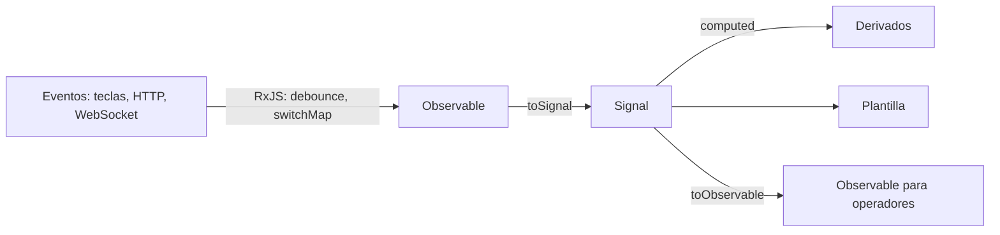

# Signals vs RxJS

Parte de: [[20-Angular/02 Intermedio/_Índice Intermedio|Intermedio]]

> [!info] Cómo avanzar
> `progreso`: **pendiente** → **viendo** (estudiando) → **visto** (contestaste la autoevaluación sin abrir las respuestas) → **dominado** (hiciste el laboratorio o lo aplicaste de verdad).

## Contenido

### Qué es
Angular tiene hoy dos modelos reactivos que conviven: **señales**, para representar **estado** (el valor actual de algo), y **RxJS**, para representar **eventos en el tiempo** (una secuencia de cosas que pasan). No compiten: cada uno resuelve un problema distinto, y Angular trae puentes oficiales en `@angular/core/rxjs-interop` para pasar de uno a otro. Saber cuál usar evita código innecesariamente complejo.

### Cómo funciona
| Aspecto | Signals | RxJS |
|---|---|---|
| Modelo | Valor actual, siempre disponible | Flujo de valores en el tiempo |
| Lectura | Síncrona: `contador()` | Asíncrona: `subscribe` |
| Suscripción | Automática (plantilla, `computed`, `effect`) | Manual o con `async` / `toSignal` |
| Limpieza | Automática | Hay que gestionarla en flujos infinitos |
| Tiempo y concurrencia | No (salvo `resource`, `debounced` experimental) | Sí: `debounceTime`, `switchMap`, `retry` |
| Curva de aprendizaje | Baja | Alta |

Regla práctica: **si la pregunta es "¿cuánto vale ahora?", señal; si es "¿qué hago cuando ocurra esto, y cómo combino o cancelo?", RxJS.**



#### De Observable a señal: `toSignal`
```ts
productos = toSignal(this.api.listar(), { initialValue: [] });
```
- Se suscribe de inmediato y se desuscribe cuando se destruye el componente o servicio.
- Debe llamarse en un contexto de inyección.
- Sin `initialValue`, el tipo incluye `undefined` hasta la primera emisión; con `requireSync: true` exiges que el Observable emita de forma síncrona (como un `BehaviorSubject`).
- Si el Observable falla, leer la señal lanza el error; maneja errores con `catchError` antes.

#### De señal a Observable: `toObservable`
```ts
filtro = signal('');
resultados$ = toObservable(this.filtro).pipe(
  debounceTime(300),
  switchMap(f => this.api.buscar(f)),
);
```
Emite el valor de la señal cuando cambia (de forma asíncrona, agrupando cambios), lo que te da acceso a todos los operadores de RxJS.

#### `resource` y `rxResource`
Para el caso más común, "cuando cambia un parámetro, carga datos", Angular 22 estabilizó `resource`, `rxResource` y `httpResource`. Exponen `value()`, `isLoading()`, `error()` y `reload()` como señales, y cancelan la carga anterior si el parámetro cambia, similar a `switchMap`:

```ts
id = input.required<number>();
pedido = httpResource<Pedido>(() => `/api/pedidos/${this.id()}`);
```

### Ejemplo
Pantalla de productos que mezcla ambos mundos:

```ts
@Component({
  selector: 'app-catalogo',
  template: `
    <input (input)="texto.set($any($event.target).value)" />
    <p>{{ visibles().length }} de {{ todos().length }}</p>
  `,
})
export class Catalogo {
  private api = inject(ProductosApi);
  protected texto = signal('');

  // RxJS para la petición; señal para el estado resultante
  protected todos = toSignal(this.api.listar(), { initialValue: [] as Producto[] });

  // Filtro local síncrono: solo señales
  protected visibles = computed(() => {
    const t = this.texto().toLowerCase();
    return this.todos().filter(p => p.nombre.toLowerCase().includes(t));
  });
}
```

Si el filtro fuera en el servidor, convertirías `texto` con `toObservable` y aplicarías `debounceTime` + `switchMap`.

### Cuándo usarlo y cuándo no
- **Señales**: estado de componentes y servicios, valores derivados, todo lo que pinta la plantilla.
- **RxJS**: debounce, cancelación, reintentos, combinación de flujos, WebSockets, `router.events`.
- **`resource`/`httpResource`**: cargas de datos dependientes de parámetros, sin necesidad de RxJS.
- No conviertas todo a RxJS "por si acaso" ni todo a señales a la fuerza; usa el puente donde se encuentran.

### Errores comunes
- **`toSignal` dentro de un método** (por ejemplo al hacer clic): crea una suscripción nueva cada vez y falla fuera de contexto de inyección. Llámalo una vez en un campo.
- **`toSignal` sin `initialValue`** y luego `.length` en la plantilla: error porque el valor inicial es `undefined`.
- **Usar `effect` para disparar peticiones** al cambiar una señal: pierdes cancelación; usa `resource` o `toObservable` + `switchMap`.
- **Duplicar estado** en un `BehaviorSubject` y en una señal; elige una fuente de verdad.

### Para profundizar
- [Angular: RxJS interop](https://angular.dev/guide/signals/rxjs-interop)
- [Angular: resource](https://angular.dev/guide/signals/resource)
- [Angular: httpResource](https://angular.dev/guide/http/http-resource)

## Autoevaluación

Contesta primero en voz alta o en papel; luego despliega la respuesta.

> [!question]- ¿Cuándo usar señales y cuándo RxJS?
> **Señales**: estado síncrono y valores que la vista muestra (contadores, selección, datos ya cargados). **RxJS**: eventos asíncronos en el tiempo (HTTP, WebSockets, debounce, cancelación, combinación de flujos).

> [!question]- ¿Cómo conviertes un Observable en señal?
> `productos = toSignal(this.api.listar(), { initialValue: [] })` (de `@angular/core/rxjs-interop`). Se suscribe al crearse y se desuscribe al destruirse el contexto.

> [!question]- ¿Y una señal en Observable?
> `toObservable(this.filtro)`; útil para aplicar `debounceTime` o `switchMap` a un valor que vive en una señal.

## Práctica

- [[Lab 1 - Signals en Angular (carrito de compras)]]

