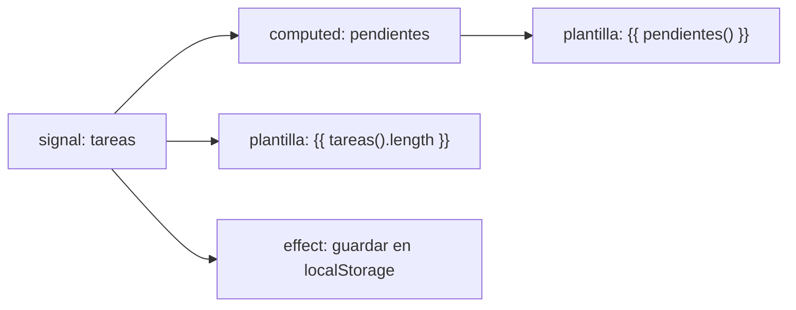

# Signals

Parte de: [[20-Angular/02 Intermedio/_Índice Intermedio|Intermedio]]

> [!info] Cómo avanzar
> `progreso`: **pendiente** → **viendo** (estudiando) → **visto** (contestaste la autoevaluación sin abrir las respuestas) → **dominado** (hiciste el laboratorio o lo aplicaste de verdad).

## Contenido

### Qué es
Una **señal** (*signal*) es un contenedor de valor **reactivo**: guarda un dato y avisa a quien lo lee cuando cambia. Se crea con `signal(valorInicial)`, se lee **llamándola como función** y se modifica con `set` o `update`. Angular rastrea qué plantillas, `computed` y `effect` leyeron cada señal, y solo actualiza esas partes. Es la base del Angular moderno: estado local, inputs, formularios (Signal Forms) y detección de cambios zoneless se construyen sobre señales.

Comparado con React: `signal` se parece a `useState`, pero no vuelve a ejecutar el componente; solo se actualizan los bindings que leen la señal. Tampoco hay arreglos de dependencias: Angular las descubre al leer.

### Cómo funciona
```ts
import { signal } from '@angular/core';

const contador = signal(0);  // WritableSignal<number>
contador();                  // leer: 0
contador.set(5);             // reemplazar
contador.update(v => v + 1); // calcular desde el anterior: 6
```

- **`set(valor)`** reemplaza el valor.
- **`update(fn)`** recibe el valor actual y devuelve el nuevo; úsalo cuando el nuevo depende del anterior.
- Al cambiar, la señal compara con `Object.is`: si el valor nuevo es igual al anterior, **no notifica**. Puedes dar tu propia función con `signal(x, { equal: ... })`.
- **`asReadonly()`** devuelve una versión de solo lectura (`Signal<T>`), sin `set` ni `update`. Patrón típico: el servicio guarda una señal privada y expone la versión de solo lectura, para que solo él pueda cambiarla.



#### Inmutabilidad: por qué `push` no funciona
La señal solo sabe que cambió cuando recibe una **referencia nueva**. Si haces `items().push(nuevo)`, modificas el mismo arreglo: la referencia no cambia, la señal no notifica y la vista (sobre todo con `OnPush`, que es el default en Angular 22) no se actualiza. Igual que en React con `setState`, crea copias:

```ts
items.update(lista => [...lista, nuevo]);                       // agregar
items.update(lista => lista.filter(t => t.id !== id));          // quitar
items.update(lista => lista.map(t => t.id === 3 ? { ...t, hecha: !t.hecha } : t)); // editar
```

### Ejemplo
Lista de tareas con estado en un servicio:

```ts
import { Service, computed, signal } from '@angular/core';

export interface Tarea { id: number; titulo: string; hecha: boolean; }

@Service()
export class TareasStore {
  private readonly _tareas = signal<Tarea[]>([]);
  readonly tareas = this._tareas.asReadonly();
  readonly pendientes = computed(() => this._tareas().filter(t => !t.hecha).length);

  agregar(titulo: string) {
    const nueva: Tarea = { id: Date.now(), titulo, hecha: false };
    this._tareas.update(lista => [...lista, nueva]);
  }

  alternar(id: number) {
    this._tareas.update(lista => lista.map(t => (t.id === id ? { ...t, hecha: !t.hecha } : t)));
  }
}
```

```ts
@Component({
  selector: 'app-tareas',
  template: `
    <input #t (keyup.enter)="store.agregar(t.value); t.value = ''" />
    <p>Pendientes: {{ store.pendientes() }}</p>
    @for (tarea of store.tareas(); track tarea.id) {
      <label><input type="checkbox" [checked]="tarea.hecha" (change)="store.alternar(tarea.id)" />
        {{ tarea.titulo }}</label>
    }
  `,
})
export class Tareas {
  protected store = inject(TareasStore);
}
```

#### La familia de señales
- [[computed y effect]]: valores derivados y efectos secundarios.
- `linkedSignal`: señal escribible que se reinicia cuando cambia su fuente (por ejemplo, "opción seleccionada" que vuelve a la primera cuando cambia la lista).
- `resource` / `httpResource`: datos asíncronos como señales, estables desde Angular 22.
- Inputs (`input()`), `model()` y consultas (`viewChild()`) también son señales.

### Cuándo usarlo y cuándo no
- **Señales**: todo estado síncrono de la UI (valores de pantalla, filtros, selección, carrito).
- **RxJS**: flujos de eventos en el tiempo (búsqueda con debounce, WebSockets, cancelación); ver [[Signals vs RxJS]].
- No envuelvas cada propiedad constante en una señal: si nunca cambia, una propiedad normal basta.

### Errores comunes
- **Mutar en lugar de reemplazar** (`push`, `splice`, asignar propiedades). La vista no se entera.
- **Olvidar los paréntesis** en la plantilla: `{{ contador }}` no muestra el número.
- **Exponer la señal escribible** desde un servicio: cualquier componente puede cambiar el estado sin control; usa `asReadonly()`.
- **Leer una señal en el constructor esperando reactividad.** Leerla una vez solo da el valor de ese momento; para reaccionar usa `computed` o `effect`.

### Para profundizar
- [Angular: signals](https://angular.dev/guide/signals)
- [Angular: linkedSignal](https://angular.dev/guide/signals/linked-signal)
- [Angular: resource](https://angular.dev/guide/signals/resource)

## Ejercicios

Resuélvelos en papel o en la herramienta; la solución está plegada.

> [!question]- `const a = signal(2); a.set(5); a.update(v => v * 3);` ¿Cuánto vale `a()`?
> `15`.

> [!question]- Declara una señal con una lista de tareas vacía tipada y agrega una tarea sin mutar.
> ```ts
> tareas = signal<Tarea[]>([]);
> agregar(t: Tarea) {
>   this.tareas.update(lista => [...lista, t]);
> }
> ```

> [!question]- Cambia la propiedad `hecha` de la tarea con `id` 3 sin mutar.
> ```ts
> this.tareas.update(lista =>
>   lista.map(t => t.id === 3 ? { ...t, hecha: !t.hecha } : t));
> ```

## Autoevaluación

Contesta primero en voz alta o en papel; luego despliega la respuesta.

> [!question]- ¿Qué es una señal (signal)?
> Un contenedor de valor reactivo: `const contador = signal(0)`. Se lee llamándola (`contador()`) y Angular sabe qué partes de la vista dependen de ella para actualizarlas.

> [!question]- ¿Qué diferencia hay entre `set` y `update`?
> `set(5)` reemplaza el valor. `update(v => v + 1)` calcula el nuevo valor a partir del anterior.

> [!question]- ¿Por qué este código no actualiza la vista? `items().push(nuevo)`
> Muta el arreglo sin cambiar la referencia; la señal no se entera. Hay que crear uno nuevo: `items.update(lista => [...lista, nuevo])`.

> [!question]- ¿Para qué sirve `asReadonly()`?
> Para exponer desde un servicio una versión de solo lectura de una señal privada, de modo que solo el servicio pueda modificarla.

## Práctica

- [[Lab 1 - Signals en Angular (carrito de compras)]]
- [[Lab 1 - Pruebas unitarias y de componentes en Angular]]

