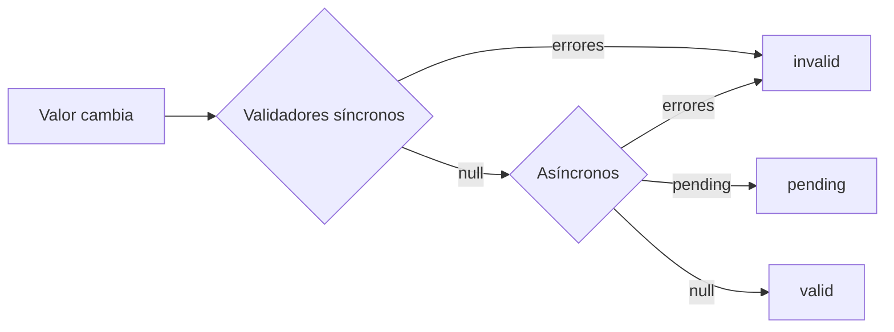

# Validaciones personalizadas

Parte de: [[20-Angular/02 Intermedio/_Índice Intermedio|Intermedio]]

> [!info] Cómo avanzar
> `progreso`: **pendiente** → **viendo** (estudiando) → **visto** (contestaste la autoevaluación sin abrir las respuestas) → **dominado** (hiciste el laboratorio o lo aplicaste de verdad).

## Contenido

### Qué es
Una **validación personalizada** es una regla propia que Angular aplica a un control o a un grupo, además de las integradas (`required`, `email`, `minLength`...). En formularios reactivos un validador es simplemente una **función** que recibe el control y devuelve los errores encontrados o `null` si todo está bien. Así implementas reglas de negocio como "la contraseña debe tener un número", "las dos contraseñas coinciden" o "este RFC ya está registrado".

### Cómo funciona
#### Validador síncrono
Tipo `ValidatorFn`: `(control: AbstractControl) => ValidationErrors | null`.
- Devuelve **`null`** si es válido.
- Devuelve un **objeto de errores** si no: `{ contieneNumero: true }` o con detalles `{ prohibido: { palabra: 'admin' } }`. La clave es el nombre del error que luego consultas con `hasError('contieneNumero')`.

#### Validador con parámetros
Una función que **recibe la configuración y devuelve** un `ValidatorFn` (una *fábrica*), igual que `Validators.minLength(3)`.

#### Validador de grupo
Para reglas entre campos, el validador se coloca en el `FormGroup`: recibe el grupo, lee los controles que necesita y devuelve el error en el grupo.

#### Validador asíncrono
Tipo `AsyncValidatorFn`: devuelve un `Observable` o `Promise` de `ValidationErrors | null`. Se usa cuando la validación requiere al servidor (¿el correo ya existe?). Mientras corre, el control está en estado `pending`. Angular solo ejecuta los asíncronos si los síncronos pasaron. Conviene combinarlo con `updateOn: 'blur'` para no consultar en cada tecla.



### Ejemplo
```ts
// shared/validadores.ts
import { AbstractControl, AsyncValidatorFn, ValidationErrors, ValidatorFn } from '@angular/forms';
import { inject } from '@angular/core';
import { map, catchError, of } from 'rxjs';
import { ClientesApi } from '../clientes/clientes-api';

// Al menos un dígito
export const contieneNumero: ValidatorFn = (c: AbstractControl): ValidationErrors | null =>
  /\d/.test(c.value ?? '') ? null : { contieneNumero: true };

// Con parámetro: prohíbe una palabra (sin distinguir mayúsculas)
export function prohibido(palabra: string): ValidatorFn {
  return c => {
    const valor = String(c.value ?? '').toLowerCase();
    return valor.includes(palabra.toLowerCase()) ? { prohibido: { palabra } } : null;
  };
}

// De grupo: password y confirmar deben coincidir
export const passwordsIguales: ValidatorFn = (g: AbstractControl): ValidationErrors | null => {
  const p = g.get('password')?.value;
  const c = g.get('confirmar')?.value;
  return p && c && p !== c ? { passwordsDistintas: true } : null;
};

// Asíncrono: correo único (se crea en contexto de inyección)
export function correoDisponible(): AsyncValidatorFn {
  const api = inject(ClientesApi);
  return c =>
    api.existeCorreo(c.value).pipe(
      map(existe => (existe ? { correoOcupado: true } : null)),
      catchError(() => of(null)), // si el API falla, no bloquear al usuario
    );
}
```

Uso:

```ts
protected form = this.fb.group(
  {
    usuario: ['', [Validators.required, prohibido('admin')]],
    correo: ['', { validators: [Validators.email], asyncValidators: [correoDisponible()], updateOn: 'blur' }],
    password: ['', [Validators.required, Validators.minLength(8), contieneNumero]],
    confirmar: ['', Validators.required],
  },
  { validators: passwordsIguales },
);
```

```html
@if (form.hasError('passwordsDistintas') && form.controls.confirmar.touched) {
  <small>Las contraseñas no coinciden.</small>
}
@if (form.controls.correo.pending) { <small>Verificando…</small> }
```

Fíjate que el error de grupo se consulta en el **grupo** (`form.hasError`), no en el control `confirmar`.

#### Mensajes de error centralizados
Para no repetir textos en cada plantilla, crea una función o pipe que traduzca las claves de error a mensajes: `required` → "Campo obligatorio", `contieneNumero` → "Incluye al menos un número", `prohibido` → `No puede contener "${e.palabra}"`. Así, agregar un validador nuevo solo implica registrar su mensaje en un lugar, y los textos quedan listos para [[Internacionalización en Angular|traducir]].

#### En Signal Forms
Con Signal Forms (estables en Angular 22) se usa `validate()` dentro del esquema, que devuelve `null` o un objeto `{ kind, message }`; para comparar campos lees el otro con `valueOf()`:

```ts
validate(s.confirmar, ({ value, valueOf }) =>
  value() !== valueOf(s.password) ? { kind: 'passwordsDistintas', message: 'No coinciden' } : null);
```

### Cuándo usarlo y cuándo no
- Validadores propios para reglas reutilizables (RFC, CURP, código postal, contraseñas).
- Asíncronos solo cuando la verdad está en el servidor, y con `updateOn: 'blur'` o *debounce*.
- No dupliques en el cliente reglas que cambian seguido y solo conoce el backend; muestra el `ProblemDetails` del API en su lugar.
- La validación del front es **comodidad**; la definitiva va en el API con FluentValidation.

### Errores comunes
- **Devolver `{}` o `false` en lugar de `null`** cuando es válido: Angular lo trata como error.
- **Poner el validador de coincidencia en un control**: no ve el otro campo cuando cambia; va en el grupo.
- **Validadores asíncronos en cada tecla**: saturan el API.
- **Olvidar que `c.value` puede ser `null`**: usa `?? ''` antes de aplicar regex.

### Para profundizar
- [Angular: validación de formularios](https://angular.dev/guide/forms/form-validation)
- [Angular: validación en Signal Forms](https://angular.dev/guide/forms/signals/validation)
- [API de ValidatorFn](https://angular.dev/api/forms/ValidatorFn)

## Ejercicios

Resuélvelos en papel o en la herramienta; la solución está plegada.

> [!question]- Escribe un validador `contieneNumero` que exija al menos un dígito.
> ```ts
> export const contieneNumero: ValidatorFn = c =>
>   /\d/.test(c.value ?? '') ? null : { sinNumero: true };
> ```

> [!question]- Escribe un validador de grupo `passwordsIguales` para `password` y `confirmar`.
> ```ts
> export const passwordsIguales: ValidatorFn = g => {
>   const p = g.get('password')?.value;
>   const c = g.get('confirmar')?.value;
>   return p === c ? null : { noCoinciden: true };
> };
> ```

> [!question]- Escribe un validador con parámetro `prohibido(palabra)`.
> ```ts
> export function prohibido(palabra: string): ValidatorFn {
>   return c => (c.value ?? '').toLowerCase().includes(palabra) ? { prohibido: { palabra } } : null;
> }
> ```

## Autoevaluación

Contesta primero en voz alta o en papel; luego despliega la respuesta.

> [!question]- ¿Qué devuelve un validador?
> `null` si es válido, o un objeto de errores (`{ sinNumero: true }`) si no. Tipo: `ValidatorFn`.

> [!question]- ¿Cómo validas que dos campos coincidan?
> Con un validador **a nivel de grupo** que lea ambos controles y se registre en las opciones del `FormGroup` (`{ validators: passwordsIguales }`).

> [!question]- ¿Qué es un validador asíncrono?
> Uno que devuelve un Observable o Promise (p. ej. consultar si un usuario ya existe). Mientras corre, el control queda en estado `PENDING`.

## Práctica

- [[Lab 4 - Formularios reactivos con validación en Angular]]

