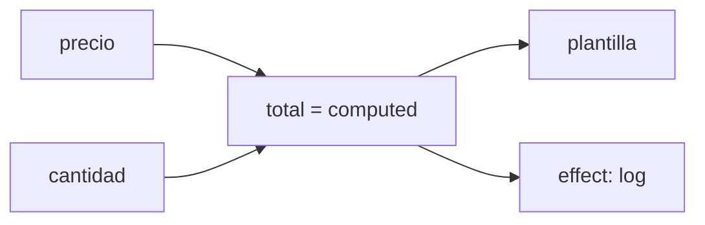

# computed y effect

Parte de: [[20-Angular/02 Intermedio/_Índice Intermedio|Intermedio]]

> [!info] Cómo avanzar
> `progreso`: **pendiente** → **viendo** (estudiando) → **visto** (contestaste la autoevaluación sin abrir las respuestas) → **dominado** (hiciste el laboratorio o lo aplicaste de verdad).

## Contenido

### Qué es
- **`computed(fn)`** crea una señal de **solo lectura** cuyo valor se deriva de otras señales. Es el equivalente a `useMemo` de React, pero sin lista de dependencias: Angular registra qué señales leyó `fn`.
- **`effect(fn)`** ejecuta código con **efectos secundarios** cada vez que cambian las señales que lee: guardar en `localStorage`, escribir logs, sincronizar con una librería externa. Se parece a `useEffect`, pero su uso recomendado es mucho más limitado.
- **`untracked(fn)`** lee señales sin crear dependencia.

### Cómo funciona
#### `computed`
```ts
const precio = signal(100);
const cantidad = signal(2);
const total = computed(() => precio() * cantidad()); // 200
cantidad.set(3);
total(); // 300
```
Características:
1. **Perezoso**: no calcula hasta que alguien lo lee.
2. **Memoizado**: guarda el resultado y solo recalcula si una dependencia notificó un cambio.
3. **Dependencias dinámicas**: si dentro hay un `if`, solo depende de las señales que realmente leyó en la última ejecución.

Si haces `precio.set(100)` cuando ya valía 100, la señal compara con `Object.is`, ve que es igual y **no notifica**: `total` no se recalcula y sigue en 300.



#### `effect`
```ts
constructor() {
  effect(() => {
    localStorage.setItem('tareas', JSON.stringify(this.tareas()));
  });
}
```
- Se crea en un **contexto de inyección** (constructor o inicializador de campo) y se destruye solo con el componente o servicio que lo creó.
- Se ejecuta al menos una vez y luego cada vez que cambia algo que leyó. La ejecución es **asíncrona**: Angular agrupa cambios y lo corre durante su ciclo de actualización, no en el instante del `set`.
- Puede recibir `onCleanup` para limpiar antes de la siguiente ejecución: `effect((onCleanup) => { const id = setInterval(...); onCleanup(() => clearInterval(id)); })`.

#### `untracked`
```ts
effect(() => {
  const usuario = this.usuario();           // dependencia
  untracked(() => this.log.registrar(usuario, this.ruta())); // ruta() NO es dependencia
});
```
Úsalo cuando dentro de un effect necesitas leer otra señal o llamar código que lee señales, sin que eso dispare el effect.

### Ejemplo
Carrito con totales derivados y persistencia:

```ts
import { Component, computed, effect, signal } from '@angular/core';
import { CurrencyPipe } from '@angular/common';

interface Linea { sku: string; precio: number; cantidad: number; }

@Component({
  selector: 'app-carrito',
  imports: [CurrencyPipe],
  template: `
    <p>Subtotal: {{ subtotal() | currency: 'MXN' }}</p>
    <p>IVA: {{ iva() | currency: 'MXN' }}</p>
    <p><strong>Total: {{ total() | currency: 'MXN' }}</strong></p>
  `,
})
export class Carrito {
  protected lineas = signal<Linea[]>(JSON.parse(localStorage.getItem('carrito') ?? '[]'));
  protected subtotal = computed(() => this.lineas().reduce((s, l) => s + l.precio * l.cantidad, 0));
  protected iva = computed(() => this.subtotal() * 0.16);
  protected total = computed(() => this.subtotal() + this.iva());

  constructor() {
    effect(() => localStorage.setItem('carrito', JSON.stringify(this.lineas())));
  }
}
```

### Cuándo usarlo y cuándo no
- **`computed`** para cualquier valor que se calcula a partir de otros: totales, filtros, banderas (`puedeGuardar = computed(() => form valid && !guardando())`).
- **`effect`** solo para salir del mundo de señales: almacenamiento, logs, analítica, APIs del DOM o librerías imperativas (un mapa, un gráfico).
- **No uses `effect` para calcular otra señal** (`effect(() => this.total.set(a() + b()))`). Genera actualizaciones extra, posibles ciclos y estado duplicado; un `computed` lo resuelve de forma declarativa. Si necesitas una señal derivada que además se pueda escribir, usa `linkedSignal`.
- Para cargar datos cuando cambia un parámetro, prefiere `resource`/`httpResource` o RxJS con `switchMap` antes que un effect que dispara peticiones.

### Errores comunes
- **Efectos en cascada**: un effect escribe una señal que dispara otro effect. Difícil de seguir; rediseña con `computed`.
- **Llamar `effect` fuera de contexto** (en un método): error `NG0203`. Créalo en el constructor o pasa `{ injector }`.
- **Leer señales sin querer** dentro de funciones llamadas por el effect, creando dependencias ocultas. Envuelve con `untracked`.
- **Usar `computed` con efectos secundarios** (peticiones, `console.log` de negocio). Debe ser una función pura.

### Para profundizar
- [Angular: signals, computed y effect](https://angular.dev/guide/signals)
- [API de untracked](https://angular.dev/api/core/untracked)

## Ejercicios

Resuélvelos en papel o en la herramienta; la solución está plegada.

> [!question]- `precio = signal(100); cantidad = signal(2); total = computed(() => precio() * cantidad());` Luego `cantidad.set(3)`. ¿Cuánto vale `total()`?
> `300`.

> [!question]- Con el mismo código, `precio.set(100)` (mismo valor). ¿Se recalcula `total`?
> No: la señal no notifica cambio cuando el valor nuevo es igual (`Object.is`) al anterior.

> [!question]- Escribe un `effect` que guarde `tareas()` en `localStorage` cada vez que cambie.
> ```ts
> constructor() {
>   effect(() => {
>     localStorage.setItem('tareas', JSON.stringify(this.tareas()));
>   });
> }
> ```

## Autoevaluación

Contesta primero en voz alta o en papel; luego despliega la respuesta.

> [!question]- ¿Qué es `computed`?
> Una señal derivada de solo lectura: `total = computed(() => this.items().reduce((s, i) => s + i.precio, 0))`. Se recalcula solo cuando cambian sus dependencias y guarda el resultado (memoización).

> [!question]- ¿Qué es `effect` y cuándo usarlo?
> Ejecuta código con efectos secundarios cuando cambian las señales que lee: guardar en `localStorage`, registrar en consola, sincronizar con una librería externa. Debe crearse en un contexto de inyección.

> [!question]- Error común: usar `effect` para calcular otra señal. ¿Qué es mejor?
> Usar `computed`. Escribir señales dentro de efectos crea flujos difíciles de seguir y posibles ciclos; `computed` es declarativo y no se ejecuta de más.

> [!question]- ¿Qué hace `untracked()`?
> Lee una señal dentro de un `computed` o `effect` **sin** convertirla en dependencia.

## Práctica

- [[Lab 1 - Signals en Angular (carrito de compras)]]

