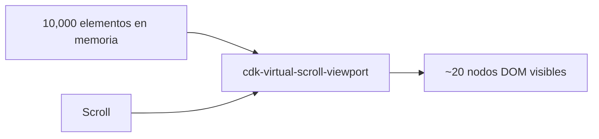

# Angular Material y CDK

Parte de: [[20-Angular/03 Avanzado/_Índice Avanzado|Avanzado]]

> [!info] Cómo avanzar
> `progreso`: **pendiente** → **viendo** (estudiando) → **visto** (contestaste la autoevaluación sin abrir las respuestas) → **dominado** (hiciste el laboratorio o lo aplicaste de verdad).

## Contenido

### Qué es
- **Angular Material** (`@angular/material`) es la librería oficial de componentes de UI basada en **Material Design 3**: botones, campos de formulario, tablas, diálogos, menús, selectores de fecha, paginadores, etc., accesibles y con temas configurables.
- **Angular CDK** (*Component Dev Kit*, `@angular/cdk`) es la capa de **comportamientos sin estilo** sobre la que Material está construido: overlays, drag and drop, *virtual scroll*, accesibilidad (foco, teclado), tablas, *portals*, observadores de layout. Puedes usarlo para construir tus propios componentes con tu diseño.

Además, Angular 22 hizo disponible de forma general **Angular Aria** (`@angular/aria`), directivas *headless* de accesibilidad para crear componentes propios. En React, lo comparable sería MUI (Material) frente a Radix o React Aria (CDK/Aria).

### Cómo funciona
#### Agregarlo
```bash
ng add @angular/material
```
El esquema instala `@angular/material` y `@angular/cdk`, te pide elegir un tema (o personalizarlo), y configura tipografía y estilos globales. Después importas en cada componente solo lo que usas, por ejemplo `MatButtonModule`, `MatTableModule` o componentes standalone como `MatButton`.

#### Temas
El tema se define en Sass con la API de Material 3 (`mat.theme(...)`), indicando paletas de color, tipografía y densidad; genera variables CSS que todos los componentes usan. Puedes tener modo claro/oscuro con `color-scheme`.

#### Piezas del CDK más útiles
| Módulo | Para qué |
|---|---|
| `ScrollingModule` | Virtual scroll: dibujar solo lo visible de listas enormes |
| `DragDropModule` | Arrastrar y soltar, reordenar listas, tableros tipo Kanban |
| `Overlay` | Paneles flotantes posicionados (menús, tooltips propios) |
| `A11yModule` | Trampa de foco en diálogos, anuncios para lectores de pantalla |
| `CdkTable` | Tabla sin estilo con la misma API que `mat-table` |
| `BreakpointObserver` | Reaccionar a tamaños de pantalla desde TypeScript |

#### Mostrar 10,000 filas sin trabar la página
Con `@for` normal se crearían 10,000 nodos de DOM; el navegador se vuelve lento. El **virtual scroll** del CDK (`cdk-virtual-scroll-viewport`) mantiene en el DOM solo los elementos visibles más un pequeño margen, y los reutiliza al desplazarte. Necesita conocer la altura de cada elemento (`itemSize`). Otra opción es **paginar** en el servidor con `mat-paginator`, que además reduce lo que viaja por la red.



### Ejemplo
Lista virtual de movimientos y un botón de Material:

```ts
import { Component, signal } from '@angular/core';
import { ScrollingModule } from '@angular/cdk/scrolling';
import { MatButtonModule } from '@angular/material/button';
import { CurrencyPipe } from '@angular/common';

interface Movimiento { id: number; concepto: string; importe: number; }

@Component({
  selector: 'app-movimientos',
  imports: [ScrollingModule, MatButtonModule, CurrencyPipe],
  template: `
    <button mat-flat-button (click)="exportar()">Exportar a Excel</button>
    <cdk-virtual-scroll-viewport itemSize="48" class="visor">
      <div *cdkVirtualFor="let m of movimientos(); trackBy: porId" class="fila">
        {{ m.concepto }} — {{ m.importe | currency: 'MXN' }}
      </div>
    </cdk-virtual-scroll-viewport>
  `,
  styles: `.visor { height: 480px; } .fila { height: 48px; }`,
})
export class Movimientos {
  protected movimientos = signal<Movimiento[]>(
    Array.from({ length: 10_000 }, (_, i) => ({ id: i, concepto: `Movimiento ${i + 1}`, importe: i * 10 })),
  );
  protected porId = (_: number, m: Movimiento) => m.id;
  exportar() { /* llamar al API de Wee.Reporteria */ }
}
```

Nota: `*cdkVirtualFor` es una directiva estructural del CDK; el control flow `@for` no se usa dentro del visor virtual.

### Cuándo usarlo y cuándo no
- **Material**: aplicaciones internas y back-offices donde la consistencia y la accesibilidad importan más que un diseño único. Ahorra semanas.
- **CDK o Angular Aria**: cuando tienes un sistema de diseño propio (o Tailwind) pero no quieres reimplementar foco, teclado, overlays o virtual scroll.
- **Otras librerías** (PrimeNG, Kendo, Syncfusion) si necesitas componentes más especializados como *grids* empresariales; evalúa licencias y costo.
- Evita mezclar varias librerías de UI en la misma app.

### Errores comunes
- **Instalar con `npm install` en lugar de `ng add`**: falta la configuración de tema y los componentes se ven sin estilo.
- **Importar todos los módulos de Material** en un archivo compartido: aumenta el bundle; importa por componente.
- **Virtual scroll con alturas variables** usando `itemSize` fijo: saltos al desplazarse; normaliza la altura o usa paginación.
- **Sobrescribir estilos internos con selectores profundos** (`::ng-deep`): se rompe en cada actualización; usa las variables y *tokens* del tema.

### Para profundizar
- [Angular Material](https://material.angular.dev)
- [CDK: scrolling (virtual scroll)](https://material.angular.dev/cdk/scrolling/overview)
- [Angular Material: guía de temas](https://material.angular.dev/guide/theming)

## Autoevaluación

Contesta primero en voz alta o en papel; luego despliega la respuesta.

> [!question]- ¿Qué diferencia hay entre Angular Material y el CDK?
> **Material**: componentes listos con diseño Material (botones, tablas, diálogos, formularios). **CDK**: comportamientos sin estilos para construir los tuyos (drag & drop, overlay, accesibilidad, virtual scroll, layout).

> [!question]- ¿Cómo lo agregas a un proyecto?
> `ng add @angular/material`: instala paquetes, configura el tema y la tipografía.

> [!question]- ¿Qué usarías para mostrar 10,000 filas sin que se trabe la página?
> `cdk-virtual-scroll-viewport` del CDK (renderiza solo lo visible) o paginación con `MatPaginator`.

