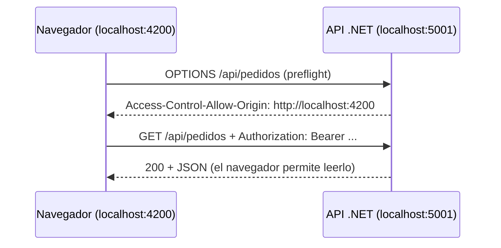

# Angular con un API .NET (autenticación y CORS)

Parte de: [[20-Angular/03 Avanzado/_Índice Avanzado|Avanzado]]

> [!info] Cómo avanzar
> `progreso`: **pendiente** → **viendo** (estudiando) → **visto** (contestaste la autoevaluación sin abrir las respuestas) → **dominado** (hiciste el laboratorio o lo aplicaste de verdad).

## Contenido

### Qué es
Conectar una aplicación Angular con un API de ASP.NET Core implica resolver dos temas: **CORS**, la política del navegador que decide si una página puede llamar a un servidor de otro origen, y **autenticación**, cómo obtener, guardar y enviar las credenciales (normalmente un JWT emitido por un servidor de identidad como Xolotl.Hecate con OAuth 2.0 + PKCE). Es exactamente el mismo problema que ya resolviste en Itzamna.Clio con React.

### Cómo funciona
#### Por qué falla `localhost:4200` → `localhost:5001`
Un **origen** es la combinación de esquema, host y puerto. `http://localhost:4200` y `https://localhost:5001` son orígenes distintos (cambian esquema y puerto). Por seguridad, el navegador aplica la **política del mismo origen**: permite enviar la petición, pero **bloquea que JavaScript lea la respuesta** salvo que el servidor la autorice con encabezados `Access-Control-Allow-Origin`. Con `Authorization` o JSON, el navegador primero manda una petición **preflight** `OPTIONS`; si el API no responde con los encabezados correctos, la llamada falla. En Angular lo verás como `HttpErrorResponse` con **`status` 0** y en consola un mensaje de CORS. CORS no lo arregla Angular: lo configura el servidor.



#### Habilitar CORS en ASP.NET Core
```csharp
// Program.cs
const string PoliticaFront = "Front";

builder.Services.AddCors(o => o.AddPolicy(PoliticaFront, p => p
    .WithOrigins(builder.Configuration.GetSection("Cors:Origenes").Get<string[]>() ?? [])
    .AllowAnyHeader()
    .AllowAnyMethod()));

var app = builder.Build();
app.UseHttpsRedirection();
app.UseCors(PoliticaFront);   // antes de autenticación y autorización
app.UseAuthentication();
app.UseAuthorization();
app.MapControllers();
```

```json
// appsettings.Development.json
{ "Cors": { "Origenes": [ "http://localhost:4200" ] } }
```

Lista orígenes explícitos por ambiente; no uses `AllowAnyOrigin()` en producción, y nunca junto con `AllowCredentials()` (el navegador lo rechaza).

#### Alternativa en desarrollo: el proxy del CLI
El servidor de desarrollo de Angular puede reenviar las peticiones `/api` al backend. Para el navegador todo es el mismo origen (`localhost:4200`), así que no hay CORS:

```json
// proxy.conf.json
{
  "/api": { "target": "https://localhost:5001", "secure": false, "changeOrigin": true }
}
```

En `angular.json`, dentro de `serve.options`: `"proxyConfig": "proxy.conf.json"`. En el código usas rutas relativas (`/api/pedidos`). En producción puedes replicar el mismo esquema sirviendo front y API bajo el mismo dominio (por ejemplo, Azure Front Door o rutas en el mismo App Service), o configurar CORS.

#### Dónde guardar el token
| Opción | Ventajas | Riesgos |
|---|---|---|
| `localStorage` / `sessionStorage` | Simple, funciona con cualquier API | Cualquier script inyectado (XSS) puede leerlo y robarlo |
| Memoria (señal en un servicio) | No queda en disco | Se pierde al recargar; requiere *silent refresh* |
| Cookie **HttpOnly** + `Secure` + `SameSite` | JavaScript no puede leerla; mitiga robo por XSS | Requiere protección CSRF, mismo sitio o configuración `AllowCredentials`; más trabajo en el servidor |

La recomendación actual para SPAs (patrón **BFF**, *Backend for Frontend*) es que el front **no maneje tokens**: un backend propio hace el flujo OAuth con PKCE, guarda los tokens del lado del servidor y entrega al navegador una cookie de sesión HttpOnly. Si el front debe tener el token (flujo PKCE en el navegador), mantenlo en memoria, con vida corta y refresh rotativo, y evita `localStorage` para datos sensibles.

### Ejemplo
Front con cookie de sesión (BFF) y sin interceptor de token:

```ts
// core/http/credenciales.interceptor.ts
export const credencialesInterceptor: HttpInterceptorFn = (req, next) =>
  req.url.startsWith('/api') ? next(req.clone({ withCredentials: true })) : next(req);
```

Si en lugar de BFF usas un access token en memoria, el [[Interceptores HTTP|interceptor de autenticación]] agrega `Authorization: Bearer` solo a tu API, y el API valida el JWT RS256 con `AddJwtBearer` apuntando al emisor de Xolotl.Hecate.

### Cuándo usarlo y cuándo no
- **Proxy del CLI**: desarrollo local; evita configurar CORS mientras programas.
- **CORS con orígenes explícitos**: cuando front y API viven en dominios distintos en producción.
- **BFF con cookie HttpOnly**: apps con datos sensibles o requisitos de seguridad altos.
- **Token en memoria + PKCE**: cuando no puedes tener un BFF; usa una librería OIDC certificada en lugar de implementar el flujo a mano.

### Errores comunes
- **Intentar arreglar CORS desde Angular** (agregando encabezados `Access-Control-*` a la petición): son encabezados de respuesta; se configuran en el API.
- **`UseCors` en el orden equivocado** (después de `UseAuthorization` o de `MapControllers`): el preflight recibe 401 o no lleva encabezados.
- **`AllowAnyOrigin` con credenciales**: el navegador rechaza la respuesta.
- **Guardar el refresh token en `localStorage`**: un XSS da acceso prolongado a la cuenta.
- **Olvidar `withCredentials`** al usar cookies entre orígenes: la cookie no viaja.

### Para profundizar
- [ASP.NET Core: habilitar CORS](https://learn.microsoft.com/aspnet/core/security/cors)
- [Angular: proxy al backend con ng serve](https://angular.dev/tools/cli/serve#proxying-to-a-backend-server)
- [MDN: CORS](https://developer.mozilla.org/es/docs/Web/HTTP/CORS)
- [IETF: OAuth 2.0 for Browser-Based Applications](https://datatracker.ietf.org/doc/draft-ietf-oauth-browser-based-apps/)

## Autoevaluación

Contesta primero en voz alta o en papel; luego despliega la respuesta.

> [!question]- ¿Por qué falla la llamada de `http://localhost:4200` a `https://localhost:5001`?
> Son orígenes distintos (puerto y esquema): el navegador aplica **CORS** y bloquea la respuesta si el API no envía `Access-Control-Allow-Origin` para ese origen.

> [!question]- ¿Cómo habilitas CORS en ASP.NET Core?
> ```csharp
> builder.Services.AddCors(o => o.AddPolicy("Angular", p => p
>     .WithOrigins("http://localhost:4200")
>     .AllowAnyHeader()
>     .AllowAnyMethod()));
> // …
> app.UseCors("Angular");
> ```
> `UseCors` va antes de `UseAuthentication`/`UseAuthorization` y del mapeo de endpoints.

> [!question]- ¿Qué alternativa hay en desarrollo sin tocar CORS?
> El proxy del servidor de desarrollo: un `proxy.conf.json` que reenvíe `/api` al backend y `ng serve --proxy-config proxy.conf.json`. Para el navegador todo es del mismo origen.

> [!question]- ¿Dónde guardar el token JWT: `localStorage` o cookie HttpOnly?
> `localStorage` es simple pero accesible por cualquier script (riesgo con XSS). Una cookie **HttpOnly** no la lee JavaScript, pero necesita protección CSRF y `withCredentials`; en CORS no se combina `AllowCredentials()` con cualquier origen.

