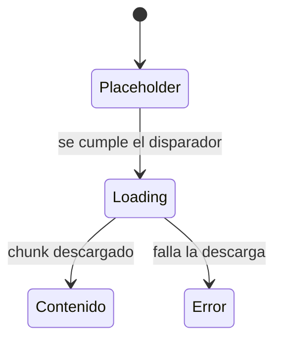

# Deferrable views (@defer)

Parte de: [[20-Angular/03 Avanzado/_Índice Avanzado|Avanzado]]

> [!info] Cómo avanzar
> `progreso`: **pendiente** → **viendo** (estudiando) → **visto** (contestaste la autoevaluación sin abrir las respuestas) → **dominado** (hiciste el laboratorio o lo aplicaste de verdad).

## Contenido

### Qué es
`@defer` es un bloque de plantilla que **retrasa la carga** de una parte de la vista: el código de los componentes, directivas y pipes que hay dentro se separa en un chunk aparte y solo se descarga y renderiza cuando se cumple un **disparador** (entra en pantalla, el navegador está ocioso, el usuario interactúa, etc.). Es como `React.lazy` + `Suspense`, pero declarado directamente en la plantilla y con disparadores integrados. Es estable desde Angular 17.

### Cómo funciona
```html
@defer (on viewport) {
  <app-grafica-ventas />
} @placeholder (minimum 300ms) {
  <div class="caja-gris">Gráfica de ventas</div>
} @loading (after 100ms; minimum 500ms) {
  <app-spinner />
} @error {
  <p>No se pudo cargar la gráfica.</p>
}
```

#### Bloques auxiliares
- **`@placeholder`**: lo que se muestra **antes** de que se active el disparador. Su contenido se carga de inmediato (no es diferido). Con `on viewport` u `on interaction`, el placeholder es el elemento que Angular observa. `minimum` evita parpadeos.
- **`@loading`**: lo que se muestra **mientras** se descarga el chunk. `after` evita mostrarlo si la carga es muy rápida; `minimum` lo mantiene un tiempo mínimo.
- **`@error`**: si la descarga falla (red, despliegue nuevo).

#### Disparadores (`on`)
| Disparador | Se activa cuando |
|---|---|
| `on idle` (por defecto) | El navegador está ocioso (`requestIdleCallback`); desde v22 acepta tiempo máximo: `on idle(500ms)` |
| `on viewport` | El placeholder (o un elemento referenciado) entra en pantalla; desde v21 acepta opciones de `IntersectionObserver` |
| `on interaction` | El usuario hace clic o presiona una tecla sobre el elemento |
| `on hover` | El mouse pasa por encima o recibe foco |
| `on immediate` | Inmediatamente después del render inicial |
| `on timer(2s)` | Tras un tiempo |
| `when condicion()` | Una expresión se vuelve verdadera (una sola vez) |

Además existe `prefetch on ...` para **descargar** el código antes de **mostrarlo**: `@defer (on interaction; prefetch on idle)` descarga en tiempo ocioso y muestra al hacer clic. Con SSR, `hydrate on ...` controla la hidratación incremental (ver [[SSR e hidratación en Angular]]).



### Ejemplo
Tablero de Wee.Reporteria con una tabla pesada y un editor que solo se carga si el usuario lo abre:

```ts
@Component({
  selector: 'app-tablero',
  imports: [TablaVentas, EditorFiltros, Spinner],
  template: `
    <h1>Ventas del mes</h1>
    <app-resumen [datos]="resumen()" />

    @defer (on viewport; prefetch on idle) {
      <app-tabla-ventas [filas]="filas()" />
    } @placeholder {
      <div style="height: 400px">Desplázate para ver el detalle</div>
    } @loading (after 150ms) {
      <app-spinner />
    }

    <button #abrir>Filtros avanzados</button>
    @defer (on interaction(abrir)) {
      <app-editor-filtros />
    }
  `,
})
export class Tablero { /* ... */ }
```

Comprueba en la salida de `ng build` que `TablaVentas` y `EditorFiltros` aparezcan como *lazy chunks*.

### Cuándo usarlo y cuándo no
- **Sí**: componentes pesados bajo el pliegue (gráficas, mapas, editores enriquecidos), paneles que se abren con un clic, widgets secundarios (comentarios, recomendaciones).
- **No**: contenido visible al cargar la página ("above the fold"); diferirlo empeora la experiencia y métricas como LCP, y puede causar saltos de diseño (CLS) si el placeholder no reserva el espacio.
- Para secciones enteras navegables, usa [[Lazy loading de rutas]].

### Errores comunes
- **El componente no se separa en otro chunk**: solo se difieren dependencias **standalone** que **no se usan fuera** del bloque `@defer` en ese mismo componente y **no se importan de forma estática** en otra parte (por ejemplo, referenciadas con `viewChild` en la clase o importadas por otro componente que se carga de inmediato). Si se usan en cualquier otro lugar ya cargado, entran al bundle principal.
- **Placeholder sin altura**: la página "brinca" al cargar el contenido.
- **`on viewport` sin placeholder**: no hay elemento que observar; agrega `@placeholder` o una referencia.
- **Diferir lo crítico**: el usuario ve cajas grises en lo que más le importa.

### Para profundizar
- [Angular: deferrable views (@defer)](https://angular.dev/guide/templates/defer)
- [API de @defer](https://angular.dev/api/core/@defer)
- [web.dev: Core Web Vitals](https://web.dev/articles/vitals)

## Autoevaluación

Contesta primero en voz alta o en papel; luego despliega la respuesta.

> [!question]- ¿Qué hace `@defer`?
> Carga de forma diferida (en otro chunk) una parte de la plantilla y sus dependencias, según un disparador.

> [!question]- ¿Qué disparadores existen?
> `on idle` (predeterminado), `on viewport`, `on interaction`, `on hover`, `on immediate`, `on timer(2s)` y `when <condición>`. También `prefetch on …` para descargar antes de mostrar.

> [!question]- ¿Para qué sirven `@placeholder`, `@loading` y `@error`?
> Contenido antes de que empiece la carga, durante la carga y si falla. Ejemplo:
> ```html
> @defer (on viewport) {
>   <app-grafica />
> } @placeholder {
>   <p>Gráfica</p>
> } @loading (minimum 300ms) {
>   <p>Cargando…</p>
> }
> ```

> [!question]- Error común: el componente dentro de `@defer` no se separa en otro chunk. ¿Por qué?
> Las dependencias deben ser standalone y **no** usarse fuera del bloque `@defer` en el mismo componente (ni importarse en otra parte del bundle inicial).

