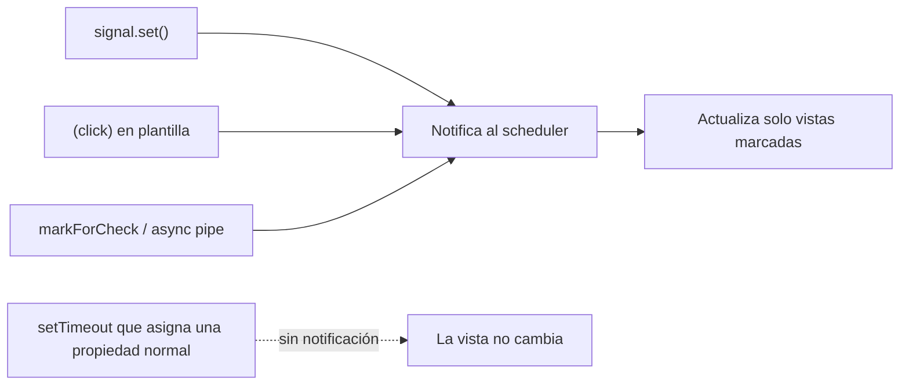

# Detección de cambios y zoneless

Parte de: [[20-Angular/03 Avanzado/_Índice Avanzado|Avanzado]]

> [!info] Cómo avanzar
> `progreso`: **pendiente** → **viendo** (estudiando) → **visto** (contestaste la autoevaluación sin abrir las respuestas) → **dominado** (hiciste el laboratorio o lo aplicaste de verdad).

## Contenido

### Qué es
La **detección de cambios** es el proceso con que Angular decide **cuándo** y **qué** partes del DOM actualizar después de que cambia el estado. Durante años, Angular dependió de la librería **Zone.js** para saber "cuándo": interceptaba toda operación asíncrona del navegador y, al terminar cualquiera, revisaba el árbol de componentes. Una aplicación **zoneless** prescinde de Zone.js: Angular solo actualiza cuando recibe una notificación explícita, principalmente de **señales**. Desde **Angular 21 las aplicaciones nuevas son zoneless por defecto**.

En React no existe este dilema: el re-render se dispara siempre con `setState`. Zoneless acerca a Angular a ese modelo explícito, pero con granularidad más fina.

### Cómo funciona
#### Con Zone.js (modelo clásico)
Zone.js "parchea" `setTimeout`, `addEventListener`, `Promise`, `XMLHttpRequest`, etc. Cuando cualquier tarea asíncrona termina, avisa a Angular, que recorre el árbol de componentes y compara los bindings (*dirty checking*). Ventaja: "magia", todo se actualiza aunque asignes una propiedad común. Desventajas: más peso en el bundle, revisiones innecesarias, trazas de error confusas y comportamientos difíciles de depurar.

#### Zoneless
Angular programa una actualización solo cuando ocurre una de estas notificaciones:
1. Cambia una **señal** leída en una plantilla.
2. Se ejecuta un **listener de evento** de la plantilla o del `host` (`(click)`).
3. Se llama `ChangeDetectorRef.markForCheck()` (lo hace el pipe `async` al recibir valores).
4. Se cambia un input con `ComponentRef.setInput()`, o se adjunta/quita una vista.



Configuración:
- Proyectos nuevos (v21+): zoneless sin configurar nada; `zone.js` ni siquiera está en `polyfills`.
- Para volver a Zone.js: `provideZoneChangeDetection()` en `app.config.ts` (la migración de `ng update` lo agrega a apps existentes que lo necesitan).
- En versiones 20 y anteriores, zoneless se activaba con `provideZonelessChangeDetection()`.

### Ejemplo
El problema típico: en una app zoneless, esto **no** actualiza la vista:

```ts
@Component({ selector: 'app-aviso', template: `<p>{{ mensaje }}</p>` })
export class Aviso {
  mensaje = 'Procesando…';
  constructor() {
    setTimeout(() => (this.mensaje = 'Listo'), 1000); // nadie avisa a Angular
  }
}
```

La corrección recomendada es usar una señal:

```ts
@Component({ selector: 'app-aviso', template: `<p>{{ mensaje() }}</p>` })
export class Aviso {
  protected mensaje = signal('Procesando…');
  constructor() {
    setTimeout(() => this.mensaje.set('Listo'), 1000); // la señal notifica
  }
}
```

Alternativa (para código heredado): inyectar `ChangeDetectorRef` y llamar `markForCheck()` después de la asignación.

#### Pruebas en zoneless
En pruebas de componentes, en lugar de depender de `fixture.detectChanges()` en todos lados, se usa `await fixture.whenStable()` para esperar a que Angular aplique las actualizaciones programadas (ver [[Pruebas en Angular (unitarias y de componentes)]]).

### Cuándo usarlo y cuándo no
- **Zoneless**: todo proyecto nuevo y cualquier app que ya use señales y `OnPush` de forma consistente. Gana rendimiento, bundle más pequeño y depuración más clara.
- **Mantener Zone.js**: apps grandes con mucho código que asigna propiedades desde callbacks, `setTimeout` o librerías de terceros que dependen de Zone.js. Migra pantalla por pantalla: primero convierte el estado a señales y [[OnPush y rendimiento|OnPush]], luego quita Zone.js.
- Librerías antiguas que usan `NgZone.onStable` u `onMicrotaskEmpty` no funcionan igual sin Zone.js; revisa su compatibilidad.

### Errores comunes
- **Asignar propiedades normales en callbacks asíncronos** (`setTimeout`, `subscribe`, eventos de una librería) y esperar que se vea. Usa señales, `toSignal` o el pipe `async`.
- **Llamar `detectChanges()` por todos lados** para "arreglar" la vista: tapa el problema de diseño.
- **Quitar Zone.js sin probar**: pantallas que "se congelan" sin error en consola. Activa primero `OnPush` y revisa cada flujo.
- **Confundir zoneless con OnPush**: son cosas distintas; OnPush decide *qué* componentes revisar, zoneless decide *cuándo* hay que revisar.

### Para profundizar
- [Angular: zoneless](https://angular.dev/guide/zoneless)
- [Angular: saltar subárboles con OnPush](https://angular.dev/best-practices/skipping-subtrees)
- [API de ChangeDetectorRef](https://angular.dev/api/core/ChangeDetectorRef)

## Autoevaluación

Contesta primero en voz alta o en papel; luego despliega la respuesta.

> [!question]- ¿Qué es la detección de cambios?
> El proceso con que Angular revisa los componentes y actualiza el DOM cuando cambia el estado.

> [!question]- ¿Qué hacía Zone.js?
> Interceptaba las APIs asíncronas del navegador (eventos, `setTimeout`, promesas, XHR) para avisar a Angular que revisara **toda** la app después de cada una.

> [!question]- ¿Qué significa zoneless?
> Angular sin Zone.js: la revisión se agenda por señales que cambian, eventos de plantilla, `async` o `markForCheck()`. Se activa con `provideZonelessChangeDetection()` (los proyectos nuevos ya pueden venir así). Resultado: bundles más chicos y menos trabajo.

> [!question]- En una app zoneless, `setTimeout(() => this.mensaje = 'Listo', 1000)` no actualiza la vista. ¿Cómo se corrige?
> Convertir `mensaje` en señal (`this.mensaje.set('Listo')`) o llamar a `ChangeDetectorRef.markForCheck()`.

