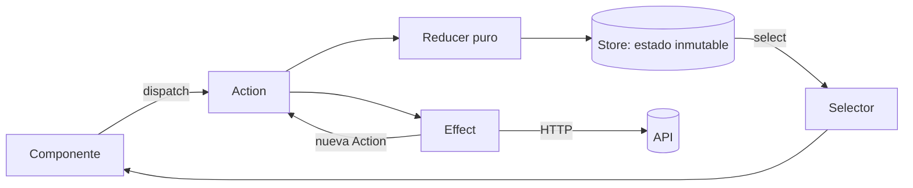

# Estado global (NgRx y Signal Store)

Parte de: [[20-Angular/03 Avanzado/_Índice Avanzado|Avanzado]]

> [!info] Cómo avanzar
> `progreso`: **pendiente** → **viendo** (estudiando) → **visto** (contestaste la autoevaluación sin abrir las respuestas) → **dominado** (hiciste el laboratorio o lo aplicaste de verdad).

## Contenido

### Qué es
El **estado global** es la información que comparten muchas partes de la aplicación: el usuario en sesión, el carrito, los permisos, catálogos, preferencias. En Angular lo más simple es un **servicio con señales**; cuando la aplicación crece, se recurre a librerías como **NgRx**, que ofrece dos opciones: **NgRx Store** (patrón Redux) y **NgRx Signal Store** (`@ngrx/signals`, basado en señales). Es el equivalente a elegir entre Context + `useReducer`, Redux Toolkit o Zustand en React.

### Cómo funciona
#### ¿Cuándo hace falta?
Necesitas algo más que un servicio cuando:
- Muchos componentes lejanos leen y modifican el mismo estado.
- Hay reglas complejas de actualización o efectos encadenados (al guardar, refrescar tres listas y notificar).
- El equipo es grande y quieres un patrón uniforme, trazable y con herramientas de depuración (*time travel*).
- Necesitas caché de entidades, estados de carga por recurso y sincronización con el servidor.

Si nada de eso aplica, un servicio con señales privadas y `asReadonly()` es suficiente y mucho más simple.

#### NgRx Store (Redux)

- **Actions**: eventos con nombre (`[Productos] Cargar`), creados con `createActionGroup`.
- **Reducers**: funciones puras que calculan el nuevo estado a partir del anterior y la acción.
- **Selectors**: funciones memoizadas para leer partes del estado (`store.selectSignal(selector)` las entrega como señal).
- **Effects**: escuchan acciones y ejecutan efectos (HTTP), y despachan nuevas acciones con el resultado.
- **Store DevTools**: inspección en la extensión Redux DevTools.

Es muy predecible, pero verboso: una funcionalidad simple implica varios archivos.

#### NgRx Signal Store
Una forma más ligera y basada en señales de construir un *store* como un servicio inyectable, componiendo "features":
- `withState`: estado inicial.
- `withComputed`: derivados (`computed`).
- `withMethods`: métodos que modifican el estado con `patchState`, y `rxMethod` para flujos RxJS.
- `withHooks`: lógica al crear o destruir el store.
- Extensiones como `withEntities` para colecciones.

### Ejemplo
Store del carrito con Signal Store:

```ts
// carrito/carrito.store.ts
import { computed, inject } from '@angular/core';
import { patchState, signalStore, withComputed, withMethods, withState } from '@ngrx/signals';
import { Producto } from '../productos/producto';

interface CarritoState { items: Producto[]; cargando: boolean; }

export const CarritoStore = signalStore(
  { providedIn: 'root' },
  withState<CarritoState>({ items: [], cargando: false }),
  withComputed(({ items }) => ({
    total: computed(() => items().reduce((s, p) => s + p.precio, 0)),
    cantidad: computed(() => items().length),
  })),
  withMethods(store => ({
    agregar(p: Producto) {
      patchState(store, s => ({ items: [...s.items, p] }));
    },
    vaciar() {
      patchState(store, { items: [] });
    },
  })),
);
```

```ts
@Component({
  selector: 'app-resumen',
  template: `{{ carrito.cantidad() }} artículos · {{ carrito.total() }}`,
})
export class Resumen {
  protected carrito = inject(CarritoStore);
}
```

Comparado con un servicio de señales, ganas una estructura estándar, `patchState` inmutable, extensiones (entidades, DevTools) y menos código repetitivo cuando hay muchos stores.

### Cuándo usarlo y cuándo no
| Situación | Opción |
|---|---|
| Estado de una sola pantalla | Señales en el componente |
| Pocos datos compartidos | Servicio con señales |
| Varias features con estado rico, equipo mediano | NgRx Signal Store |
| App muy grande, auditoría de cada cambio, equipo acostumbrado a Redux | NgRx Store |

No adoptes NgRx Store "porque es lo empresarial": su costo de ceremonia es real. Empieza por servicios y sube de nivel cuando duela.

### Errores comunes
- **Meter todo en el store global**, incluso el estado de un formulario: acopla pantallas y complica pruebas.
- **Mutar el estado** en lugar de usar `patchState` con copias.
- **Duplicar datos del servidor** sin estrategia de invalidación: listas desactualizadas.
- **Mezclar varias soluciones** (BehaviorSubject en un lado, Store en otro) para el mismo dato.

### Para profundizar
- [NgRx Store](https://ngrx.io/guide/store)
- [NgRx Signal Store](https://ngrx.io/guide/signals/signal-store)
- [Angular: signals](https://angular.dev/guide/signals)

## Autoevaluación

Contesta primero en voz alta o en papel; luego despliega la respuesta.

> [!question]- ¿Cuándo necesitas una solución de estado global?
> Cuando muchas partes de la app leen y modifican el mismo estado, hay flujos complejos o necesitas trazabilidad. En apps pequeñas basta un servicio con señales.

> [!question]- ¿Cuáles son las piezas de NgRx Store?
> **Actions** (qué pasó), **reducers** (funciones puras que calculan el nuevo estado), **selectors** (leen porciones del estado) y **effects** (efectos secundarios como llamadas HTTP).

> [!question]- ¿Qué es NgRx Signal Store?
> Una forma más ligera basada en señales:
> ```ts
> export const CarritoStore = signalStore(
>   { providedIn: 'root' },
>   withState({ items: [] as Item[] }),
>   withComputed(({ items }) => ({ total: computed(() => items().length) })),
>   withMethods(store => ({ vaciar: () => patchState(store, { items: [] }) })),
> );
> ```

