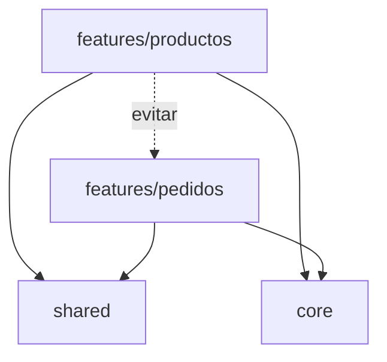

# Estructura de carpetas por feature en Angular

Parte de: [[20-Angular/03 Avanzado/_Índice Avanzado|Avanzado]]

> [!info] Cómo avanzar
> `progreso`: **pendiente** → **viendo** (estudiando) → **visto** (contestaste la autoevaluación sin abrir las respuestas) → **dominado** (hiciste el laboratorio o lo aplicaste de verdad).

## Contenido

### Qué es
**Organizar por feature** significa agrupar el código según la **funcionalidad de negocio** que resuelve (productos, pedidos, clientes, reportes) en lugar de por tipo técnico (todos los componentes juntos, todos los servicios juntos). Cada carpeta de feature contiene sus componentes, servicios, modelos, rutas y pruebas. Es la misma idea que la **arquitectura vertical slice** que ya usas en tus APIs .NET, aplicada al front-end, y la que recomienda la guía de estilo de Angular.

### Cómo funciona
Estructura típica:

```text
src/app/
├─ core/                     una sola vez para toda la app
│  ├─ auth/                  AuthService, sesionGuard, authInterceptor
│  ├─ http/                  errorInterceptor, API_URL token, ProblemDetails
│  ├─ layout/                Shell, Menu, Encabezado
│  └─ error-handler.ts
├─ shared/                   reutilizable y sin lógica de negocio
│  ├─ ui/                    Boton, Tarjeta, Spinner, ConfirmDialog
│  ├─ pipes/                 InicialesPipe, RelativoPipe
│  └─ validators/            rfc, curp, passwordsIguales
├─ features/
│  ├─ productos/
│  │  ├─ productos.routes.ts
│  │  ├─ data/               productos-api.ts, producto.ts, productos.store.ts
│  │  ├─ lista/              lista.ts, lista.html, lista.spec.ts
│  │  └─ detalle/
│  └─ pedidos/
│     ├─ pedidos.routes.ts
│     └─ ...
├─ app.routes.ts
├─ app.config.ts
└─ app.ts
```

#### Qué va en `core/`
Lo que la aplicación necesita **una sola vez** y se configura al arrancar: autenticación, interceptores, manejador de errores global, el *layout* principal (shell, menú), servicios singleton de infraestructura (configuración, logging, notificaciones). Ninguna feature debería tener su propia copia de esto.

#### Qué va en `shared/`
Piezas **reutilizables y genéricas** que usan varias features: componentes de presentación (botones, tarjetas, diálogos), pipes, directivas, validadores, utilidades. Regla: `shared/` no conoce a ninguna feature ni llama al API de negocio. Si algo solo lo usa una feature, vive dentro de esa feature.

#### Reglas de dependencia

Las features dependen de `core` y `shared`, no entre sí. Si pedidos necesita datos de productos, extrae lo común (por ejemplo, el modelo y el API de lectura) o comunícalas a través de rutas o de un store compartido.

#### Features + lazy loading
Cada feature expone un archivo de rutas (`productos.routes.ts`) que `app.routes.ts` carga con `loadChildren`. Así:
- Cada feature se convierte en un **chunk** independiente: el usuario solo descarga lo que visita.
- Los límites de carpeta coinciden con los límites del bundle, lo que hace evidente cuando una feature importa algo de otra (rompería la separación).
- Puedes proteger cada feature con `canMatch` según el rol.
- Equipos distintos pueden trabajar en features distintas con menos conflictos.

### Ejemplo
```ts
// app.routes.ts
export const routes: Routes = [
  {
    path: '',
    component: Shell, // core/layout
    canActivate: [sesionGuard],
    children: [
      { path: 'productos', loadChildren: () => import('./features/productos/productos.routes') },
      { path: 'pedidos', loadChildren: () => import('./features/pedidos/pedidos.routes') },
      {
        path: 'reportes',
        canMatch: [rolGuard('Finanzas')],
        loadChildren: () => import('./features/reportes/reportes.routes'),
      },
    ],
  },
  { path: 'login', loadComponent: () => import('./core/auth/login/login') },
];
```

```ts
// features/productos/productos.routes.ts
import { Routes } from '@angular/router';
export default [
  { path: '', loadComponent: () => import('./lista/lista').then(m => m.Lista) },
  { path: ':id', loadComponent: () => import('./detalle/detalle').then(m => m.Detalle) },
] satisfies Routes;
```

### Cuándo usarlo y cuándo no
- **Siempre** que la app tenga más de dos o tres pantallas; es el estándar actual.
- En apps diminutas (una pantalla) basta con `src/app` plano.
- En monorepos grandes, cada feature puede ser una librería separada (Nx), con reglas de dependencia verificadas por herramienta.
- Nombres en el idioma del negocio; coherentes con tu API (si el API tiene el slice `Pedidos`, la feature también).

### Errores comunes
- **`shared/` convertido en cajón de sastre** con lógica de negocio: todo depende de todo.
- **Features que se importan entre sí**: rompe el lazy loading (el código de una entra en el chunk de otra) y crea acoplamiento.
- **Archivos barril (`index.ts`) gigantes** que reexportan todo: dificultan el *tree shaking* y pueden meter código perezoso en el bundle inicial.
- **Carpetas por tipo** (`components/`, `services/`) en apps grandes: para cambiar una funcionalidad hay que tocar cinco carpetas.

### Para profundizar
- [Angular: guía de estilo](https://angular.dev/style-guide)
- [Angular: estrategias de carga de rutas](https://angular.dev/guide/routing/loading-strategies)

## Autoevaluación

Contesta primero en voz alta o en papel; luego despliega la respuesta.

> [!question]- ¿Qué es organizar por feature?
> Agrupar por funcionalidad de negocio (`features/productos`, `features/pedidos`) en lugar de por tipo de archivo (todos los servicios juntos). Cada feature tiene sus componentes, servicios y rutas.

> [!question]- ¿Qué suele ir en `core/` y en `shared/`?
> `core/`: piezas únicas de la app (interceptores, guards, servicio de auth, layout). `shared/`: componentes, pipes y directivas reutilizables sin lógica de negocio.

> [!question]- ¿Qué ventaja tiene combinar features con lazy loading?
> Cada feature expone su archivo de rutas y se carga con `loadChildren`: el código queda aislado y la carga inicial es más ligera.

