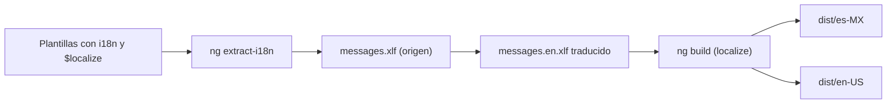

# Internacionalización en Angular

Parte de: [[20-Angular/03 Avanzado/_Índice Avanzado|Avanzado]]

> [!info] Cómo avanzar
> `progreso`: **pendiente** → **viendo** (estudiando) → **visto** (contestaste la autoevaluación sin abrir las respuestas) → **dominado** (hiciste el laboratorio o lo aplicaste de verdad).

## Contenido

### Qué es
La **internacionalización (i18n)** prepara la aplicación para varios idiomas y regiones: textos traducidos, formatos de fecha, moneda y números, plurales y dirección del texto. La **localización** es producir cada versión concreta (por ejemplo `es-MX`, `en-US`). Angular trae una solución integrada (`@angular/localize`) que traduce en **tiempo de build**; también existen librerías que traducen en tiempo de ejecución, como Transloco o ngx-translate (en React lo comparable es react-i18next).

### Cómo funciona
#### i18n integrado
1. Agregas el paquete: `ng add @angular/localize`.
2. **Marcas** los textos:
   - En plantillas con el atributo `i18n`, idealmente con significado, descripción e id: `<h1 i18n="encabezado|Título del tablero@@tableroTitulo">Ventas del mes</h1>`.
   - En atributos con `i18n-<atributo>`: `<input placeholder="Buscar" i18n-placeholder />`.
   - En TypeScript con la etiqueta `$localize`: `` $localize`:@@guardado:Cambios guardados` ``.
   - Plurales y selecciones con ICU: `{count, plural, =0 {sin pedidos} =1 {un pedido} other {{{count}} pedidos}}`.
3. **Extraes** los textos: `ng extract-i18n --output-path src/locale` genera `messages.xlf` (XLIFF; también JSON o XMB).
4. **Traduces** copiando el archivo (`messages.en.xlf`) y llenando los `<target>`.
5. **Configuras** los idiomas en `angular.json` (`i18n.sourceLocale` y `i18n.locales`) y compilas con `"localize": true`.



#### Su limitación principal
El i18n integrado genera **una compilación por idioma**: los textos se insertan durante el build. Eso da el mejor rendimiento (no hay diccionarios en tiempo de ejecución), pero **no permite cambiar de idioma sin recargar** a otra versión de la app (otra URL, como `/en/` o `/es/`), y el servidor debe enrutar a la carpeta correcta. Si necesitas cambiar idioma al vuelo o cargar traducciones desde una base de datos, una librería de tiempo de ejecución como Transloco encaja mejor.

#### Formatos de México sin traducir textos
Aunque tu app esté en un solo idioma, los pipes `date`, `currency`, `number` y `percent` usan el **locale** activo, que por defecto es `en-US` (fechas tipo `Nov 10, 2026`, moneda con `$` y formato inglés). Para formato mexicano, registra los datos del locale y declara `LOCALE_ID`:

```ts
// app.config.ts
import { ApplicationConfig, LOCALE_ID, DEFAULT_CURRENCY_CODE } from '@angular/core';
import { registerLocaleData } from '@angular/common';
import localeEsMx from '@angular/common/locales/es-MX';

registerLocaleData(localeEsMx);

export const appConfig: ApplicationConfig = {
  providers: [
    { provide: LOCALE_ID, useValue: 'es-MX' },
    { provide: DEFAULT_CURRENCY_CODE, useValue: 'MXN' },
  ],
};
```

Con eso, `{{ hoy | date: 'fullDate' }}` sale en español y `{{ 1500 | currency }}` usa pesos. Si usas el i18n integrado con `localize`, el CLI incluye automáticamente los datos del locale de cada build.

### Ejemplo
Plantilla preparada para traducción y formato:

```html
<h1 i18n="@@pedidosTitulo">Pedidos</h1>
<p i18n="@@pedidosConteo">
  {total(), plural, =0 {No hay pedidos} =1 {Hay un pedido} other {Hay {{ total() }} pedidos}}
</p>
<p>{{ ultimaActualizacion() | date: 'medium' }} · {{ importe() | currency }}</p>
<button i18n-title="@@exportarTitulo" title="Exportar a Excel" i18n="@@exportar">Exportar</button>
```

Y en TypeScript:

```ts
this.avisos.mostrar($localize`:@@pedidoGuardado:Pedido guardado correctamente`);
```

### Cuándo usarlo y cuándo no
- **i18n integrado**: sitios públicos con pocos idiomas fijos y alto interés en rendimiento y SEO por idioma.
- **Librería de tiempo de ejecución**: back-offices donde el usuario cambia de idioma desde su perfil, o traducciones administradas por negocio.
- **Solo `LOCALE_ID`**: apps internas solo en español de México, como la mayoría de tus proyectos; es lo mínimo y casi siempre necesario.

### Errores comunes
- **No asignar ids (`@@id`)**: Angular genera ids por contenido; si cambias una coma, la traducción se pierde.
- **Concatenar textos** (`'Hola ' + nombre`): impide traducir bien el orden de las palabras; usa interpolación dentro del texto marcado.
- **Olvidar `registerLocaleData`** al fijar `LOCALE_ID` manualmente: error de que faltan los datos del locale.
- **Formatear fechas a mano** con `toLocaleString` en algunos lugares y pipes en otros: resultados inconsistentes.

### Para profundizar
- [Angular: internacionalización](https://angular.dev/guide/i18n)
- [Angular: preparar componentes para traducción](https://angular.dev/guide/i18n/prepare)
- [Angular: formato de datos según el locale](https://angular.dev/guide/i18n/format-data-locale)

## Autoevaluación

Contesta primero en voz alta o en papel; luego despliega la respuesta.

> [!question]- ¿Cómo marcas textos para traducir con el i18n integrado?
> En plantillas con el atributo `i18n` (`<h1 i18n="@@tituloInicio">Bienvenido</h1>`) y en TypeScript con `$localize`. Luego `ng extract-i18n` genera el archivo de mensajes (XLIFF) para traducir.

> [!question]- ¿Qué limitación tiene el i18n integrado?
> Genera **un build por idioma**; cambiar de idioma implica cargar otra versión de la app. Para cambiar en tiempo de ejecución se usan librerías como Transloco o ngx-translate.

> [!question]- ¿Cómo haces que los pipes `date` y `currency` usen formato de México?
> Registrando los datos del locale y fijando `LOCALE_ID`:
> ```ts
> import localeEsMx from '@angular/common/locales/es-MX';
> registerLocaleData(localeEsMx);
> // providers: [{ provide: LOCALE_ID, useValue: 'es-MX' }]
> ```

