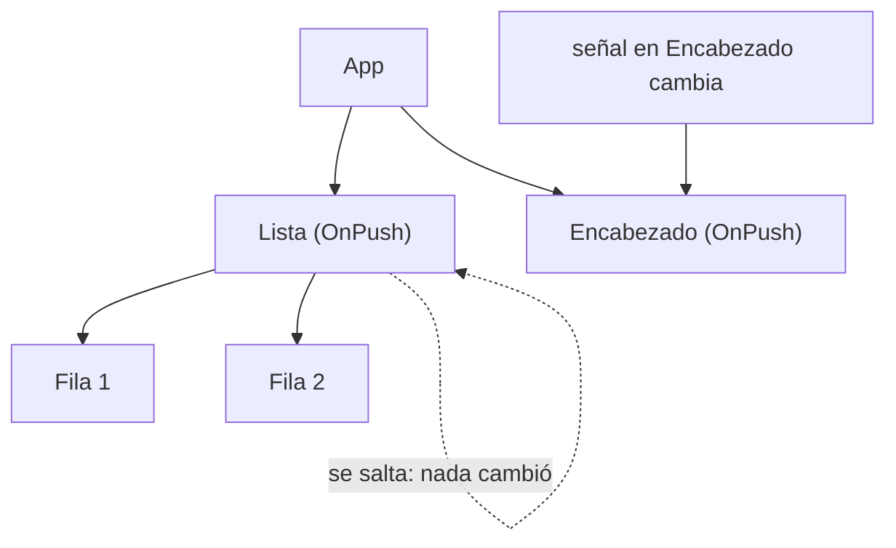

# OnPush y rendimiento

Parte de: [[20-Angular/03 Avanzado/_Índice Avanzado|Avanzado]]

> [!info] Cómo avanzar
> `progreso`: **pendiente** → **viendo** (estudiando) → **visto** (contestaste la autoevaluación sin abrir las respuestas) → **dominado** (hiciste el laboratorio o lo aplicaste de verdad).

## Contenido

### Qué es
`ChangeDetectionStrategy.OnPush` es una estrategia de detección de cambios que le dice a Angular: "revisa este componente **solo** cuando haya un motivo concreto", en lugar de revisarlo en cada ciclo. Desde **Angular 22, OnPush es la estrategia por defecto** para componentes que no declaran otra; la estrategia anterior se renombró **`Eager`** (antes `Default`), y la migración de `ng update` agrega `Eager` a los componentes existentes para no cambiar su comportamiento.

### Cómo funciona
Un componente OnPush se marca para revisión solo cuando:
1. Cambia la **referencia** de uno de sus inputs (comparación `===`).
2. Cambia una **señal** que su plantilla lee.
3. Ocurre un **evento** en su plantilla o en un hijo (`(click)`).
4. El pipe `async` recibe un valor nuevo, o alguien llama `markForCheck()`.

Si nada de eso ocurre, Angular **salta** el componente y todo su subárbol, lo cual ahorra mucho trabajo en pantallas grandes.



#### El error clásico: mutar un input
```ts
// Padre
this.cliente.direccion.ciudad = 'Puebla'; // mutación
```
El hijo OnPush recibe `[cliente]="cliente"`, pero la referencia del objeto es la misma: Angular no detecta cambio y **la vista del hijo sigue mostrando la ciudad anterior**. La solución es tratar los datos como **inmutables**: `this.cliente = { ...this.cliente, direccion: { ...this.cliente.direccion, ciudad: 'Puebla' } }`, o mejor, guardarlos en una señal y usar `update` con copias. Es la misma disciplina que React exige con el estado.

### Ejemplo
Componente de fila optimizado para una tabla de pedidos:

```ts
import { ChangeDetectionStrategy, Component, computed, input } from '@angular/core';
import { CurrencyPipe } from '@angular/common';

@Component({
  selector: 'app-fila-pedido',
  imports: [CurrencyPipe],
  // En v22 ya es el default; declararlo explícito no estorba en código compartido con v21 o anteriores
  changeDetection: ChangeDetectionStrategy.OnPush,
  template: `
    <td>{{ pedido().folio }}</td>
    <td>{{ pedido().total | currency: 'MXN' }}</td>
    <td [class.alerta]="vencido()">{{ pedido().vence }}</td>
  `,
})
export class FilaPedido {
  pedido = input.required<{ folio: string; total: number; vence: string }>();
  protected vencido = computed(() => new Date(this.pedido().vence) < new Date());
}
```

### Técnicas de rendimiento
1. **OnPush + señales** en todos los componentes: el default en v22; mantenlo.
2. **`track` correcto en `@for`** con un id estable, para reutilizar nodos del DOM.
3. **Lazy loading de rutas** ([[Lazy loading de rutas]]) y **`@defer`** ([[Deferrable views (@defer)]]) para reducir el JavaScript inicial.
4. **`computed()` en lugar de métodos en la plantilla**: se memoiza y no recalcula en cada ciclo.
5. **Virtual scroll del CDK** para listas de miles de elementos.
6. **`NgOptimizedImage`** (`ngSrc`) para imágenes: tamaños, prioridad y carga perezosa correctos.
7. **Pipes puros** en lugar de funciones de formato en la plantilla.
8. **Zoneless** ([[Detección de cambios y zoneless]]) para evitar revisiones globales.
9. **Presupuestos de bundle** en `angular.json` y análisis con `ng build --stats-json`.
10. **SSR/prerender** para mejorar el tiempo de primera pintura en páginas públicas.

Para medir, usa la pestaña **Profiler** de Angular DevTools (cuánto tarda cada ciclo y qué componentes se revisan) y Lighthouse para métricas de carga.

### Cuándo usarlo y cuándo no
- **OnPush**: siempre en código nuevo; obliga a un flujo de datos claro.
- **`Eager`**: solo temporalmente en componentes heredados que mutan objetos o asignan propiedades desde callbacks, mientras los migras.
- No optimices a ciegas: mide primero con el Profiler; la mayoría de los problemas son listas sin `track` o bundles enormes.

### Errores comunes
- **Mutar inputs, arreglos u objetos**: la vista no se actualiza. Crea copias.
- **Asignar propiedades normales en un `subscribe`** dentro de un componente OnPush: no se ve hasta el siguiente evento. Usa señales o `toSignal`.
- **Llamar funciones costosas desde la plantilla**: se ejecutan en cada revisión; usa `computed`.
- **Asumir que tras actualizar a v22 todo es OnPush**: la migración puso `Eager` en los componentes existentes; cámbialos uno por uno.

### Para profundizar
- [Angular: saltar subárboles de componentes](https://angular.dev/best-practices/skipping-subtrees)
- [Angular: buenas prácticas de rendimiento](https://angular.dev/best-practices/runtime-performance)
- [Angular DevTools](https://angular.dev/tools/devtools)

## Autoevaluación

Contesta primero en voz alta o en papel; luego despliega la respuesta.

> [!question]- ¿Qué hace `ChangeDetectionStrategy.OnPush`?
> El componente solo se revisa cuando cambia la **referencia** de un input, ocurre un evento en él, emite un `async` que usa, cambia una señal que lee su plantilla o se llama a `markForCheck()`.

> [!question]- Error común con OnPush: mutar un objeto input. ¿Qué pasa?
> `this.usuario.nombre = 'X'` no cambia la referencia y el hijo OnPush no se actualiza. Hay que crear un objeto nuevo (`{ ...usuario, nombre: 'X' }`).

> [!question]- Nombra cinco técnicas de rendimiento.
> OnPush + señales, `track` correcto en `@for`, pipes puros o `computed` en vez de llamar métodos pesados en la plantilla, lazy loading y `@defer`, virtual scroll (CDK) para listas largas, revisar el tamaño con `ng build` y sus *budgets*.

