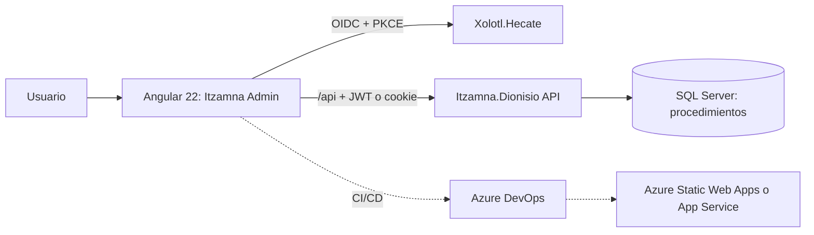

# Proyecto práctico en Angular

Parte de: [[20-Angular/03 Avanzado/_Índice Avanzado|Avanzado]]

> [!info] Cómo avanzar
> `progreso`: **pendiente** → **viendo** (estudiando) → **visto** (contestaste la autoevaluación sin abrir las respuestas) → **dominado** (hiciste el laboratorio o lo aplicaste de verdad).

## Contenido

### Qué es
El proyecto práctico es una aplicación completa que integra todo lo aprendido en el área: componentes standalone, señales, control flow, servicios con DI, `HttpClient` con interceptores, router con guards y lazy loading, formularios con validación, manejo de errores, pruebas y despliegue. La meta no es solo "que funcione", sino demostrar que sabes construir un front-end Angular **mantenible y profesional** conectado a un API .NET real, algo que puedes mostrar en entrevistas para puestos senior.

### Cómo funciona
#### Propuesta: "Itzamna Admin"
Un panel de administración en Angular para el API de Itzamna.Dionisio (ASP.NET Core con controllers, Dapper y procedimientos en SQL Server), autenticado contra Xolotl.Hecate.



#### Qué debe incluir para demostrar lo aprendido
| Tema | Evidencia en el proyecto |
|---|---|
| Componentes y control flow | Lista, detalle y formulario con `@if`/`@for`/`@switch` y `track` |
| Señales | Estado con `signal`, `computed`, `linkedSignal`; `effect` solo para persistir preferencias |
| Servicios y DI | Un servicio de API por feature; `InjectionToken` para la URL base |
| HTTP | `httpResource` para lecturas, métodos para escrituras, `HttpParams` para paginación |
| Interceptores | Token o credenciales, `X-Correlation-Id`, manejo centralizado de 401/403 |
| Router | Rutas hijas, parámetros como inputs, guard de sesión y de rol, `canDeactivate` |
| Lazy loading | Cada feature con su `*.routes.ts` y `loadChildren`; verificado en la salida del build |
| Formularios | Reactivos o Signal Forms con validadores propios (RFC) y validación asíncrona |
| Errores | Lectura de ProblemDetails con `codigo`, `ErrorHandler` global, estados vacíos y de error |
| Rendimiento | OnPush (default), `@defer` en un gráfico, virtual scroll en una tabla grande |
| Estructura | `core/`, `shared/`, `features/` ([[Estructura de carpetas por feature en Angular]]) |
| Pruebas | Unitarias de validadores y store, de componente con `setInput`, HTTP con `HttpTestingController`, 1–2 E2E con Playwright |
| Calidad | ESLint, `strict` y `strictTemplates`, sin `any` |
| Entrega | Pipeline YAML en Azure DevOps: instalar, lint, test, build, desplegar |

#### Etapas sugeridas
1. **Esqueleto**: `ng new`, estructura de carpetas, layout, router y proxy al API.
2. **Lectura**: lista paginada y detalle de productos con `httpResource`.
3. **Escritura**: alta y edición con formularios y validación.
4. **Seguridad**: login OIDC, guard, interceptor, roles.
5. **Calidad**: pruebas, manejo de errores, rendimiento.
6. **Entrega**: pipeline, despliegue y README.

### Ejemplo
Criterio de "terminado" (*Definition of Done*) que puedes copiar al README:

```text
[ ] El usuario puede iniciar sesión, listar, crear, editar y eliminar productos y pedidos.
[ ] Las rutas de administración no se muestran ni se descargan sin el rol Admin.
[ ] Toda petición fallida muestra un mensaje entendible (incluye status 0 y ProblemDetails).
[ ] ng build en producción sin advertencias de presupuesto; cada feature es un lazy chunk.
[ ] ng test pasa en el pipeline; cobertura >= 70 % en servicios, validadores y stores.
[ ] Lighthouse >= 90 en accesibilidad y buenas prácticas en la pantalla principal.
[ ] Ningún secreto en el repo: URLs y client id vienen de la configuración del ambiente.
[ ] README con arquitectura, cómo correrlo, capturas y decisiones técnicas.
[ ] Desplegado en Azure con URL pública de demostración (datos ficticios).
```

### Cómo presentarlo en tu portafolio
- **README claro**: problema que resuelve, diagrama de arquitectura, stack con versiones, cómo correrlo en local en menos de cinco minutos (con datos de prueba).
- **Demo en vivo** con un usuario de solo lectura y datos ficticios; un video corto (graba con tu iPhone o con la a6700 la pantalla y tu explicación) de dos minutos recorriendo el flujo principal.
- **Sección "Decisiones técnicas"**: por qué señales en lugar de NgRx, por qué BFF o token en memoria, por qué lazy loading por feature. Esto es lo que más valoran en entrevistas senior.
- **Comparación con React**: si tienes Itzamna.Clio, explica qué cambió al rehacer una parte en Angular; demuestra criterio, no solo sintaxis.
- **Historial de commits limpio** y el pipeline de Azure DevOps visible (insignia de build).

### Cuándo usarlo y cuándo no
- Hazlo después de completar los temas básicos e intermedios y al menos un laboratorio de cada uno.
- Mantén el alcance acotado: dos features bien hechas valen más que diez a medias.
- No dependas de servicios de pago para la demo; usa niveles gratuitos de Azure cuando existan (verifica límites vigentes antes de desplegar).

### Errores comunes
- **Proyecto sin terminar** porque el alcance creció: define el criterio de terminado al inicio y respétalo.
- **Copiar un tutorial** sin decisiones propias: el entrevistador lo nota en dos preguntas.
- **Ignorar pruebas y errores**: son justo lo que distingue a un senior.
- **Secretos en el repo** (client secrets, cadenas de conexión): usa variables del pipeline y configuración por ambiente.
- **Demo caída** el día de la entrevista: revisa que el plan gratuito no la apague o ten el video de respaldo.

### Para profundizar
- [Angular: tutoriales y guías oficiales](https://angular.dev/tutorials)
- [Angular: despliegue](https://angular.dev/tools/cli/deployment)
- [Azure Static Web Apps: desplegar Angular](https://learn.microsoft.com/azure/static-web-apps/deploy-angular)

## Autoevaluación

Contesta primero en voz alta o en papel; luego despliega la respuesta.

> [!question]- ¿Qué debe incluir tu proyecto para demostrar lo aprendido?
> Componentes standalone con señales, servicio con HttpClient e interceptor contra un API real (idealmente tu API .NET), router con lazy loading y guard, un formulario reactivo con validación, manejo de errores y pruebas.

> [!question]- ¿Cómo lo presentarías en tu portafolio?
> Repositorio con README (qué hace, cómo correrlo, capturas), commits claros, despliegue público (p. ej. GitHub Pages o Azure Static Web Apps) y una lista de decisiones técnicas.

> [!question]- ¿Qué criterio usas para darlo por terminado?
> Que `ng build` pase sin errores ni advertencias de presupuesto, `ng test` en verde, que funcione en el celular y que alguien más pueda clonarlo y correrlo siguiendo el README.

## Práctica

- [[Lab 1 - Componentes standalone y data binding en Angular]]
- [[Lab 1 - Signals en Angular (carrito de compras)]]
- [[Lab 2 - Servicio, HttpClient e interceptor en Angular]]
- [[Lab 3 - Router con guards y lazy loading en Angular]]
- [[Lab 4 - Formularios reactivos con validación en Angular]]
- [[Lab 1 - Pruebas unitarias y de componentes en Angular]]

