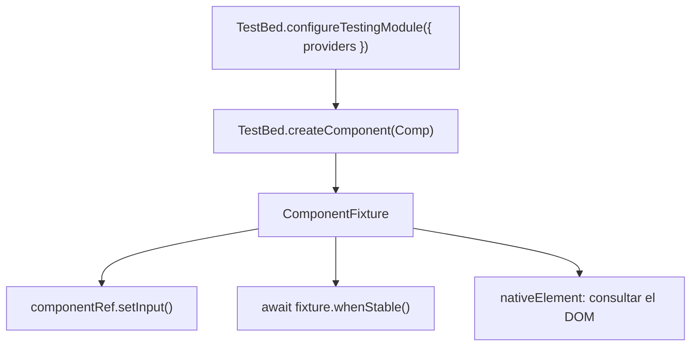

# Pruebas en Angular (unitarias y de componentes)

Parte de: [[20-Angular/03 Avanzado/_Índice Avanzado|Avanzado]]

> [!info] Cómo avanzar
> `progreso`: **pendiente** → **viendo** (estudiando) → **visto** (contestaste la autoevaluación sin abrir las respuestas) → **dominado** (hiciste el laboratorio o lo aplicaste de verdad).

## Contenido

### Qué es
Probar en Angular significa verificar automáticamente servicios, pipes, validadores y componentes. Angular ofrece:
- **`TestBed`**: crea un entorno de pruebas con su propio inyector, para instanciar servicios y componentes con sus dependencias (reales o simuladas).
- **`ComponentFixture`**: envoltorio del componente creado, con acceso a su instancia, su DOM y la detección de cambios.
- **Utilidades de HTTP**: `provideHttpClientTesting()` y `HttpTestingController` para simular el backend.
- **Component harnesses** del CDK para interactuar con componentes de Material sin depender de su HTML interno.
- **Ejecutor**: desde **Angular 21, `ng new` usa Vitest** como ejecutor por defecto (builder `@angular/build:unit-test`); Karma con Jasmine sigue disponible para proyectos existentes y hay migraciones (`refactor-jasmine-vitest`, y en v22 `migrate-karma-to-vitest`).

Si vienes de React con Vitest y Testing Library, la sintaxis `describe`/`it`/`expect` será igual; lo nuevo es `TestBed`.

### Cómo funciona


1. Configuras el entorno: `TestBed.configureTestingModule({ imports: [Componente], providers: [...] })`.
2. Creas el componente: `const fixture = TestBed.createComponent(Componente)`.
3. Pasas inputs con **`fixture.componentRef.setInput('nombre', valor)`**. Funciona con inputs de señal (que no puedes asignar directamente) y marca el componente para actualizar.
4. Esperas el render: en aplicaciones zoneless, **`await fixture.whenStable()`**; `fixture.detectChanges()` sigue existiendo para forzar un ciclo.
5. Revisas el DOM (`fixture.nativeElement.querySelector(...)`) o el estado de la instancia.

#### Unitarias, de componente y end-to-end
- **Unitaria**: una pieza aislada (servicio, pipe, validador, `computed`), con dependencias simuladas. Rápida, muchas.
- **De componente**: el componente con su plantilla en un DOM simulado (jsdom o navegador), verificando lo que ve y hace el usuario.
- **End-to-end (E2E)**: la aplicación completa en un navegador real, contra un backend real o de pruebas, recorriendo flujos (login, crear pedido). Más lentas y frágiles, pocas. Angular no trae una herramienta propia: se usan **Playwright** o **Cypress** (`ng e2e` te ofrece instalar uno).

### Ejemplo
Prueba de componente con un input requerido y un output:

```ts
// tarjeta-producto.spec.ts
import { TestBed } from '@angular/core/testing';
import { describe, it, expect, beforeEach } from 'vitest';
import { TarjetaProducto } from './tarjeta-producto';

describe('TarjetaProducto', () => {
  beforeEach(() => TestBed.configureTestingModule({ imports: [TarjetaProducto] }));

  it('muestra el nombre y emite al agregar', async () => {
    const fixture = TestBed.createComponent(TarjetaProducto);
    const producto = { id: 1, nombre: 'Teclado', precio: 899 };
    fixture.componentRef.setInput('producto', producto);

    let emitido: unknown;
    fixture.componentInstance.agregar.subscribe(p => (emitido = p));

    await fixture.whenStable();
    const el: HTMLElement = fixture.nativeElement;
    expect(el.querySelector('h3')?.textContent).toContain('Teclado');

    el.querySelector('button')!.click();
    expect(emitido).toEqual(producto);
  });
});
```

Prueba de servicio HTTP sin servidor real:

```ts
import { TestBed } from '@angular/core/testing';
import { provideHttpClient } from '@angular/common/http';
import { HttpTestingController, provideHttpClientTesting } from '@angular/common/http/testing';
import { ProductosApi } from './productos-api';

describe('ProductosApi', () => {
  it('pide el producto por id', () => {
    TestBed.configureTestingModule({ providers: [provideHttpClient(), provideHttpClientTesting()] });
    const api = TestBed.inject(ProductosApi);
    const http = TestBed.inject(HttpTestingController);

    let resultado: unknown;
    api.obtener(7).subscribe(p => (resultado = p));

    const req = http.expectOne('/api/productos/7'); // falla si no hubo exactamente una
    expect(req.request.method).toBe('GET');
    req.flush({ id: 7, nombre: 'Mouse', precio: 349 }); // responde la "API"

    expect(resultado).toEqual({ id: 7, nombre: 'Mouse', precio: 349 });
    http.verify(); // no quedaron peticiones pendientes
  });
});
```

Para reemplazar un servicio en un componente usa `providers: [{ provide: ProductosApi, useValue: { obtener: () => of(prod) } }]`.

### Cuándo usarlo y cuándo no
- **Muchas unitarias** para lógica: validadores, pipes, stores, `computed`.
- **Pruebas de componente** para comportamiento visible: qué se muestra en cada estado, qué emite cada botón. Prueba lo que ve el usuario, no detalles internos.
- **Pocas E2E** para flujos críticos (login con Xolotl.Hecate, crear y pagar un pedido), ejecutadas en el pipeline de Azure DevOps.
- No pruebes el framework (que `@if` funciona) ni detalles de implementación que cambian con cada refactor.

### Errores comunes
- **Asignar un input de señal directamente** (`component.producto = ...`): no compila; usa `setInput`.
- **Revisar el DOM sin esperar el render**: el texto aún no aparece; usa `await fixture.whenStable()`.
- **Olvidar `provideHttpClient()`** junto a `provideHttpClientTesting()` en versiones antes de la 21, o al configurar interceptores.
- **No llamar `http.verify()`**: peticiones inesperadas pasan desapercibidas.
- **Pruebas que dependen del orden** o de estado global compartido: cada `it` debe preparar lo suyo.

### Para profundizar
- [Angular: pruebas](https://angular.dev/guide/testing)
- [Angular: fundamentos de pruebas de componentes](https://angular.dev/guide/testing/components-basics)
- [Angular: probar peticiones HTTP](https://angular.dev/guide/http/testing)
- [Vitest](https://vitest.dev/guide/)

## Autoevaluación

Contesta primero en voz alta o en papel; luego despliega la respuesta.

> [!question]- ¿Qué herramientas de pruebas trae Angular?
> `ng test` ejecuta las pruebas unitarias con el runner configurado en el proyecto (Vitest o Karma/Jasmine, según cómo se creó). `TestBed` arma un entorno de Angular para probar componentes, servicios, pipes y guards.

> [!question]- ¿Cómo pasas un input a un componente en una prueba?
> `fixture.componentRef.setInput('tarea', { id: 1, titulo: 'A', hecha: false });` y luego `fixture.detectChanges();`.

> [!question]- ¿Cómo pruebas un servicio que usa HttpClient sin llamar al servidor real?
> Con `provideHttpClient()` + `provideHttpClientTesting()` y `HttpTestingController`: `expectOne(url)`, `req.flush(datos)` y `verify()` al final.

> [!question]- ¿Qué diferencia hay entre una prueba unitaria y una end-to-end?
> La **unitaria** prueba una pieza aislada en milisegundos. La **e2e** (Playwright, Cypress) abre un navegador real y recorre la app completa como un usuario.

## Práctica

- [[Lab 1 - Pruebas unitarias y de componentes en Angular]]

