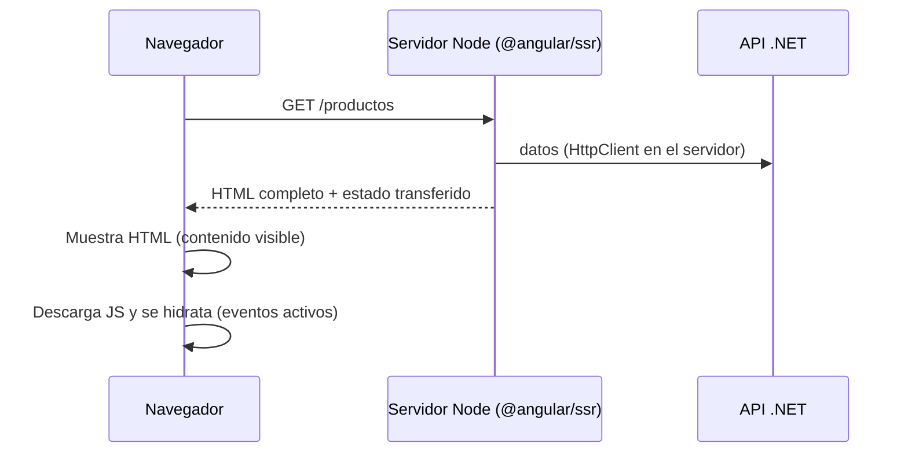

# SSR e hidratación en Angular

Parte de: [[20-Angular/03 Avanzado/_Índice Avanzado|Avanzado]]

> [!info] Cómo avanzar
> `progreso`: **pendiente** → **viendo** (estudiando) → **visto** (contestaste la autoevaluación sin abrir las respuestas) → **dominado** (hiciste el laboratorio o lo aplicaste de verdad).

## Contenido

### Qué es
- **SSR** (*Server-Side Rendering*): el servidor (Node.js) ejecuta la aplicación Angular y envía al navegador **HTML ya renderizado**, en lugar de una página vacía que se llena con JavaScript. Mejora el tiempo hasta ver contenido y el SEO.
- **Hidratación**: el proceso en que Angular, ya en el navegador, **reutiliza ese HTML** del servidor, le conecta los eventos y el estado, en lugar de destruirlo y volver a dibujarlo.
- **Prerenderizado (SSG)**: generar el HTML de ciertas rutas **en tiempo de build**, como archivos estáticos.

Es lo mismo que hacen Next.js o Remix para React, integrado en el CLI con el paquete `@angular/ssr`.

### Cómo funciona


#### Activarlo
- Proyecto nuevo: `ng new mi-app --ssr` (el CLI también lo pregunta).
- Proyecto existente: `ng add @angular/ssr`.

Se generan archivos como `server.ts` (servidor Express), `main.server.ts`, `app.config.server.ts` y `app.routes.server.ts`, donde decides el modo de render por ruta:

```ts
// app.routes.server.ts
import { RenderMode, ServerRoute } from '@angular/ssr';

export const serverRoutes: ServerRoute[] = [
  { path: '', renderMode: RenderMode.Prerender },        // SSG en build
  { path: 'productos/:id', renderMode: RenderMode.Server }, // SSR en cada petición
  { path: 'admin/**', renderMode: RenderMode.Client },    // solo navegador (CSR)
];
```

La hidratación se activa con `provideClientHydration()` en `app.config.ts`. Con **hidratación incremental** (el comportamiento por defecto en Angular 22), los bloques `@defer` con disparador `hydrate on ...` se quedan como HTML estático hasta que se necesitan, lo que reduce aún más el JavaScript inicial. Los eventos que el usuario dispara antes de hidratar se pueden reproducir después (*event replay*).

`HttpClient` guarda en el HTML las respuestas obtenidas en el servidor (*transfer state*), para que el navegador no repita las mismas peticiones al hidratarse.

#### `localStorage is not defined`
En el servidor **no existe** `window`, `document`, `localStorage` ni `sessionStorage`: es Node.js, no un navegador. Si un componente o servicio los usa al crearse, el render del servidor falla con ese error. Soluciones:
- Pon ese código en **`afterNextRender()`**, que solo corre en el navegador.
- O comprueba la plataforma: `isPlatformBrowser(inject(PLATFORM_ID))`.
- Para `document` usa `inject(DOCUMENT)`, que Angular provee también en el servidor.

### Ejemplo
Servicio de preferencias seguro para SSR:

```ts
import { PLATFORM_ID, Service, inject, signal } from '@angular/core';
import { isPlatformBrowser } from '@angular/common';

@Service()
export class Preferencias {
  private esNavegador = isPlatformBrowser(inject(PLATFORM_ID));
  readonly tema = signal<'claro' | 'oscuro'>(this.leer());

  private leer(): 'claro' | 'oscuro' {
    if (!this.esNavegador) return 'claro'; // valor neutro en el servidor
    return (localStorage.getItem('tema') as 'claro' | 'oscuro') ?? 'claro';
  }

  cambiar(t: 'claro' | 'oscuro') {
    this.tema.set(t);
    if (this.esNavegador) localStorage.setItem('tema', t);
  }
}
```

### Cuándo usarlo y cuándo no
- **SSR**: páginas públicas donde importa SEO o la primera carga (catálogo, landing, blog).
- **Prerender**: páginas que casi no cambian (inicio, "acerca de", documentación).
- **Solo cliente (CSR)**: paneles internos detrás de login, como el administrador de Itzamna.Dionisio; ahí SSR suele agregar complejidad (un servidor Node que operar en Azure) sin beneficio claro.
- Puedes mezclar los tres modos por ruta.

### Errores comunes
- **Usar APIs del navegador al crear componentes**: `window is not defined`/`localStorage is not defined`.
- **Diferencias entre HTML del servidor y del cliente** (fechas con `new Date()`, valores aleatorios): errores de hidratación `NG0500`. Calcula esos valores después de hidratar.
- **Manipular el DOM directamente** (`innerHTML`, librerías jQuery): rompe la hidratación; usa `ngSkipHydration` como último recurso.
- **Llamar al API con rutas relativas desde el servidor**: en Node necesitas la URL absoluta del backend.

### Para profundizar
- [Angular: SSR](https://angular.dev/guide/ssr)
- [Angular: hidratación](https://angular.dev/guide/hydration)
- [Angular: hidratación incremental](https://angular.dev/guide/incremental-hydration)

## Autoevaluación

Contesta primero en voz alta o en papel; luego despliega la respuesta.

> [!question]- ¿Qué es SSR?
> Renderizar el HTML en el servidor para que el navegador reciba la página ya armada: mejora el primer pintado y el SEO. Se habilita al crear el proyecto (`ng new --ssr`) o con `ng add @angular/ssr`.

> [!question]- ¿Qué es la hidratación?
> El navegador **reutiliza** el DOM que mandó el servidor y le conecta la lógica de Angular en lugar de destruirlo y volver a crearlo (`provideClientHydration()`).

> [!question]- Error común: `localStorage is not defined` al usar SSR. ¿Por qué y cómo se evita?
> En el servidor no existen `window`, `document` ni `localStorage`. Usa ese código solo en el navegador: dentro de `afterNextRender` o comprobando `isPlatformBrowser(inject(PLATFORM_ID))`.

> [!question]- ¿Qué es el prerenderizado (SSG)?
> Generar el HTML de rutas estáticas en tiempo de build en lugar de en cada petición.

