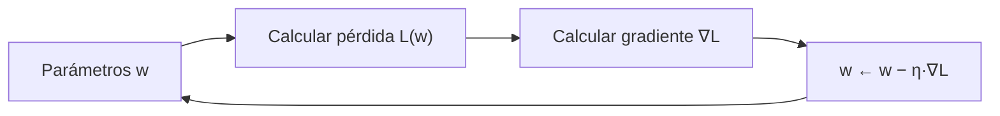

# Cálculo para ML (derivadas y gradiente)

Parte de: [[21-IA-Machine-Learning/01 Matemáticas necesarias/_Índice Matemáticas necesarias|Matemáticas necesarias]]

> [!info] Cómo avanzar
> `progreso`: **pendiente** → **viendo** (estudiando) → **visto** (contestaste la autoevaluación sin abrir las respuestas) → **dominado** (hiciste el laboratorio o lo aplicaste de verdad).

## Contenido

### Qué es
Entrenar un modelo es **minimizar una función de pérdida**: un número que dice qué tan mal predice. El cálculo te da la herramienta para saber **hacia dónde mover los parámetros** para que ese número baje. La **derivada** de una función de una variable mide su pendiente en un punto: cuánto cambia la salida si mueves un poquito la entrada. El **gradiente** es la versión para muchas variables: el vector de todas las derivadas parciales, que apunta hacia donde la función **sube más rápido**. Ir en dirección contraria es el **descenso de gradiente**, el motor de casi todo el ML moderno.

### Cómo funciona
**Derivadas que necesitas.** Con cuatro reglas cubres el 90 %:
- Potencia: `d/dx xⁿ = n·xⁿ⁻¹` (y las constantes desaparecen).
- Suma: la derivada de una suma es la suma de derivadas.
- Exponencial y logaritmo: `d/dx eˣ = eˣ`, `d/dx ln x = 1/x`.
- **Regla de la cadena**: si `y = f(g(x))`, entonces `dy/dx = f'(g(x))·g'(x)`. "Derivada de afuera por derivada de adentro".

Ejemplo: `f(x) = 3x² + 2x − 5` → `f'(x) = 6x + 2`; en `x = 2` la pendiente es 14.

**Derivadas parciales.** Con varias variables derivas respecto a una y tratas las demás como constantes. Para `f(x, y) = x²y + 3y`: `∂f/∂x = 2xy` y `∂f/∂y = x² + 3`. El gradiente es `∇f = [2xy, x² + 3]`; en `(1, 2)` vale `[4, 4]`.

**Descenso de gradiente.** Repite: `w ← w − η·∇L(w)`, donde `η` (eta) es la **tasa de aprendizaje**.



- Si `η` es muy chica, avanzas lentísimo.
- Si es demasiado grande, **te pasas del mínimo**, la pérdida oscila o diverge (crece sin control, aparecen `NaN`).

**Regla de la cadena en redes neuronales.** Una red es una composición de funciones: capa 1 → activación → capa 2 → … → pérdida. Para saber cómo afecta un peso de la primera capa a la pérdida final, multiplicas las derivadas locales de cada paso, de atrás hacia adelante. Eso es **backpropagation** (lo ves en [[Descenso de gradiente y backpropagation]]). Un caso típico: la sigmoide `σ(z) = 1/(1+e⁻ᶻ)` tiene derivada `σ(z)(1−σ(z))`, que en `z = 0` vale `0.5·0.5 = 0.25`, su máximo. Como nunca pasa de 0.25, al multiplicar muchas en cadena el gradiente se encoge: es el origen del "desvanecimiento del gradiente".

**Mínimos locales y puntos silla.** Derivada (o gradiente) cero significa "aquí la pendiente es plana", no "encontraste el mejor punto". Puede ser un mínimo local, un máximo o un punto silla. En funciones **convexas** (como la pérdida de la regresión lineal o logística) cualquier mínimo es global; en redes neuronales no hay esa garantía, aunque en la práctica los mínimos que se encuentran suelen funcionar bien.

### Ejemplo
Descenso de gradiente sobre `f(w) = (w − 3)²`, cuyo mínimo está en `w = 3`. Su derivada es `2(w − 3)`.

```python
import numpy as np

def f(w):
    return (w - 3) ** 2

def df(w):
    return 2 * (w - 3)

for eta in (0.1, 1.1):           # una tasa razonable y una demasiado grande
    w = 0.0
    historia = []
    for paso in range(5):
        w = w - eta * df(w)
        historia.append(round(w, 3))
    print(f"eta={eta}: {historia}")
# eta=0.1: [0.6, 1.08, 1.464, 1.771, 2.017]   -> se acerca a 3
# eta=1.1: [6.6, -1.32, 8.184, -3.221, 10.465] -> oscila y diverge

# Verificar una derivada numéricamente (diferencias centrales)
g = lambda x: 3 * x**2 + 2 * x - 5
h = 1e-5
print(round((g(2 + h) - g(2 - h)) / (2 * h), 4))   # 14.0

sig = lambda z: 1 / (1 + np.exp(-z))
print(sig(0) * (1 - sig(0)))                       # 0.25
```

Los dos primeros pasos con `η = 0.1` dan `0.6` y `1.08`: cada paso recorre el 20 % de la distancia que falta. La verificación numérica con diferencias finitas es un truco excelente para comprobar que una derivada escrita a mano es correcta.

En la práctica nunca derivas a mano: PyTorch y TensorFlow usan **diferenciación automática**, y scikit-learn o [[ML.NET]] traen optimizadores ya hechos (por ejemplo, los trainers SDCA y L-BFGS de ML.NET). Lo que sí necesitas es la intuición para elegir la tasa de aprendizaje y diagnosticar cuando la pérdida no baja.

### Cuándo usarlo y cuándo no
Úsalo para entender entrenamiento, tasas de aprendizaje, explosión o desvanecimiento del gradiente y optimizadores como Adam ([[Optimizadores (SGD y Adam)]]). No necesitas integrales ni cálculo avanzado para empezar; tampoco derivar arquitecturas completas. Los árboles de decisión, por cierto, no se entrenan con gradientes (aunque el gradient boosting sí usa la idea del gradiente de la pérdida).

### Errores comunes
- **Creer que gradiente cero es el óptimo global.** Solo es un punto plano; en problemas no convexos puede ser local o silla.
- **Tasa de aprendizaje fija y grande.** Si la pérdida sube o salen `NaN`, baja `η` (divide entre 10) antes de culpar al modelo.
- **No escalar las features.** Con escalas muy distintas, el gradiente zigzaguea y converge lento; estandarizar ayuda mucho.
- **Olvidar la regla de la cadena** al derivar compuestos: es el error clásico en ejercicios con sigmoide o log loss.

### Para profundizar
- [Essence of calculus (3Blue1Brown)](https://www.3blue1brown.com/topics/calculus)
- [Google ML Crash Course: descenso de gradiente](https://developers.google.com/machine-learning/crash-course/linear-regression/gradient-descent)
- [Mathematics for Machine Learning (cap. de cálculo vectorial)](https://mml-book.github.io/)

## Ejercicios

Resuélvelos en papel o en la herramienta; la solución está plegada.

> [!question]- Deriva `f(x) = 3x² + 2x - 5` y evalúa en `x = 2`.
> `f'(x) = 6x + 2` → `f'(2) = 14`

> [!question]- Calcula las parciales de `f(x, y) = x²y + 3y` en `(1, 2)`.
> `∂f/∂x = 2xy = 4`, `∂f/∂y = x² + 3 = 4` → gradiente `(4, 4)`.

> [!question]- Haz 2 pasos de descenso de gradiente sobre `f(w) = (w - 3)²` desde `w = 0` con tasa `0.1`.
> `f'(w) = 2(w - 3)`.
> Paso 1: `w = 0 - 0.1·(-6) = 0.6`
> Paso 2: `w = 0.6 - 0.1·(-4.8) = 1.08` (se acerca a 3).

> [!question]- La sigmoide cumple `σ'(z) = σ(z)(1 - σ(z))`. ¿Cuánto vale en `z = 0`?
> `σ(0) = 0.5` → `0.5 · 0.5 = 0.25` (su derivada máxima; por eso se "desvanece" en redes profundas).

## Autoevaluación

Contesta primero en voz alta o en papel; luego despliega la respuesta.

> [!question]- ¿Qué es el gradiente de una función de varias variables?
> El vector de sus derivadas parciales. Apunta hacia donde la función crece más rápido; por eso el entrenamiento se mueve en dirección **contraria** al gradiente de la pérdida.

> [!question]- ¿Para qué sirve la regla de la cadena en redes neuronales?
> Para derivar funciones compuestas capa por capa: `dL/dw = dL/dy · dy/dz · dz/dw`. Backpropagation es aplicar la regla de la cadena de forma eficiente de la salida hacia la entrada.

> [!question]- ¿Qué pasa si la tasa de aprendizaje es demasiado grande?
> Los pasos se pasan del mínimo: la pérdida oscila o diverge (crece hasta `nan`). Si es muy pequeña, converge muy lento.

> [!question]- Error común: ¿derivada cero significa que encontraste el mínimo global?
> No: puede ser un mínimo local, un máximo o un punto silla. En redes grandes los puntos silla son frecuentes.

