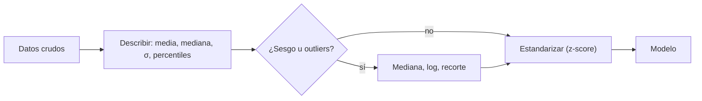

# Estadística para ML (distribuciones, media, varianza)

Parte de: [[21-IA-Machine-Learning/01 Matemáticas necesarias/_Índice Matemáticas necesarias|Matemáticas necesarias]]

> [!info] Cómo avanzar
> `progreso`: **pendiente** → **viendo** (estudiando) → **visto** (contestaste la autoevaluación sin abrir las respuestas) → **dominado** (hiciste el laboratorio o lo aplicaste de verdad).

## Contenido

### Qué es
La estadística descriptiva resume un montón de números en unos pocos que puedes razonar: **dónde está el centro** (media, mediana), **qué tan dispersos** están (varianza, desviación estándar) y **qué forma tienen** (distribución). En ML la usas antes de entrenar (explorar datos, detectar outliers, escalar features) y después (comparar errores, saber si una mejora es real o ruido).

### Cómo funciona
**Centro.**
- **Media** `x̄ = Σxᵢ / n`: el "punto de equilibrio". Es sensible a valores extremos: un sueldo de 2 millones sube mucho la media de una oficina.
- **Mediana**: el valor del medio al ordenar (o el promedio de los dos del medio si n es par). Es **robusta** a outliers; por eso los ingresos o los tiempos de respuesta se reportan con mediana o percentiles (p50, p95).

**Dispersión.**
- **Varianza** = promedio de las distancias al cuadrado respecto a la media. Mide cuánto se alejan los datos; está en unidades al cuadrado.
- **Desviación estándar** = raíz de la varianza; vuelve a las unidades originales y es la que interpretas ("en promedio nos alejamos unas 2 unidades de la media").
- **Poblacional vs muestral.** Si tienes todos los datos, divides entre `n`. Si es una muestra y quieres estimar la varianza de la población, divides entre `n − 1` (corrección de Bessel), porque la media muestral está "pegada" a los propios datos y subestimaría la dispersión. En NumPy `np.var` usa `ddof=0` por defecto; pandas `.var()` usa `ddof=1`. Esa diferencia confunde a mucha gente.

**z-score.** `z = (x − μ)/σ` dice a cuántas desviaciones estándar está un valor de la media. Es la base de la **estandarización** (`StandardScaler`), que deja cada feature con media 0 y desviación 1 para que modelos sensibles a escala (k-NN, SVM, regresión con regularización, PCA) traten a todas por igual.

**Distribuciones.** Una distribución describe qué valores son probables. La **normal** (campana de Gauss) aparece cuando sumas muchos efectos pequeños independientes; cumple la **regla 68-95-99.7**: cerca del 68 % de los datos caen a ±1σ de la media, 95 % a ±2σ y 99.7 % a ±3σ. Otras útiles: uniforme, Bernoulli/binomial (conteos de éxitos), Poisson (llegadas por unidad de tiempo), y distribuciones sesgadas como la log-normal (precios, ingresos). Si una variable está muy sesgada, aplicar `log` suele acercarla a una campana y ayudar al modelo.



### Ejemplo
Para `[2, 4, 4, 4, 5, 5, 7, 9]` la media es 5, la mediana 4.5, la varianza poblacional 4 (desviación 2) y la muestral ≈ 4.571. El 9 tiene z = (9 − 5)/2 = 2.

```python
import numpy as np
import pandas as pd

x = np.array([2, 4, 4, 4, 5, 5, 7, 9])
print(x.mean(), np.median(x))            # 5.0 4.5
print(x.var(), x.std())                  # 4.0 2.0   (poblacional, ddof=0)
print(round(x.var(ddof=1), 3))           # 4.571      (muestral)
print((9 - x.mean()) / x.std())          # 2.0

s = pd.Series(x)
print(round(s.var(), 3))                 # 4.571 -> pandas usa ddof=1 por defecto

# Regla 68-95-99.7 con datos simulados
rng = np.random.default_rng(0)
z = rng.normal(size=200_000)
for k in (1, 2, 3):
    print(k, round(np.mean(np.abs(z) < k), 3))   # ~0.683, ~0.954, ~0.997

# Un outlier mueve la media pero casi no la mediana
sueldos = np.array([18, 20, 21, 22, 25, 2000])
print(sueldos.mean().round(1), np.median(sueldos))   # 351.0 21.5
```

En el mundo .NET, si haces reportes como en Wee.Reporteria, el mismo razonamiento aplica: reporta mediana y p95 de tiempos en lugar de solo promedios. En [[ML.NET]] la normalización se hace con transformaciones como `NormalizeMeanVariance` o `NormalizeMinMax` dentro del pipeline, con el mismo cuidado de "aprender" la media y la desviación solo con datos de entrenamiento.

### Cuándo usarlo y cuándo no
Haz siempre un resumen estadístico al recibir un dataset (`df.describe()` en pandas): detecta columnas constantes, rangos imposibles, nulos y outliers. Usa media y desviación cuando la distribución es aproximadamente simétrica; mediana y percentiles cuando hay sesgo o colas largas. No asumas normalidad sin mirar un histograma. La regla 68-95-99.7 solo vale para distribuciones cercanas a la normal.

### Errores comunes
- **Mezclar varianza poblacional y muestral** al comparar resultados de NumPy y pandas (`ddof` distinto).
- **Reportar solo la media** con datos sesgados; un par de valores extremos la arrastran.
- **Estandarizar con estadísticos de todo el dataset** antes de separar entrenamiento y prueba: es fuga de datos ([[Datos de entrenamiento, validación y prueba]]).
- **Borrar outliers por reflejo.** A veces son errores de captura, pero otras son justo lo que quieres detectar (fraude, fallas).

### Para profundizar
- [Khan Academy: estadística descriptiva](https://www.khanacademy.org/math/statistics-probability/summarizing-quantitative-data)
- [NumPy: funciones estadísticas](https://numpy.org/doc/stable/reference/routines.statistics.html)
- [scikit-learn: preprocesamiento y escalado](https://scikit-learn.org/stable/modules/preprocessing.html)

## Ejercicios

Resuélvelos en papel o en la herramienta; la solución está plegada.

> [!question]- Para `[2, 4, 4, 4, 5, 5, 7, 9]` calcula media, mediana, varianza y desviación estándar poblacionales.
> Media `5`, mediana `4.5`, varianza `4`, desviación estándar `2`.

> [!question]- Mismos datos: ¿varianza muestral?
> Suma de cuadrados = 32 → `32 / 7 ≈ 4.571`

> [!question]- Mismos datos: ¿z-score del 9?
> `(9 - 5) / 2 = 2` → está a 2 desviaciones estándar arriba de la media.

> [!question]- Verifica todo con NumPy.
> ```python
> import numpy as np
> d = np.array([2,4,4,4,5,5,7,9])
> d.mean(), np.median(d), d.var(), d.std(), d.var(ddof=1)
> # (5.0, 4.5, 4.0, 2.0, 4.571...)
> ```

## Autoevaluación

Contesta primero en voz alta o en papel; luego despliega la respuesta.

> [!question]- ¿Qué diferencia hay entre media y mediana?
> La media es el promedio y se mueve mucho con valores extremos; la mediana es el valor central y es robusta a outliers. Con datos sesgados (sueldos, tiempos de respuesta) la mediana describe mejor lo típico.

> [!question]- ¿Qué mide la varianza y qué la desviación estándar?
> La varianza es el promedio de las distancias al cuadrado a la media; la desviación estándar es su raíz y está en las mismas unidades que los datos.

> [!question]- ¿Qué dice la regla 68-95-99.7?
> En una distribución normal, ≈68 % de los datos cae a 1σ de la media, ≈95 % a 2σ y ≈99.7 % a 3σ.

> [!question]- Error común: ¿varianza poblacional y muestral se calculan igual?
> No: la muestral divide entre `n - 1`. En NumPy `np.var(x)` usa `n` por defecto; `np.var(x, ddof=1)` usa `n - 1`. pandas `.var()` usa `n - 1` por defecto.

## Práctica

- [[Lab 1 - NumPy y pandas en Google Colab]]

