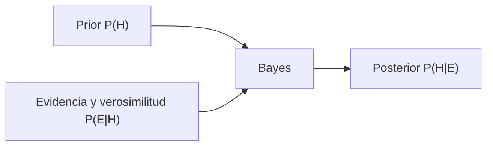

# Probabilidad para ML

Parte de: [[21-IA-Machine-Learning/01 Matemáticas necesarias/_Índice Matemáticas necesarias|Matemáticas necesarias]]

> [!info] Cómo avanzar
> `progreso`: **pendiente** → **viendo** (estudiando) → **visto** (contestaste la autoevaluación sin abrir las respuestas) → **dominado** (hiciste el laboratorio o lo aplicaste de verdad).

## Contenido

### Qué es
La probabilidad es la forma de **razonar con incertidumbre**. Un modelo de ML casi nunca "sabe"; estima qué tan probable es cada respuesta. Un clasificador de fraude que dice `0.83` está diciendo "con lo que he visto, 83 de cada 100 casos así resultaron fraude". Entender probabilidades te permite elegir umbrales, interpretar métricas, detectar trampas como la falacia de la tasa base y leer modelos como Naive Bayes o la regresión logística.

### Cómo funciona
**Lo básico.** Una probabilidad va de 0 a 1. Si todos los resultados son igual de probables, `P(A) = casos favorables / casos posibles`. Con dos dados hay 36 combinaciones y 6 suman 7 → `6/36 = 1/6`.

**Complemento.** `P(no A) = 1 − P(A)`. Es el atajo para preguntas de "al menos uno": la probabilidad de al menos un fallo en 3 intentos independientes con `P(fallo) = 0.1` es `1 − 0.9³ = 0.271`.

**Probabilidad condicional.** `P(A | B)` es la probabilidad de A **sabiendo que** ocurrió B: `P(A | B) = P(A ∩ B) / P(B)`. Ojo: `P(A | B)` y `P(B | A)` son cosas distintas.

**Independencia.** A y B son independientes si saber uno no cambia la probabilidad del otro: `P(A | B) = P(A)`, o lo que es igual, `P(A ∩ B) = P(A)·P(B)`. Con `P(A) = 0.3` y `P(B) = 0.6`, la intersección es `0.18`. Muchos modelos asumen independencia por comodidad (Naive Bayes asume que las palabras de un correo son independientes dada la clase), aunque no sea del todo cierta.

**Teorema de Bayes.** Te deja "voltear" una condicional:

`P(H | E) = P(E | H)·P(H) / P(E)`

- `P(H)`: lo que creías antes (prior, la **tasa base**).
- `P(E | H)`: qué tan probable es la evidencia si la hipótesis es cierta (verosimilitud).
- `P(H | E)`: lo que crees después de ver la evidencia (posterior).



**La trampa de la tasa base.** Una enfermedad afecta al 1 % de la población; la prueba detecta al 99 % de los enfermos (sensibilidad) pero da positivo al 5 % de los sanos. Si sales positivo, ¿qué tan probable es que estés enfermo? Intuitivamente uno dice 99 %, pero:

`P(E | +) = 0.99·0.01 / (0.99·0.01 + 0.05·0.99) ≈ 0.167`

Solo **16.7 %**. Como los sanos son muchísimos, sus falsos positivos superan a los verdaderos positivos. Esto mismo pasa en ML con clases raras (fraude, fallas): un modelo con buen recall puede tener precisión baja. Lo verás en [[Precisión, recall y F1]].

**Distribuciones.** Una variable aleatoria tiene una distribución: Bernoulli (sí/no), binomial (cuántos éxitos en n intentos), normal (campana), etc. Las conectas con datos reales en [[Estadística para ML (distribuciones, media, varianza)]].

### Ejemplo
Calcula exacto y verifica por simulación (Monte Carlo), una técnica útil cuando la fórmula no es obvia.

```python
import numpy as np
rng = np.random.default_rng(42)

# 1) Dos dados suman 7
d1, d2 = rng.integers(1, 7, 100_000), rng.integers(1, 7, 100_000)
print("exacto", round(6 / 36, 4), "simulado", round(np.mean(d1 + d2 == 7), 4))

# 2) Bayes: P(enfermo | positivo)
prev, sens, fp = 0.01, 0.99, 0.05
posterior = sens * prev / (sens * prev + fp * (1 - prev))
print("P(enfermo|+) =", round(posterior, 3))          # 0.167

# 3) Al menos un fallo en 3 intentos con p = 0.1
print("al menos un fallo =", round(1 - 0.9 ** 3, 3))  # 0.271

# 4) Un clasificador da probabilidades; el umbral decide la clase
proba = np.array([0.15, 0.48, 0.52, 0.91])
print((proba >= 0.5).astype(int), (proba >= 0.3).astype(int))
```

**¿Por qué el modelo devuelve probabilidades y no solo la clase?** Porque la decisión depende del costo del error. En scikit-learn usas `predict_proba` y eliges el umbral; en [[ML.NET]] la predicción binaria trae `Probability` y `Score` además de `PredictedLabel`, así que en tu API .NET puedes aplicar un umbral distinto por regla de negocio (por ejemplo, revisar manualmente todo lo que pase de 0.3). Además, las probabilidades permiten ordenar casos por riesgo y calcular métricas como la [[Curva ROC y AUC]].

### Cuándo usarlo y cuándo no
Usa razonamiento probabilístico siempre que haya decisiones con umbral, clases desbalanceadas o necesidad de comunicar riesgo. Ten cuidado: las probabilidades que devuelve un modelo no siempre están **calibradas** (un 0.8 puede no significar 80 % real); scikit-learn tiene `CalibratedClassifierCV` para corregirlo. Para decisiones de alto impacto, combina probabilidad con costo esperado, no solo con el umbral 0.5.

### Errores comunes
- **Ignorar la tasa base.** Un positivo de una prueba "99 % sensible" no implica 99 % de certeza; depende de la prevalencia.
- **Confundir `P(A|B)` con `P(B|A)`.** "La mayoría de los fraudes vienen de noche" no es lo mismo que "la mayoría de las compras nocturnas son fraude".
- **Multiplicar probabilidades de eventos dependientes** como si fueran independientes.
- **Sumar en vez de usar el complemento** en problemas de "al menos uno": `0.1 + 0.1 + 0.1 = 0.3` es incorrecto; lo correcto es `0.271`.

### Para profundizar
- [Khan Academy: probabilidad](https://www.khanacademy.org/math/statistics-probability/probability-library)
- [Seeing Theory (visualizaciones de probabilidad, Brown University)](https://seeing-theory.brown.edu/)
- [scikit-learn: calibración de probabilidades](https://scikit-learn.org/stable/modules/calibration.html)

## Ejercicios

Resuélvelos en papel o en la herramienta; la solución está plegada.

> [!question]- Con dos dados, ¿cuál es la probabilidad de que sumen 7?
> 6 combinaciones favorables de 36 → `1/6 ≈ 0.167`

> [!question]- Prevalencia 1 %, sensibilidad 99 %, falsos positivos 5 %. ¿P(enfermo | positivo)?
> `P(+) = 0.99·0.01 + 0.05·0.99 = 0.0099 + 0.0495 = 0.0594`
> `P(E|+) = 0.0099 / 0.0594 ≈ 0.167` (≈ 17 %).

> [!question]- A y B independientes con `P(A) = 0.3`, `P(B) = 0.6`. ¿`P(A∩B)`?
> `0.3 · 0.6 = 0.18`

> [!question]- Un modelo falla con probabilidad 0.1 en cada intento independiente. ¿Probabilidad de al menos un fallo en 3 intentos?
> `1 - 0.9³ = 1 - 0.729 = 0.271`

## Autoevaluación

Contesta primero en voz alta o en papel; luego despliega la respuesta.

> [!question]- ¿Qué dice el teorema de Bayes?
> `P(A|B) = P(B|A)·P(A) / P(B)`. Permite actualizar una creencia (`P(A)`, la *a priori*) con evidencia `B`. Es la base de Naive Bayes y de razonar sobre falsos positivos.

> [!question]- ¿Cuándo dos eventos son independientes?
> Cuando `P(A∩B) = P(A)·P(B)`, es decir, saber uno no cambia la probabilidad del otro.

> [!question]- ¿Por qué un clasificador devuelve probabilidades y no solo clases?
> Para poder elegir el umbral según el costo de los errores (p. ej. fraude: mejor más falsos positivos) y para combinar o calibrar modelos.

> [!question]- Error común: con una prueba 99 % sensible, ¿un positivo significa 99 % de estar enfermo?
> No. Depende de la prevalencia y de los falsos positivos (ver ejercicio de Bayes): con enfermedades raras la mayoría de los positivos son falsos.

