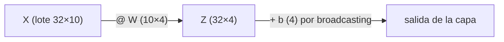

# Álgebra lineal para ML (vectores, matrices y producto punto)

Parte de: [[21-IA-Machine-Learning/01 Matemáticas necesarias/_Índice Matemáticas necesarias|Matemáticas necesarias]]

> [!info] Cómo avanzar
> `progreso`: **pendiente** → **viendo** (estudiando) → **visto** (contestaste la autoevaluación sin abrir las respuestas) → **dominado** (hiciste el laboratorio o lo aplicaste de verdad).

## Contenido

### Qué es
El álgebra lineal es el idioma en el que se escribe casi todo el machine learning. Un **vector** es una lista ordenada de números; en ML representa **un ejemplo** (una fila de tu tabla: edad, ingreso, antigüedad) o un **embedding** (un texto convertido en 768 números). Una **matriz** es una tabla de números con forma `m×n`: puede ser un dataset completo (m filas = ejemplos, n columnas = features) o los **pesos** de un modelo. Con solo tres operaciones —producto punto, multiplicación matriz-vector y multiplicación matriz-matriz— ya puedes leer la regresión lineal, la logística, una red neuronal y la búsqueda semántica.

### Cómo funciona
**Intuición del producto punto.** Multiplicas elemento a elemento y sumas: `a·b = Σ aᵢbᵢ`. Mide **cuánto apuntan en la misma dirección** dos vectores, escalado por sus longitudes. Si es grande y positivo, se parecen; si es cero, son perpendiculares ("no tienen nada que ver"); si es negativo, apuntan a lados opuestos. Por eso aparece en todos lados:

- Una neurona o una regresión lineal calcula `w·x + b`: pondera cada feature por su peso y suma.
- La atención de un Transformer compara consultas y claves con productos punto.
- La **similitud coseno** es el producto punto dividido entre las normas: `cos(a,b) = a·b / (‖a‖‖b‖)`. Quita el efecto del tamaño y deja solo la dirección; va de -1 a 1. Es la medida estándar para comparar embeddings.

**Norma.** `‖a‖ = √(a·a)` es la longitud del vector. La distancia euclidiana entre dos puntos es `‖a − b‖`; la usan k-NN y k-means.

**Matriz por vector.** `A·x` produce un vector donde cada componente es el producto punto de una **fila** de `A` con `x`. Interprétalo como "aplicar una transformación" (rotar, escalar, proyectar) o como "evaluar varias neuronas a la vez": cada fila es el vector de pesos de una neurona.

**Matriz por matriz.** `A (m×n) · B (p×q)` solo existe si **n = p** (las dimensiones internas coinciden) y el resultado mide **m×q** (las externas). El elemento `(i, j)` es el producto punto de la fila *i* de A con la columna *j* de B. No es conmutativa: en general `A·B ≠ B·A`.



**Transpuesta.** `Aᵀ` intercambia filas y columnas. La verás en fórmulas como `Xᵀ X` (mínimos cuadrados, covarianza en [[Reducción de dimensionalidad (PCA)]]).

### Ejemplo
Comprueba las operaciones con NumPy; observa la diferencia entre `*` (elemento a elemento) y `@` (producto matricial).

```python
import numpy as np

a = np.array([1, 2, 3])
b = np.array([4, -1, 2])

punto = a @ b                     # 1*4 + 2*(-1) + 3*2 = 8
coseno = punto / (np.linalg.norm(a) * np.linalg.norm(b))
print(punto, round(coseno, 3))    # 8 0.467

A = np.array([[1, 2], [3, 4]])
B = np.array([[0, 1], [1, 0]])
print(A @ B)   # [[2 1] [4 3]]  -> intercambia columnas de A
print(A * B)   # [[0 2] [3 0]]  -> elemento a elemento, NO es producto matricial

M = np.array([[2, 0], [1, 3]])
x = np.array([1, 2])
print(M @ x)   # [2 7]

# Una "capa" lineal: 32 ejemplos con 10 features -> 4 salidas
X = np.random.default_rng(0).normal(size=(32, 10))
W = np.zeros((10, 4)); bias = np.ones(4)
print((X @ W + bias).shape)   # (32, 4)
```

Si intentas `np.ones((2, 3)) @ np.ones((2, 3))` obtienes un `ValueError`: las dimensiones internas (3 y 2) no coinciden. La de `(3×2)·(2×4)` sí funciona y da `(3×4)`.

**En .NET.** Para cálculos vectoriales rápidos sin salir de C# existe `System.Numerics.Tensors.TensorPrimitives` (con `Dot`, `Norm` y `CosineSimilarity`), útil si guardas embeddings y quieres compararlos en tu API. [[ML.NET]] usa vectores internamente (`VBuffer<float>`) aunque casi nunca los manipulas a mano.

### Cuándo usarlo y cuándo no
Necesitas el álgebra lineal **para leer y depurar**: entender por qué falla una forma (`shapes`) es el 80 % de los errores en NumPy y PyTorch. No necesitas demostrar teoremas ni invertir matrices a mano; las librerías lo hacen mejor y de forma numéricamente estable (por ejemplo, `np.linalg.lstsq` en lugar de invertir `XᵀX`). Profundiza en valores y vectores propios cuando llegues a PCA, y en descomposiciones (SVD) si te interesan sistemas de recomendación.

### Errores comunes
- **Confundir `*` con `@`.** En NumPy `*` multiplica elemento a elemento (y puede "funcionar" por broadcasting sin avisar). Para producto matricial usa `@` o `np.matmul`.
- **No revisar formas.** Imprime `.shape` antes de multiplicar; un vector `(n,)` no es lo mismo que una matriz columna `(n, 1)`.
- **Usar producto punto crudo para comparar textos.** Los vectores largos dominan; normaliza o usa similitud coseno.
- **Asumir conmutatividad.** `A @ B` y `B @ A` casi nunca coinciden, y a veces uno ni existe.
- **Invertir matrices para resolver sistemas.** Es lento e inestable; usa `np.linalg.solve` o `lstsq`.

### Para profundizar
- [Essence of linear algebra (3Blue1Brown)](https://www.3blue1brown.com/topics/linear-algebra)
- [NumPy: linear algebra (numpy.linalg)](https://numpy.org/doc/stable/reference/routines.linalg.html)
- [Mathematics for Machine Learning (libro gratuito)](https://mml-book.github.io/)

## Ejercicios

Resuélvelos en papel o en la herramienta; la solución está plegada.

> [!question]- Calcula el producto punto de `a = [1, 2, 3]` y `b = [4, -1, 2]`.
> `1·4 + 2·(-1) + 3·2 = 4 - 2 + 6 = 8`

> [!question]- Con los mismos vectores, calcula la similitud coseno (3 decimales).
> `|a| = √14 ≈ 3.742`, `|b| = √21 ≈ 4.583`.
> `cos θ = 8 / (3.742 · 4.583) = 8/√294 ≈ 0.467`

> [!question]- Multiplica `A = [[1, 2], [3, 4]]` por `B = [[0, 1], [1, 0]]` (A·B).
> `[[2, 1], [4, 3]]` (B intercambia las columnas de A).

> [!question]- Calcula `A·x` con `A = [[2, 0], [1, 3]]` y `x = [1, 2]`.
> `[2·1 + 0·2, 1·1 + 3·2] = [2, 7]`

> [!question]- ¿Qué forma tiene el resultado de (3×2)·(2×4)? ¿Y de (2×3)·(2×3)?
> 3×4. La segunda no es válida: 3 ≠ 2 (habría que transponer una: (2×3)·(3×2) = 2×2).

## Autoevaluación

Contesta primero en voz alta o en papel; luego despliega la respuesta.

> [!question]- ¿Qué representa un vector en ML?
> Una lista ordenada de números que describe algo: las características de un ejemplo (edad, ingreso…), los pesos de un modelo o un embedding. Geométricamente es un punto o una flecha en un espacio de *n* dimensiones.

> [!question]- ¿Qué mide el producto punto y por qué aparece tanto?
> `a·b = Σ aᵢbᵢ = |a||b|cos θ`. Mide qué tanto apuntan en la misma dirección. Una neurona calcula `w·x + b`, y la similitud coseno entre embeddings es el producto punto normalizado.

> [!question]- ¿Cuándo se pueden multiplicar dos matrices A (m×n) y B (p×q)?
> Solo si `n == p`; el resultado es m×q. En NumPy, un error `shapes not aligned` casi siempre es esto.

> [!question]- Error común: ¿`A * B` y `A @ B` son lo mismo en NumPy?
> No. `*` multiplica elemento por elemento (y aplica broadcasting); `@` es el producto matricial.

## Práctica

- [[Lab 4 - Embeddings y búsqueda por similitud]]

