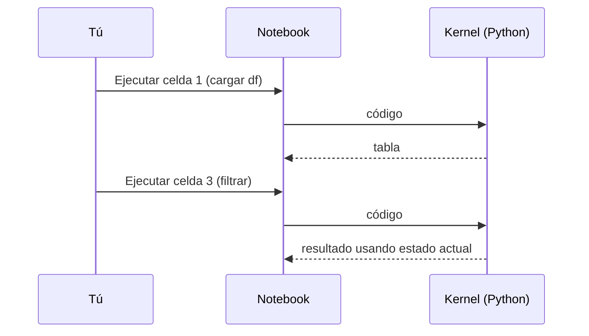

# Jupyter notebooks

Parte de: [[21-IA-Machine-Learning/02 Python para datos/_Índice Python para datos|Python para datos]]

> [!info] Cómo avanzar
> `progreso`: **pendiente** → **viendo** (estudiando) → **visto** (contestaste la autoevaluación sin abrir las respuestas) → **dominado** (hiciste el laboratorio o lo aplicaste de verdad).

## Contenido

### Qué es
Un **notebook** de Jupyter (archivo `.ipynb`) es un documento que mezcla **celdas de código** ejecutables, **celdas de texto** en Markdown y los **resultados** (tablas, gráficas, mensajes) guardados junto al código. Detrás hay un **kernel**: un proceso de Python que vive mientras el notebook está abierto y conserva en memoria todas las variables. Es la herramienta estándar para explorar datos, probar modelos y documentar un análisis paso a paso, porque ves el efecto de cada línea al instante sin volver a correr todo.

### Cómo funciona
1. Abres el notebook (en JupyterLab, en VS Code o en Google Colab).
2. Se inicia un kernel asociado a un intérprete de Python (idealmente el de tu entorno virtual, ver [[Python - entornos virtuales y pip]]).
3. Ejecutas una celda (`Shift+Enter`): el código corre en ese kernel y las variables quedan vivas.
4. La siguiente celda ve todo lo que dejaron las anteriores **en el orden en que tú las ejecutaste**, no en el orden en que aparecen en la página.



**El problema del orden.** Como el estado vive en el kernel, puedes ejecutar la celda 5, luego la 2, borrar una celda que definía una variable y aun así seguir usándola porque sigue en memoria. Resultado: un notebook que "funciona" en tu sesión pero falla al abrirlo de nuevo o al compartirlo. El número entre corchetes junto a cada celda (`[7]`) indica el orden real de ejecución. La disciplina sana es: antes de dar por bueno un notebook, haz **Restart & Run All** (reiniciar kernel y ejecutar todo) y verifica que corre de arriba abajo.

**Comandos útiles dentro de una celda:**
- `!pip install paquete` ejecuta un comando de sistema (en notebooks locales es mejor `%pip install`, que instala en el kernel actual).
- `%timeit expresión` mide cuánto tarda algo.
- `df.head()` como última línea muestra la tabla formateada; no necesitas `print`.

**Dónde ejecutarlos:**
- **Jupyter local (JupyterLab o Notebook)**: instalas `jupyter` en tu venv y lo abres en el navegador. Control total, usa tu hardware (tu GTX 1660 Ti de 6 GB sirve para modelos pequeños con PyTorch).
- **VS Code**: abre `.ipynb` nativamente con la extensión de Jupyter; eliges el kernel como eliges el intérprete. Te da depurador, Git y tu editor de siempre.
- **Google Colab**: notebooks en la nube de Google, gratis, sin instalar nada, con las librerías principales ya instaladas y opción de usar GPU o TPU **sujeta a disponibilidad y límites de uso que Google ajusta** (no garantiza recursos en el plan gratuito). Contras: la sesión es temporal (los archivos locales se borran al desconectarse; guarda en Drive o descarga), y se desconecta por inactividad.

### Ejemplo
Un notebook de análisis típico tiene esta estructura. Cada bloque comentado sería una celda:

```python
# --- Celda 1: imports y configuración (siempre arriba) ---
import numpy as np
import pandas as pd

rng = np.random.default_rng(42)   # semilla fija = resultados reproducibles

# --- Celda 2: cargar datos ---
df = pd.DataFrame({
    "ciudad": rng.choice(["CDMX", "GDL", "MTY"], 200),
    "venta": rng.gamma(2.0, 500.0, 200).round(2),
})

# --- Celda 3: explorar ---
print(df.head(3))
print(df.describe().round(1))

# --- Celda 4: resultado ---
resumen = df.groupby("ciudad")["venta"].agg(["count", "mean"]).round(1)
print(resumen)
```

Imports y semillas al inicio, una idea por celda, Markdown entre celdas explicando el porqué, y nada que dependa de haber corrido algo "a mano" fuera de orden.

**Para un desarrollador .NET.** Durante años existió Polyglot Notebooks (notebooks de C# en VS Code), pero Microsoft anunció su descontinuación en febrero de 2026, así que no conviene invertir en él. Para experimentos rápidos en C# hoy es más práctico un archivo suelto ejecutado con `dotnet run app.cs` (aplicaciones basadas en archivo de .NET 10). Para ML, lo usual es explorar en Python con notebooks y, si el modelo va a producción en .NET, entrenarlo con [[ML.NET]] o exportarlo a ONNX.

### Cuándo usarlo y cuándo no
Úsalo para **explorar**, prototipar, enseñar y compartir análisis con resultados visibles. No lo uses como código de producción: es difícil de probar, de revisar en un pull request (el JSON del `.ipynb` mezcla salidas y metadatos) y de versionar. Cuando algo funciona, muévelo a módulos `.py` con pruebas, y deja el notebook como "cuaderno de laboratorio". Si vas a guardar notebooks en Git, limpia las salidas antes de hacer commit.

### Errores comunes
- **Ejecutar celdas fuera de orden** y confiar en variables que ya no existen en el código: usa *Restart & Run All*.
- **Kernel equivocado**: el paquete está en un venv y el notebook usa otro intérprete.
- **Perder archivos en Colab** al cerrar la sesión: guárdalos en Drive o descárgalos.
- **Subir credenciales** escritas en una celda: usa variables de entorno o los "Secretos" de Colab.
- **Notebooks gigantes** sin estructura; divide por etapas (carga, limpieza, modelo, evaluación).

### Para profundizar
- [Documentación de Project Jupyter](https://docs.jupyter.org/en/latest/)
- [Jupyter en VS Code](https://code.visualstudio.com/docs/datascience/jupyter-notebooks)
- [Google Colab: preguntas frecuentes](https://research.google.com/colaboratory/faq.html)

## Autoevaluación

Contesta primero en voz alta o en papel; luego despliega la respuesta.

> [!question]- ¿Qué es un notebook y cuándo conviene?
> Un documento con celdas de código, resultados y texto. Ideal para explorar datos y prototipar; para código de producción conviene pasar a módulos `.py` con pruebas.

> [!question]- ¿Qué pasa si ejecutas celdas fuera de orden?
> El estado del kernel ya no coincide con lo que se lee de arriba abajo: puede funcionar hoy y fallar al reiniciar. Antes de compartir: *Restart & Run All*.

> [!question]- ¿Qué ofrece Google Colab frente a Jupyter local?
> Nada que instalar, librerías comunes preinstaladas y GPU gratuita con límites de uso (que cambian; Pendiente de confirmar los vigentes). Los archivos locales de la sesión se borran al cerrarla.

## Práctica

- [[Lab 1 - NumPy y pandas en Google Colab]]

