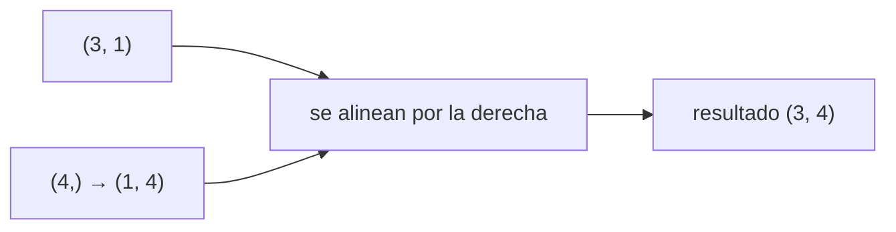

# NumPy

Parte de: [[21-IA-Machine-Learning/02 Python para datos/_Índice Python para datos|Python para datos]]

> [!info] Cómo avanzar
> `progreso`: **pendiente** → **viendo** (estudiando) → **visto** (contestaste la autoevaluación sin abrir las respuestas) → **dominado** (hiciste el laboratorio o lo aplicaste de verdad).

## Contenido

### Qué es
NumPy es la librería base del cómputo numérico en Python. Su pieza central es el **`ndarray`**: un arreglo de N dimensiones con **un solo tipo de dato** (por ejemplo, `float64`) guardado en un bloque contiguo de memoria. Sobre él ofrece operaciones **vectorizadas** (se aplican a todo el arreglo sin escribir ciclos), álgebra lineal, estadísticas y generación de números aleatorios. pandas, scikit-learn y buena parte de PyTorch se apoyan en sus ideas, así que dominar NumPy es dominar la forma de pensar de todo el ecosistema.

### Cómo funciona
**Por qué es rápido.** Una lista de Python guarda referencias a objetos sueltos, cada uno con su tipo; sumar dos listas implica un ciclo interpretado que revisa tipos elemento por elemento. Un `ndarray` guarda los números crudos, juntos, de un solo tipo, y las operaciones corren en código C compilado (con instrucciones SIMD en muchos casos). Suele ser decenas de veces más rápido y ocupa mucha menos memoria.

**Forma (`shape`) y ejes.** `np.arange(12).reshape(3, 4)` es una matriz de 3 filas y 4 columnas. El **eje 0** recorre las filas (hacia abajo) y el **eje 1** las columnas (hacia la derecha). `sum(axis=0)` **colapsa el eje 0**: suma hacia abajo y deja un resultado por columna. `sum(axis=1)` deja uno por fila. La regla mnemotécnica: el eje que indicas es el que desaparece.

**Indexado.**
- `arr[1, 2]`: un elemento; `arr[:, 1]`: toda la columna 1; `arr[0]`: la fila 0.
- **Máscaras booleanas**: `arr[arr % 2 == 0]` devuelve solo los elementos que cumplen la condición (como un `Where` de LINQ).
- **Vistas vs copias**: el slicing (`a[0:2]`) devuelve una **vista** que comparte memoria con el original; si modificas la vista, cambias `a`. El indexado con máscaras o listas de índices devuelve una **copia**. Usa `.copy()` cuando quieras independencia.

**Broadcasting.** Reglas para operar arreglos de formas distintas sin copiarlos: se comparan las dimensiones **desde la derecha**; dos dimensiones son compatibles si son iguales o si una es 1 (que se "estira"). Así, `(3, 1) + (4,)` → `(3, 4)`. Es lo que permite restar la media de cada columna con una sola línea.



### Ejemplo

```python
import numpy as np

arr = np.arange(12).reshape(3, 4)
print(arr)
print(arr[:, 1])                 # [1 5 9]          columna 1
print(arr.sum(axis=0))           # [12 15 18 21]    una suma por columna
print(arr.sum(axis=1))           # [ 6 22 38]       una suma por fila
print(arr[arr % 2 == 0])         # [ 0  2  4  6  8 10]

print((np.ones((3, 1)) + np.arange(4)).shape)   # (3, 4) por broadcasting

# Estandarizar cada columna (media 0, desviación 1) sin ciclos
z = (arr - arr.mean(axis=0)) / arr.std(axis=0)
print(z.mean(axis=0).round(6), z.std(axis=0).round(6))   # [0 0 0 0] [1 1 1 1]

# Vistas: modificar b cambia a
a = np.array([1, 2, 3, 4])
b = a[0:2]
b[0] = 99
print(a)                         # [99  2  3  4]
c = a[0:2].copy(); c[0] = -1
print(a)                         # sin cambios: [99  2  3  4]

# Vectorizar vs ciclo
import time
x = np.random.default_rng(0).random(1_000_000)
t = time.perf_counter(); s1 = sum(v * v for v in x); t_ciclo = time.perf_counter() - t
t = time.perf_counter(); s2 = np.dot(x, x); t_np = time.perf_counter() - t
print(np.isclose(s1, s2), f"NumPy ~{t_ciclo / t_np:.0f}x más rápido")
```

El factor exacto de velocidad depende de tu máquina, pero la diferencia es siempre grande. Este patrón de estandarización es justo lo que hace `StandardScaler` de scikit-learn.

**En .NET.** No hay un equivalente idéntico en la librería estándar, pero `System.Numerics.Tensors` (con `TensorPrimitives` y el tipo `Tensor<T>`) cubre operaciones vectorizadas, y [[ML.NET]] maneja internamente sus propios vectores. Para ML en C# casi siempre trabajas a nivel de pipeline, no de arreglos.

### Cuándo usarlo y cuándo no
Usa NumPy para cualquier cálculo numérico sobre muchos datos homogéneos: matrices, vectores, estadísticas, simulaciones, preparar entradas para modelos. Si tus datos son tablas con columnas de tipos distintos y nombres, usa [[pandas]] (que usa NumPy por dentro). Si necesitas GPU o gradientes automáticos, pasa a PyTorch, cuya API de tensores se parece mucho.

### Errores comunes
- **Modificar una vista creyendo que es copia** (o al revés): el slicing comparte memoria.
- **Confundir `axis`**: `axis=0` colapsa filas (resultado por columna).
- **Broadcasting accidental**: restar un `(n,)` de un `(n, 1)` produce una matriz `(n, n)` sin error. Revisa `.shape`.
- **Escribir ciclos `for`** sobre arreglos grandes en lugar de vectorizar.
- **Mezclar tipos** y terminar con `dtype=object`, que pierde toda la velocidad.

### Para profundizar
- [NumPy: guía para principiantes absolutos](https://numpy.org/doc/stable/user/absolute_beginners.html)
- [NumPy: broadcasting](https://numpy.org/doc/stable/user/basics.broadcasting.html)
- [NumPy: indexado, vistas y copias](https://numpy.org/doc/stable/user/basics.indexing.html)

## Ejercicios

Resuélvelos en papel o en la herramienta; la solución está plegada.

> [!question]- `arr = np.arange(12).reshape(3, 4)`. ¿Qué da `arr[:, 1]`?
> `array([1, 5, 9])` (la segunda columna).

> [!question]- Mismo `arr`: ¿`arr.sum(axis=0)` y `arr.sum(axis=1)`?
> `axis=0` → `[12, 15, 18, 21]`; `axis=1` → `[6, 22, 38]`.

> [!question]- Mismo `arr`: obtén solo los pares con una máscara.
> `arr[arr % 2 == 0]` → `array([0, 2, 4, 6, 8, 10])`

> [!question]- ¿Qué forma tiene `np.ones((3, 1)) + np.arange(4)`?
> `(3, 4)` por broadcasting.

> [!question]- Normaliza cada columna de `arr` a media 0 y desviación 1.
> ```python
> (arr - arr.mean(axis=0)) / arr.std(axis=0)
> ```

## Autoevaluación

Contesta primero en voz alta o en papel; luego despliega la respuesta.

> [!question]- ¿Por qué NumPy es más rápido que listas de Python?
> Guarda datos de un solo tipo en memoria contigua y ejecuta operaciones vectorizadas en C, sin un bucle de Python por elemento.

> [!question]- ¿Qué es el broadcasting?
> La regla que permite operar arreglos de formas distintas alineando dimensiones desde la derecha: son compatibles si son iguales o una es 1. Ej.: `(3,1) + (4,)` → `(3,4)`.

> [!question]- ¿Qué significa `axis=0` en `arr.sum(axis=0)`?
> Suma a lo largo de las filas (colapsa la dimensión 0): el resultado tiene un valor por columna.

> [!question]- Error común: `b = a[0:2]` y luego modificas `b`. ¿Qué le pasa a `a`?
> También cambia: el slicing de NumPy devuelve una *vista*. Usa `a[0:2].copy()` si necesitas independencia.

## Práctica

- [[Lab 1 - NumPy y pandas en Google Colab]]

