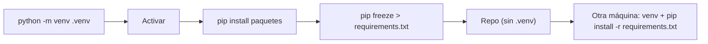

# Python - entornos virtuales y pip

Parte de: [[21-IA-Machine-Learning/02 Python para datos/_Índice Python para datos|Python para datos]]

> [!info] Cómo avanzar
> `progreso`: **pendiente** → **viendo** (estudiando) → **visto** (contestaste la autoevaluación sin abrir las respuestas) → **dominado** (hiciste el laboratorio o lo aplicaste de verdad).

## Contenido

### Qué es
Un **entorno virtual** es una carpeta con su propio intérprete de Python y sus propias librerías, aislada del Python global de tu máquina. **pip** es el gestor de paquetes que instala librerías desde PyPI. Juntos resuelven el mismo problema que NuGet con `PackageReference` en .NET: que cada proyecto tenga sus dependencias y versiones sin pisar a los demás. Sin entornos, instalar `pandas` para un proyecto puede romper otro que necesitaba una versión distinta.

### Cómo funciona
1. Creas el entorno dentro del proyecto con el módulo estándar `venv` (la carpeta suele llamarse `.venv`).
2. Lo **activas**: tu terminal pasa a usar el `python` y el `pip` de esa carpeta.
3. Instalas paquetes con `pip install`; se guardan solo en `.venv`.
4. Congelas las versiones en un archivo (`requirements.txt`) para que otra persona, o tu pipeline de Azure DevOps, recree el mismo entorno.



**En Windows (PowerShell)**, con el lanzador `py` que instala Python para Windows:

```bash
# Crear el entorno en la carpeta del proyecto
py -m venv .venv
# Activarlo (PowerShell)
.venv\Scripts\Activate.ps1
# Si PowerShell bloquea scripts, permite los firmados/locales solo para tu usuario
Set-ExecutionPolicy -Scope CurrentUser RemoteSigned
# Instalar y congelar dependencias
python -m pip install numpy pandas scikit-learn matplotlib jupyter
python -m pip freeze > requirements.txt
# En otra máquina o en CI
python -m pip install -r requirements.txt
# Salir del entorno
deactivate
```

En Linux o macOS la activación es `source .venv/bin/activate`. Usar `python -m pip` en vez de `pip` a secas garantiza que el pip pertenece al Python que estás usando.

**Por qué falla el `import` en VS Code o Jupyter.** El error típico: instalaste el paquete en un entorno, pero el editor o el kernel del notebook usa **otro intérprete** (el global, u otro venv). En VS Code eliges el intérprete con *Python: Select Interpreter* y apuntas a `.venv`. En Jupyter, el kernel debe ser el del entorno: instala `ipykernel` dentro del venv o abre el notebook desde VS Code con ese intérprete seleccionado. Para comprobar cuál usas, ejecuta esto en el mismo lugar donde falla el import:

### Ejemplo

```python
import sys, importlib.util

print(sys.executable)      # ruta del intérprete activo; debe apuntar a ...\.venv\...
print(sys.prefix != sys.base_prefix)   # True si estás dentro de un entorno virtual

for paquete in ("numpy", "pandas", "sklearn"):
    print(paquete, "instalado" if importlib.util.find_spec(paquete) else "NO instalado en este intérprete")
```

Si `sys.executable` no es el del `.venv`, el problema no es el paquete sino el intérprete seleccionado.

**Buenas prácticas para tus repos (Azure DevOps):**
- Agrega `.venv/` al `.gitignore`; nunca subas el entorno, sube `requirements.txt`.
- Fija versiones (`pandas==x.y.z`) en lo que va a producción para builds reproducibles, igual que no dejarías versiones flotantes en NuGet.
- Los secretos (cadenas de conexión, llaves de API) van en variables de entorno o en un `.env` fuera del repo, no en el código.
- En un pipeline, el paso típico es: tarea `UsePythonVersion`, crear venv, `pip install -r requirements.txt`, correr pruebas.

**Alternativas.** `conda` (útil cuando hay dependencias nativas complejas), `uv` y Poetry (gestores más modernos con archivo de bloqueo). Todos resuelven el mismo problema; empieza con `venv` + pip porque vienen con Python.

### Cuándo usarlo y cuándo no
Usa un entorno virtual **para cada proyecto**, siempre, incluso para pruebas pequeñas. La excepción es Google Colab, que ya trae un entorno preparado y temporal: ahí instalas con `!pip install paquete` y se pierde al cerrar la sesión. Para notebooks locales, un venv por proyecto con su kernel evita casi todos los "en mi máquina sí funciona".

### Errores comunes
- **Instalar en el Python global** con `pip install` sin activar el entorno; luego otro proyecto se rompe.
- **Kernel o intérprete equivocado** en VS Code/Jupyter: el paquete existe, pero en otro entorno.
- **Subir `.venv` al repositorio**: pesa cientos de MB y no es portable entre sistemas operativos.
- **`requirements.txt` sin versiones** en producción: dos builds del mismo commit pueden instalar librerías distintas.
- **Política de ejecución de PowerShell** que impide activar: se arregla a nivel de usuario, no desactivando la seguridad del sistema.

### Para profundizar
- [Python: venv (documentación oficial)](https://docs.python.org/es/3/library/venv.html)
- [Python Packaging User Guide: pip y entornos virtuales](https://packaging.python.org/en/latest/guides/installing-using-pip-and-virtual-environments/)
- [VS Code: entornos de Python](https://code.visualstudio.com/docs/python/environments)

## Autoevaluación

Contesta primero en voz alta o en papel; luego despliega la respuesta.

> [!question]- ¿Para qué sirve un entorno virtual?
> Aísla las librerías de cada proyecto para que versiones distintas no choquen entre sí ni con el Python del sistema.

> [!question]- ¿Cómo creas y activas uno en Windows?
> ```powershell
> py -m venv .venv
> .venv\Scripts\Activate.ps1
> pip install numpy pandas
> pip freeze > requirements.txt
> ```

> [!question]- Error común: instalaste un paquete pero `import` falla en VS Code o Jupyter. ¿Por qué?
> El editor o el kernel usa otro intérprete. Selecciona el Python de `.venv` (en VS Code: *Python: Select Interpreter*) o instala con `python -m pip` del mismo intérprete.

