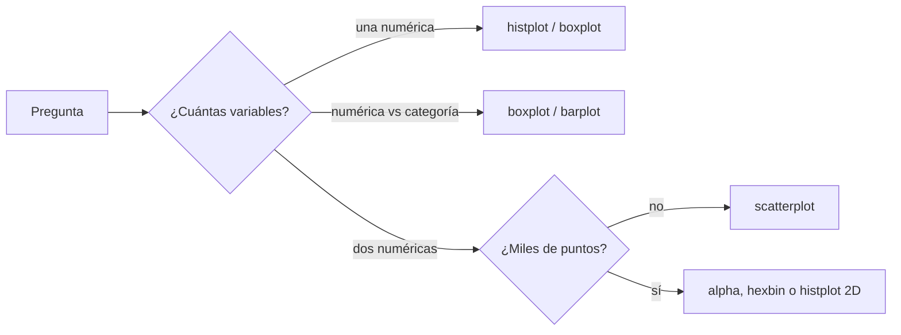

# Visualización con matplotlib y seaborn

Parte de: [[21-IA-Machine-Learning/02 Python para datos/_Índice Python para datos|Python para datos]]

> [!info] Cómo avanzar
> `progreso`: **pendiente** → **viendo** (estudiando) → **visto** (contestaste la autoevaluación sin abrir las respuestas) → **dominado** (hiciste el laboratorio o lo aplicaste de verdad).

## Contenido

### Qué es
Visualizar datos es la forma más rápida de **entenderlos antes de modelar** y de comunicar resultados después. **matplotlib** es la librería de gráficas base de Python: control total sobre cada elemento (ejes, títulos, colores), a costa de ser algo verbosa. **seaborn** está construida **encima de matplotlib** y ofrece gráficas estadísticas de alto nivel que trabajan directamente con DataFrames de [[pandas]]: con una línea obtienes un histograma con curva de densidad o un diagrama de caja por grupo. Lo normal es usar seaborn para crear la gráfica y matplotlib para ajustar detalles.

### Cómo funciona
**El modelo de matplotlib.** Una **Figure** es el lienzo completo; dentro hay uno o varios **Axes** (cada gráfica individual con sus ejes). La forma recomendada es la interfaz orientada a objetos: `fig, ax = plt.subplots()` y luego `ax.plot(...)`, `ax.set_title(...)`. Como seaborn dibuja sobre un `Axes` de matplotlib, puedes pasarle `ax=ax` y combinar ambas.

**Qué gráfica usar según la pregunta:**

| Pregunta | Gráfica | seaborn |
|---|---|---|
| ¿Cómo se distribuye una variable numérica? | Histograma, densidad (KDE), caja | `histplot`, `kdeplot`, `boxplot` |
| ¿Cómo se compara entre grupos? | Caja o violín por categoría, barras | `boxplot(x=cat, y=num)`, `barplot` |
| ¿Se relacionan dos numéricas? | Dispersión, línea de tendencia | `scatterplot`, `regplot` |
| ¿Cómo cambia en el tiempo? | Línea | `lineplot` |
| ¿Qué variables están correlacionadas? | Mapa de calor | `heatmap(df.corr())` |
| Desempeño de un clasificador | Matriz de confusión, ROC | `ConfusionMatrixDisplay`, `RocCurveDisplay` de scikit-learn |

Para la **distribución** de una sola variable numérica, el histograma es el punto de partida: muestra sesgo, colas, picos múltiples y valores imposibles. El diagrama de caja resume mediana, cuartiles y outliers, y es ideal para comparar grupos.

**Demasiados puntos (overplotting).** Con miles de puntos, una dispersión se vuelve una mancha y no ves dónde se concentran. Remedios: transparencia (`alpha=0.1`), puntos más pequeños (`s=5`), muestrear, o cambiar a gráficas de densidad 2D como `hexbin` de matplotlib o `histplot(x=, y=)` de seaborn, que muestran conteos por celda.



### Ejemplo
Este código genera una figura con cuatro paneles y la guarda como PNG (en un notebook se muestra sola).

```python
import matplotlib
matplotlib.use("Agg")              # sin ventana; en Jupyter no hace falta
import matplotlib.pyplot as plt
import numpy as np
import pandas as pd
import seaborn as sns

rng = np.random.default_rng(7)
n = 5000
df = pd.DataFrame({
    "ciudad": rng.choice(["CDMX", "GDL", "MTY"], n),
    "antiguedad": rng.uniform(0, 10, n),
})
df["venta"] = 500 + 120 * df["antiguedad"] + rng.normal(0, 300, n)

fig, axes = plt.subplots(2, 2, figsize=(11, 8))
sns.histplot(df, x="venta", kde=True, ax=axes[0, 0])
axes[0, 0].set_title("Distribución de la venta")

sns.boxplot(df, x="ciudad", y="venta", ax=axes[0, 1])
axes[0, 1].set_title("Venta por ciudad")

axes[1, 0].scatter(df["antiguedad"], df["venta"], s=4, alpha=0.15)
axes[1, 0].set_title("Dispersión con transparencia")

hb = axes[1, 1].hexbin(df["antiguedad"], df["venta"], gridsize=30, cmap="viridis")
fig.colorbar(hb, ax=axes[1, 1], label="conteo")
axes[1, 1].set_title("Densidad con hexbin")

for ax in axes[1]:
    ax.set_xlabel("Antigüedad (años)"); ax.set_ylabel("Venta (MXN)")
fig.tight_layout()
fig.savefig("ventas.png", dpi=120)
print("guardado ventas.png")
```

Fíjate en el último par de paneles: con 5,000 puntos, la dispersión con `alpha` ya deja ver la tendencia, y el hexbin muestra con claridad dónde se concentran los datos.

**Para el mundo .NET.** Si el destino es un tablero para usuarios de negocio, Power BI suele ser mejor opción que una imagen de matplotlib. En C# existen librerías como ScottPlot para gráficas en aplicaciones de escritorio. Para exploración de ML, matplotlib/seaborn en un notebook son lo más rápido.

### Cuándo usarlo y cuándo no
Usa matplotlib/seaborn para exploración y para figuras estáticas en reportes o documentación. Si necesitas interactividad (zoom, tooltip) en un notebook o web, mira Plotly. Para tableros que se actualizan solos y se comparten con negocio, usa una herramienta de BI. No grafiques por graficar: cada gráfica debe responder una pregunta concreta.

### Errores comunes
- **Overplotting** en dispersiones grandes: usa `alpha`, muestreo o hexbin.
- **Ejes sin etiquetas ni unidades**: quien lo vea no sabe qué mide.
- **Ejes Y truncados en barras**, que exageran diferencias pequeñas.
- **Mezclar la interfaz `plt.` con la de `ax.`** y terminar dibujando en la gráfica equivocada; prefiere `fig, ax = plt.subplots()`.
- **Histogramas con muy pocas o demasiadas barras (bins)**: prueba varios valores antes de sacar conclusiones.

### Para profundizar
- [matplotlib: guía rápida](https://matplotlib.org/stable/users/explain/quick_start.html)
- [seaborn: tutorial oficial](https://seaborn.pydata.org/tutorial.html)
- [scikit-learn: visualizaciones de evaluación](https://scikit-learn.org/stable/visualizations.html)

## Autoevaluación

Contesta primero en voz alta o en papel; luego despliega la respuesta.

> [!question]- ¿Qué gráfica usas para ver la distribución de una variable numérica?
> Histograma o KDE (`sns.histplot`, `sns.kdeplot`); para comparar grupos, boxplot o violin.

> [!question]- ¿Qué relación hay entre matplotlib y seaborn?
> seaborn está construido sobre matplotlib: da gráficas estadísticas con menos código y funciona directo con DataFrames; para ajustes finos se usa matplotlib (`plt.title`, `ax.set_xlim`).

> [!question]- Error común: una gráfica de dispersión con miles de puntos se ve como una mancha. ¿Qué haces?
> Bajar `alpha`, usar puntos más pequeños, muestrear o usar `hexbin`/`kdeplot` para ver densidad.

## Práctica

- [[Lab 1 - NumPy y pandas en Google Colab]]

