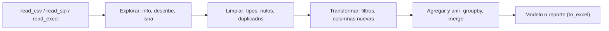

# pandas

Parte de: [[21-IA-Machine-Learning/02 Python para datos/_Índice Python para datos|Python para datos]]

> [!info] Cómo avanzar
> `progreso`: **pendiente** → **viendo** (estudiando) → **visto** (contestaste la autoevaluación sin abrir las respuestas) → **dominado** (hiciste el laboratorio o lo aplicaste de verdad).

## Contenido

### Qué es
pandas es la librería para trabajar con **datos tabulares** en Python: cargar CSV, Excel o resultados de SQL, limpiarlos, transformarlos, agruparlos y unirlos. Sus dos estructuras son la **`Series`** (una columna: valores con un índice) y el **`DataFrame`** (una tabla: varias Series que comparten índice, cada una con su tipo). Si vienes de SQL Server, piensa en un DataFrame como un resultado de consulta en memoria al que le puedes aplicar `WHERE`, `GROUP BY`, `JOIN` y `ORDER BY` con métodos.

### Cómo funciona
**Equivalencias con SQL:**

| SQL | pandas |
|---|---|
| `SELECT col1, col2` | `df.loc[:, ["col1", "col2"]]` |
| `WHERE venta > 1000 AND ciudad = 'CDMX'` | `df[(df.venta > 1000) & (df.ciudad == "CDMX")]` |
| `GROUP BY ciudad` + `AVG(venta)` | `df.groupby("ciudad")["venta"].mean()` |
| `ORDER BY x DESC` | `.sort_values("x", ascending=False)` |
| `LEFT JOIN clientes ON ...` | `ventas.merge(clientes, on="cliente_id", how="left")` |
| `ISNULL(edad, ...)` | `df["edad"].fillna(valor)` |

En los filtros se usan `&`, `|` y `~` (no `and`/`or`) y cada condición va entre paréntesis.

**`loc` vs `iloc`.**
- `df.loc[filas, columnas]` selecciona por **etiqueta**: valores del índice y nombres de columna; acepta máscaras booleanas. Los rangos con `loc` **incluyen** el final.
- `df.iloc[filas, columnas]` selecciona por **posición** entera, como un arreglo; el final del rango se excluye.

**Valores faltantes.** pandas los representa como `NaN` (o `NA`). Opciones: detectarlos (`isna().sum()`), eliminarlos (`dropna`) si son pocos y aleatorios, o **imputarlos** (`fillna` con mediana, moda o un valor centinela) y, a veces, agregar una columna indicadora "venía vacío". En ML, la imputación debe calcularse con los datos de entrenamiento, no con todo el dataset (ver [[Datos de entrenamiento, validación y prueba]]).

**`SettingWithCopyWarning`.** Aparece cuando modificas algo que **podría ser una copia** de otro DataFrame (por ejemplo, filtras y luego asignas una columna sobre el filtro): no queda claro si el cambio afectará al original. La solución es ser explícito: usa `df.loc[máscara, "col"] = valor` para modificar el original, o `.copy()` al crear el subconjunto si quieres uno independiente. Ojo con la versión: en pandas 3.0 el modelo *Copy-on-Write* pasó a ser el comportamiento por defecto y esta advertencia ya no existe; ahora un subconjunto siempre se comporta como copia, así que una asignación encadenada simplemente **no modifica** el original (sin avisar). Por eso el hábito de usar `loc` sobre el DataFrame original sigue siendo el correcto en cualquier versión.



### Ejemplo

```python
import numpy as np
import pandas as pd

ventas = pd.DataFrame({
    "cliente_id": [1, 2, 1, 3, 4, 2],
    "ciudad": ["CDMX", "GDL", "CDMX", "MTY", "CDMX", "GDL"],
    "venta": [1500, 800, 300, 2100, 950, 1200],
})
clientes = pd.DataFrame({"cliente_id": [1, 2, 3], "edad": [34, np.nan, 51]})

# Promedio por ciudad, de mayor a menor
print(ventas.groupby("ciudad")["venta"].mean().sort_values(ascending=False))

# Filtro compuesto
print(ventas[(ventas["venta"] > 1000) & (ventas["ciudad"] == "CDMX")])

# LEFT JOIN: se conservan todas las ventas, aunque el cliente 4 no exista
df = ventas.merge(clientes, on="cliente_id", how="left")
print(df.isna().sum()["edad"])                  # 3 nulos (cliente 2 sin edad y 4 sin registro)

# Imputar con la mediana
df["edad"] = df["edad"].fillna(df["edad"].median())
print(df["edad"].tolist())

# loc (etiquetas, final incluido) vs iloc (posiciones, final excluido)
print(df.loc[0:2, ["ciudad", "venta"]].shape, df.iloc[0:2, 1:3].shape)   # (3, 2) (2, 2)

# Modificar sin ambigüedad
df.loc[df["ciudad"] == "MTY", "venta"] = df["venta"] * 1.1
grandes = df[df["venta"] > 1000].copy()        # subconjunto independiente
grandes["categoria"] = "grande"
print(grandes.loc[:, ["ciudad", "venta", "categoria"]])
```

**En .NET.** Para tus reportes de Excel en Wee.Reporteria seguirías con C# y Dapper, pero si quieres algo parecido a pandas existe `Microsoft.Data.Analysis.DataFrame`, que [[ML.NET]] puede consumir. En Python, `pd.read_sql` con un conector a SQL Server te deja traer el resultado de un procedimiento directo a un DataFrame para explorarlo.

### Cuándo usarlo y cuándo no
Úsalo para exploración, limpieza y preparación de datos que caben en memoria (hasta unos cuantos millones de filas sin problema en una PC normal). Para agregaciones pesadas, deja que SQL Server trabaje y trae solo el resultado. Para datos que no caben en memoria, considera Polars, DuckDB o Spark. Para cálculo numérico puro sobre matrices, usa [[NumPy]].

### Errores comunes
- **Usar `and`/`or` en filtros** en vez de `&`/`|` con paréntesis: da error de ambigüedad.
- **Asignar sobre un filtro encadenado** (`df[df.x > 0]["y"] = 1`): puede no modificar nada. Usa `loc`.
- **Confundir `loc` e `iloc`**, sobre todo cuando el índice no es 0..n-1 tras filtrar u ordenar.
- **`merge` que duplica filas** porque la llave no es única en la tabla derecha; valida con `validate="many_to_one"`.
- **Ciclos con `iterrows`** para cálculos que se pueden vectorizar.

### Para profundizar
- [pandas: 10 minutos para empezar](https://pandas.pydata.org/docs/user_guide/10min.html)
- [pandas: comparación con SQL](https://pandas.pydata.org/docs/getting_started/comparison/comparison_with_sql.html)
- [pandas: Copy-on-Write](https://pandas.pydata.org/docs/user_guide/copy_on_write.html)

## Ejercicios

Resuélvelos en papel o en la herramienta; la solución está plegada.

> [!question]- Con `df` de columnas `ciudad` y `venta`, calcula la venta promedio por ciudad, de mayor a menor.
> ```python
> df.groupby('ciudad')['venta'].mean().sort_values(ascending=False)
> ```

> [!question]- Filtra las filas con `venta > 1000` de la ciudad `'CDMX'`.
> ```python
> df[(df['venta'] > 1000) & (df['ciudad'] == 'CDMX')]
> ```
> Ojo: paréntesis y `&`, no `and`.

> [!question]- Une `ventas` y `clientes` por `cliente_id` conservando todas las ventas.
> ```python
> ventas.merge(clientes, on='cliente_id', how='left')
> ```

> [!question]- Rellena los nulos de `edad` con la mediana.
> ```python
> df['edad'] = df['edad'].fillna(df['edad'].median())
> ```

## Autoevaluación

Contesta primero en voz alta o en papel; luego despliega la respuesta.

> [!question]- ¿Qué son `Series` y `DataFrame`?
> `Series`: una columna con índice. `DataFrame`: tabla de columnas con un índice común, cada columna con su tipo.

> [!question]- ¿Qué diferencia hay entre `loc` e `iloc`?
> `loc` selecciona por etiqueta (nombre de fila/columna, incluye el extremo final); `iloc` por posición entera (excluye el final).

> [!question]- ¿Cómo manejas valores faltantes?
> Detecta con `df.isna().sum()`; decide entre `dropna()`, `fillna(valor)` o imputar (media/mediana) según el caso. Imputa con estadísticas del conjunto de **entrenamiento**, no de todo el dataset.

> [!question]- Error común: `SettingWithCopyWarning`. ¿Qué indica?
> Que modificas algo que puede ser una copia de un filtro. Usa `df.loc[filtro, 'col'] = valor` o `.copy()` explícito.

## Práctica

- [[Lab 1 - NumPy y pandas en Google Colab]]

