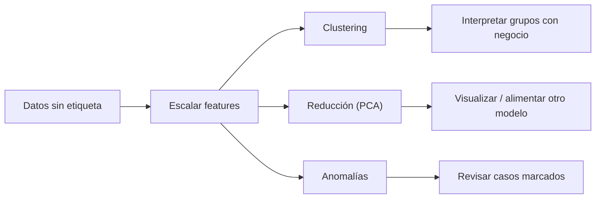

# Aprendizaje no supervisado

Parte de: [[Aprendizaje supervisado, no supervisado y por refuerzo]]

> [!info] Cómo avanzar
> `progreso`: **pendiente** → **viendo** (estudiando) → **visto** (contestaste la autoevaluación sin abrir las respuestas) → **dominado** (hiciste el laboratorio o lo aplicaste de verdad).

## Contenido

### Qué es
En el aprendizaje no supervisado **no hay etiquetas**: el algoritmo recibe solo las features y busca estructura por su cuenta. No responde "¿cuál es la respuesta?" sino "¿qué forma tienen estos datos?". Es útil cuando etiquetar es caro o imposible, cuando quieres explorar antes de modelar, o cuando lo que buscas es justamente lo raro.

### Cómo funciona
Las tres tareas típicas:

1. **Clustering (agrupamiento)**: encontrar grupos de ejemplos parecidos entre sí. Segmentar clientes por comportamiento de compra, agrupar tickets por tema, agrupar productos. Algoritmos: [[Clustering (k-means)]], DBSCAN, clustering jerárquico.
2. **Reducción de dimensionalidad**: comprimir muchas features en pocas que conserven la mayor parte de la información, para visualizar en 2D, quitar ruido o acelerar otros modelos. Algoritmos: [[Reducción de dimensionalidad (PCA)]], t-SNE, UMAP.
3. **Detección de anomalías**: identificar ejemplos que no se parecen al resto (transacciones raras, lecturas de sensor fuera de patrón, picos de latencia). Algoritmos: Isolation Forest, One-Class SVM, distancia a centroides.

También entran aquí las **reglas de asociación** ("quien compra A suele comprar B").



**¿Cómo evalúas si no hay respuesta correcta?** No existe una exactitud que calcular, así que combinas:
- **Métricas internas**: miden qué tan compactos y separados son los grupos. El **coeficiente de silueta** (de -1 a 1; más alto = grupos mejor definidos), la inercia (suma de distancias al centroide) para el método del codo, o el índice Davies-Bouldin (más bajo es mejor).
- **Estabilidad**: si cambias la semilla o tomas otra muestra, ¿salen grupos parecidos?
- **Utilidad e interpretabilidad**: ¿los grupos tienen sentido para el negocio y llevan a decisiones distintas? Un segmento de "clientes que compran de noche con tarjeta" vale si marketing puede actuar sobre él.
- **Validación externa** cuando existe alguna etiqueta parcial (comparar con categorías conocidas, como en el ejemplo de iris del tema padre).

**Escalar es obligatorio.** k-means, PCA y la mayoría de estos métodos se basan en **distancias o varianzas**. Si una feature es "ingreso" (miles) y otra "número de compras" (unidades), la distancia la domina el ingreso y el clustering prácticamente ignora las demás. Estandariza (`StandardScaler`) antes.

### Ejemplo
El mismo k-means sin escalar y escalando, comparando con la estructura real:

```python
import numpy as np
from sklearn.cluster import KMeans
from sklearn.preprocessing import StandardScaler
from sklearn.metrics import silhouette_score, adjusted_rand_score

rng = np.random.default_rng(1)
# Dos segmentos reales que se distinguen por número de compras, no por ingreso
compras = np.concatenate([rng.normal(3, 1, 300), rng.normal(15, 2, 300)])
ingreso = rng.normal(25_000, 8_000, 600)          # ruido grande, misma distribución en ambos
real = np.array([0] * 300 + [1] * 300)
X = np.column_stack([ingreso, compras])

sin = KMeans(n_clusters=2, n_init=10, random_state=0).fit_predict(X)
Xs = StandardScaler().fit_transform(X)
con = KMeans(n_clusters=2, n_init=10, random_state=0).fit_predict(Xs)

print("sin escalar  ARI:", round(adjusted_rand_score(real, sin), 2))   # cerca de 0: agrupa por ingreso
print("escalado     ARI:", round(adjusted_rand_score(real, con), 2))   # cerca de 1
print("silueta (escalado):", round(silhouette_score(Xs, con), 2))
```

Sin escalar, k-means parte los datos por ingreso (la columna con números más grandes) y no encuentra los segmentos reales.

**En .NET.** [[ML.NET]] tiene `mlContext.Clustering.Trainers.KMeans` y el catálogo `mlContext.AnomalyDetection` (por ejemplo, PCA aleatorizado para anomalías), además de detección de anomalías en series de tiempo (`DetectSpikeBySsa`, `DetectIidSpike`), útil para alertas sobre métricas de tus APIs.

### Cuándo usarlo y cuándo no
Úsalo para explorar un dataset nuevo, segmentar, comprimir features, pre-etiquetar (agrupas y luego alguien nombra los grupos) o detectar rarezas. No lo uses cuando tienes etiquetas y una pregunta concreta: un modelo supervisado será más preciso y fácil de evaluar. No esperes que el algoritmo "descubra la verdad": los grupos dependen de las features y la escala que elijas.

### Errores comunes
- **No escalar** antes de métodos basados en distancia.
- **Elegir el número de grupos sin criterio**: usa codo, silueta y sentido de negocio.
- **Sobreinterpretar grupos** que cambian con cada semilla.
- **Incluir IDs o columnas irrelevantes** que distorsionan las distancias.

### Para profundizar
- [scikit-learn: clustering](https://scikit-learn.org/stable/modules/clustering.html)
- [scikit-learn: detección de anomalías y novedades](https://scikit-learn.org/stable/modules/outlier_detection.html)
- [Microsoft Learn: tareas de ML en ML.NET](https://learn.microsoft.com/es-mx/dotnet/machine-learning/resources/tasks)

## Autoevaluación

Contesta primero en voz alta o en papel; luego despliega la respuesta.

> [!question]- Menciona tres tareas típicas.
> Clustering (k-means), reducción de dimensionalidad (PCA) y detección de anomalías.

> [!question]- ¿Cómo evalúas un clustering si no hay etiquetas?
> Con métricas internas (inercia, silhouette), revisando muestras de cada grupo y midiendo si sirve para la tarea de negocio.

> [!question]- ¿Qué pasa si no escalas las variables antes de k-means?
> Las de mayor rango (ingreso en pesos vs edad) dominan la distancia y los grupos salen sesgados.

