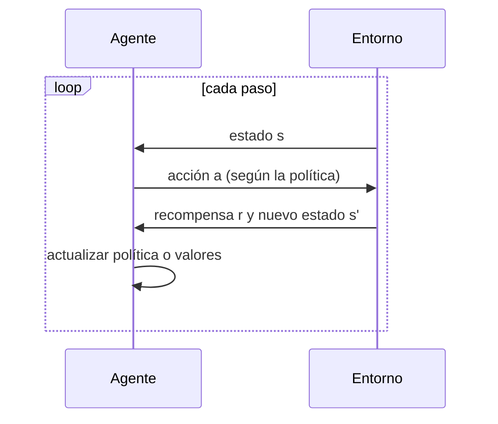

# Aprendizaje por refuerzo

Parte de: [[Aprendizaje supervisado, no supervisado y por refuerzo]]

> [!info] Cómo avanzar
> `progreso`: **pendiente** → **viendo** (estudiando) → **visto** (contestaste la autoevaluación sin abrir las respuestas) → **dominado** (hiciste el laboratorio o lo aplicaste de verdad).

## Contenido

### Qué es
En el aprendizaje por refuerzo (*reinforcement learning*, RL) un **agente** aprende a tomar decisiones **interactuando con un entorno**. Nadie le dice la acción correcta en cada momento; solo recibe una **recompensa** (positiva o negativa) como consecuencia de lo que hace, a veces mucho después. Su objetivo es aprender una **política**: una regla que, dado el estado actual, elige la acción que maximiza la recompensa acumulada a largo plazo. Es como aprender a jugar ajedrez solo sabiendo al final si ganaste o perdiste.

### Cómo funciona
**Las piezas:**
- **Agente**: quien decide.
- **Entorno**: el mundo con el que interactúa (un juego, un simulador, un sistema).
- **Estado**: lo que el agente observa en un momento.
- **Acción**: lo que puede hacer.
- **Recompensa**: el número que recibe después de actuar.
- **Política**: la estrategia estado → acción que se va mejorando.
- **Función de valor**: cuánta recompensa futura espera desde un estado (o un par estado-acción, el famoso valor *Q*).



**Exploración vs explotación.** Es el dilema central. **Explotar** es elegir la acción que hoy crees mejor; **explorar** es probar otras para descubrir si hay algo mejor. Si solo explotas, te quedas con la primera opción decente; si solo exploras, nunca aprovechas lo aprendido. Una estrategia simple es **ε-greedy**: con probabilidad ε (por ejemplo 10 %) eliges al azar, y el resto del tiempo eliges la mejor conocida; suele reducirse ε con el tiempo. El problema clásico para ilustrarlo es el "bandido multibrazo": varias máquinas tragamonedas con pagos desconocidos. En el mundo real equivale a decidir qué variante de una página mostrar mientras aprendes cuál convierte mejor.

**Dónde aparece en los LLMs.** Los modelos de lenguaje se preentrenan de forma auto-supervisada (predecir el siguiente token), pero para que sigan instrucciones, sean útiles y eviten respuestas dañinas se ajustan con técnicas de refuerzo como **RLHF** (*reinforcement learning from human feedback*): personas comparan respuestas, se entrena un **modelo de recompensa** que imita esas preferencias, y el LLM se optimiza para maximizarla. Hay variantes que usan retroalimentación generada por otros modelos o por reglas escritas, y métodos que optimizan directamente con preferencias (como DPO). También se usa refuerzo para entrenar razonamiento con recompensas verificables (por ejemplo, si el código pasa las pruebas o si la respuesta matemática es correcta).

### Ejemplo
Un bandido de tres brazos con ε-greedy, en NumPy puro:

```python
import numpy as np

rng = np.random.default_rng(0)
prob_real = np.array([0.20, 0.50, 0.65])     # probabilidad de "premio" de cada brazo (el agente no la conoce)
estimado = np.zeros(3)
veces = np.zeros(3)
epsilon, total = 0.1, 0

for paso in range(5_000):
    if rng.random() < epsilon:
        a = rng.integers(3)                  # explorar
    else:
        a = int(np.argmax(estimado))         # explotar
    r = float(rng.random() < prob_real[a])   # recompensa 1 o 0
    veces[a] += 1
    estimado[a] += (r - estimado[a]) / veces[a]   # promedio incremental
    total += r

print("estimado:", estimado.round(2))        # se acerca a [0.2, 0.5, 0.65]
print("veces elegido:", veces.astype(int))   # la mayoría en el brazo 2
print("recompensa promedio:", round(total / 5_000, 3))
```

El agente descubre que el tercer brazo es el mejor y lo usa la mayor parte del tiempo, pero sigue explorando un poco. Con ε = 0 podría quedarse atorado en un brazo peor si al inicio tuvo suerte con él.

Para entornos más ricos, la librería de referencia en Python es **Gymnasium** (sucesora de OpenAI Gym), con entornos estándar como CartPole. [[ML.NET]] no incluye refuerzo; en .NET este tipo de lógica se implementa a mano o se consume un modelo entrenado en Python.

### Cuándo usarlo y cuándo no
Tiene sentido cuando hay **decisiones secuenciales** cuyo efecto se ve después, un entorno o simulador donde equivocarse es barato, y una recompensa que se puede medir: juegos, robótica, control, recomendaciones adaptativas, precios dinámicos (con mucho cuidado). Para la mayoría de problemas de negocio con datos históricos y una respuesta conocida, el [[Aprendizaje supervisado]] es más simple, estable y fácil de validar. Para pruebas A/B con aprendizaje continuo, los bandidos son una versión ligera y práctica.

### Errores comunes
- **Recompensa mal diseñada**: el agente encuentra atajos que maximizan el número sin lograr lo que querías (*reward hacking*).
- **No explorar lo suficiente** y quedarse con una política mediocre.
- **Entrenar en el sistema real sin simulador**: cada error cuesta dinero o usuarios.
- **Esperar estabilidad**: el entrenamiento por refuerzo es ruidoso; repite con varias semillas.

### Para profundizar
- [Sutton y Barto: Reinforcement Learning, An Introduction (libro gratuito)](http://incompleteideas.net/book/the-book-2nd.html)
- [Gymnasium (Farama Foundation)](https://gymnasium.farama.org/)
- [Hugging Face Deep RL Course](https://huggingface.co/learn/deep-rl-course/unit0/introduction)

## Autoevaluación

Contesta primero en voz alta o en papel; luego despliega la respuesta.

> [!question]- ¿Cuáles son sus piezas?
> Agente, entorno, estado, acción, recompensa y política (qué acción tomar en cada estado).

> [!question]- ¿Qué es el dilema exploración vs explotación?
> Elegir entre probar acciones nuevas (aprender) o repetir la mejor conocida (ganar recompensa ahora). Una estrategia simple es ε-greedy.

> [!question]- ¿Dónde aparece en los LLMs?
> En el ajuste con retroalimentación humana o de preferencias (RLHF y variantes), que alinea las respuestas con lo que las personas prefieren.

