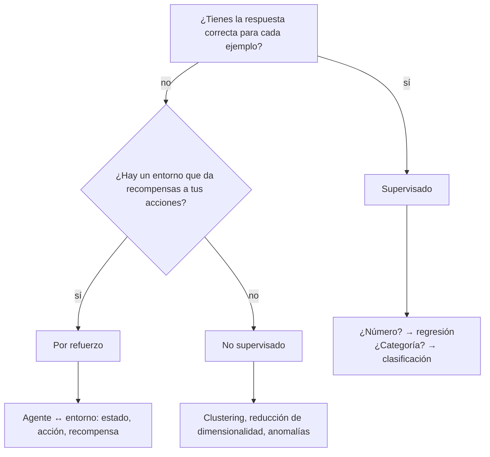

# Aprendizaje supervisado, no supervisado y por refuerzo

Parte de: [[21-IA-Machine-Learning/03 Machine learning clásico/_Índice Machine learning clásico|Machine learning clásico]]

> [!info] Cómo avanzar
> `progreso`: **pendiente** → **viendo** (estudiando) → **visto** (contestaste la autoevaluación sin abrir las respuestas) → **dominado** (hiciste el laboratorio o lo aplicaste de verdad).

## Contenido

### Qué es
Los algoritmos de machine learning se agrupan en tres grandes familias según **qué tipo de retroalimentación** reciben al aprender:

- **[[Aprendizaje supervisado]]**: cada ejemplo trae la respuesta correcta (etiqueta). El modelo aprende a mapear entradas → salida. "Estas 10,000 transacciones son fraude o no; aprende a distinguirlas."
- **[[Aprendizaje no supervisado]]**: no hay etiquetas. El modelo busca estructura por sí solo: grupos, patrones, rarezas. "Aquí hay 10,000 clientes; ¿qué segmentos naturales existen?"
- **[[Aprendizaje por refuerzo]]**: no hay respuestas por ejemplo, sino **recompensas** por acciones dentro de un entorno. Un agente prueba, observa el resultado y aprende qué hacer. "Decide qué movimiento hacer; al final sabrás si ganaste."

Conocer la familia te dice qué datos necesitas, qué algoritmos considerar y cómo evaluar.

### Cómo funciona
La pregunta que decide es: **¿qué sé de la respuesta?**



| | Supervisado | No supervisado | Por refuerzo |
|---|---|---|---|
| Datos | Ejemplos con etiqueta | Ejemplos sin etiqueta | Interacción con un entorno |
| Objetivo | Predecir la etiqueta | Descubrir estructura | Maximizar recompensa acumulada |
| Ejemplos | Precio de casa, churn, spam | Segmentar clientes, PCA, anomalías | Juegos, robótica, ajuste de LLMs |
| Evaluación | Contra etiquetas reales (métricas) | Indirecta (silueta, utilidad de negocio) | Recompensa obtenida |
| Algoritmos de esta sección | [[Regresión lineal]], [[Regresión logística]], árboles, boosting, k-NN, SVM | [[Clustering (k-means)]], [[Reducción de dimensionalidad (PCA)]] | Q-learning, métodos de política |

**Caso: 10,000 tickets sin categoría.** Si quieres agruparlos por tema y no tienes etiquetas, es **no supervisado**: conviertes cada ticket en un vector (por ejemplo, TF-IDF o embeddings) y aplicas clustering. Después alguien revisa los grupos y los nombra. Si luego etiquetas una muestra, puedes entrenar un clasificador **supervisado** que asigne categoría a los tickets nuevos: las familias se combinan seguido.

**Aprendizaje auto-supervisado.** Es una cuarta idea, muy importante hoy: el modelo **fabrica sus propias etiquetas a partir de los datos** sin intervención humana. Un LLM aprende a predecir la siguiente palabra de un texto: la "etiqueta" es la palabra que realmente seguía. Técnicamente se entrena como supervisado, pero no requiere que nadie etiquete, así que escala a cantidades enormes de texto o imágenes. Es la base del preentrenamiento de modelos como los Transformers y de los embeddings. Además, el **semi-supervisado** combina pocas etiquetas con muchos datos sin etiquetar.

### Ejemplo
Los mismos datos usados de dos formas: con etiquetas (supervisado) y sin ellas (no supervisado).

```python
from sklearn.datasets import load_iris
from sklearn.linear_model import LogisticRegression
from sklearn.cluster import KMeans
from sklearn.metrics import adjusted_rand_score
from sklearn.preprocessing import StandardScaler

X, y = load_iris(return_X_y=True)
X = StandardScaler().fit_transform(X)

# Supervisado: usa y para aprender
clf = LogisticRegression(max_iter=1000).fit(X, y)
print("supervisado, exactitud:", round(clf.score(X, y), 3))

# No supervisado: ignora y, solo agrupa
grupos = KMeans(n_clusters=3, n_init=10, random_state=0).fit_predict(X)
# Comparamos con las especies reales solo para ilustrar (en la vida real no las tendrías)
print("no supervisado, coincidencia con especies (ARI):", round(adjusted_rand_score(y, grupos), 3))
```

El clustering recupera buena parte de la estructura sin haber visto nunca las especies, pero no sabe "nombrarlas"; el clasificador supervisado sí, porque aprendió de las etiquetas.

**En .NET.** [[ML.NET]] organiza sus trainers justamente así: `mlContext.Regression`, `mlContext.BinaryClassification` y `mlContext.MulticlassClassification` (supervisado), `mlContext.Clustering` y `mlContext.AnomalyDetection` (no supervisado). No incluye aprendizaje por refuerzo.

### Cuándo usarlo y cuándo no
Si tienes etiquetas confiables, el supervisado casi siempre da resultados más útiles y medibles. Usa no supervisado para explorar, segmentar, comprimir features o detectar anomalías cuando etiquetar es caro. El refuerzo tiene sentido cuando hay decisiones secuenciales y un simulador o entorno donde probar sin consecuencias graves; para la mayoría de los problemas de negocio tabulares no es la primera opción.

### Errores comunes
- **Forzar supervisado sin etiquetas confiables**: etiquetas ruidosas producen un modelo que aprende el ruido.
- **Evaluar clustering como si fuera clasificación**: no hay "respuesta correcta"; mide utilidad e interpretabilidad.
- **Usar refuerzo donde basta supervisado**: es mucho más difícil de entrenar y depurar.
- **Confundir auto-supervisado con no supervisado**: el primero sí tiene una tarea de predicción con etiquetas generadas.

### Para profundizar
- [scikit-learn: aprendizaje supervisado](https://scikit-learn.org/stable/supervised_learning.html)
- [scikit-learn: aprendizaje no supervisado](https://scikit-learn.org/stable/unsupervised_learning.html)
- [Google ML Crash Course: tipos de ML](https://developers.google.com/machine-learning/intro-to-ml/what-is-ml)

## Subtemas

- [[Aprendizaje supervisado]]
- [[Aprendizaje no supervisado]]
- [[Aprendizaje por refuerzo]]

## Autoevaluación

Contesta primero en voz alta o en papel; luego despliega la respuesta.

> [!question]- ¿Qué distingue a los tres tipos?
> Supervisado: datos con etiqueta (respuesta correcta). No supervisado: sin etiqueta, busca estructura. Por refuerzo: un agente aprende por recompensas al interactuar con un entorno.

> [!question]- Tienes 10 000 tickets sin categoría y quieres agruparlos por tema. ¿Qué tipo usas?
> No supervisado (clustering de embeddings, p. ej. k-means). Si después etiquetas una muestra, podrías entrenar un clasificador supervisado.

> [!question]- ¿Qué es el aprendizaje auto-supervisado?
> Las etiquetas salen de los mismos datos (predecir la siguiente palabra, una parte oculta de una imagen). Así se preentrenan los LLMs.

## Progreso de los subtemas

```base
filters:
  and:
    - file.inFolder("21-IA-Machine-Learning/03 Machine learning clásico/Aprendizaje supervisado, no supervisado y por refuerzo")
    - file.name != "Aprendizaje supervisado, no supervisado y por refuerzo"
views:
  - type: table
    name: Progreso
    order:
      - file.name
      - progreso
      - nivel
```
