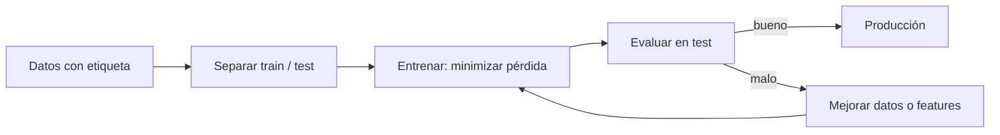

# Aprendizaje supervisado

Parte de: [[Aprendizaje supervisado, no supervisado y por refuerzo]]

> [!info] Cómo avanzar
> `progreso`: **pendiente** → **viendo** (estudiando) → **visto** (contestaste la autoevaluación sin abrir las respuestas) → **dominado** (hiciste el laboratorio o lo aplicaste de verdad).

## Contenido

### Qué es
En el aprendizaje supervisado el modelo aprende de **ejemplos con la respuesta correcta**: pares (entrada, etiqueta). Como un alumno con un cuaderno de ejercicios resueltos, ajusta sus parámetros hasta reproducir las respuestas y luego las aplica a casos nuevos. Resuelve dos grandes tipos de problema:

- **Regresión**: la etiqueta es un **número continuo**. Precio de una casa, minutos de entrega, demanda de mañana.
- **Clasificación**: la etiqueta es una **categoría**. Binaria (fraude sí/no, el cliente cancela o no) o multiclase (categoría de un ticket, especie de una flor).

### Cómo funciona
1. **Reúnes datos históricos** donde conoces la respuesta: pedidos con su tiempo real de entrega, clientes que cancelaron o no.
2. **Defines features y etiqueta**, cuidando que las features existan **en el momento de predecir**.
3. **Separas** entrenamiento, validación y prueba ([[Datos de entrenamiento, validación y prueba]]).
4. **Entrenas**: el algoritmo minimiza una pérdida que compara su predicción con la etiqueta (error cuadrático en regresión, log loss en clasificación).
5. **Evalúas** con métricas en datos que el modelo no vio ([[Métricas de clasificación y regresión]]).
6. **Despliegas** y monitoreas.



**Qué necesita para funcionar bien:**
- **Etiquetas correctas y consistentes.** Si dos personas etiquetan igual caso de forma distinta, el modelo aprende la confusión.
- **Datos representativos** de lo que verá en producción (mismas temporadas, mismos tipos de cliente, misma proporción aproximada de clases).
- **Suficientes ejemplos**, sobre todo de la clase rara (si solo hay 30 fraudes, el modelo apenas puede aprender cómo se ven).
- **Features informativas** y disponibles al predecir ([[Feature engineering]]).

**Fuga de información (data leakage) por etiquetas del futuro.** Es el error más peligroso del supervisado: una feature o la propia construcción de la etiqueta usa información que **no estará disponible** en el momento real de predecir. Ejemplo: para predecir si un cliente cancelará el próximo mes incluyes "número de llamadas a retención", que solo ocurre *después* de que avisó que se iba. En la evaluación el modelo luce casi perfecto; en producción se desploma, porque esa señal no existe todavía. Se evita fijando una **fecha de corte**: todas las features se calculan con datos anteriores al corte y la etiqueta con lo que pasó después.

### Ejemplo
Regresión y clasificación con la misma estructura de código:

```python
from sklearn.datasets import make_regression, make_classification
from sklearn.model_selection import train_test_split
from sklearn.linear_model import LinearRegression, LogisticRegression
from sklearn.metrics import mean_absolute_error, accuracy_score

# Regresión: etiqueta numérica
X, y = make_regression(n_samples=500, n_features=3, noise=10, random_state=0)
X_tr, X_te, y_tr, y_te = train_test_split(X, y, test_size=0.2, random_state=0)
reg = LinearRegression().fit(X_tr, y_tr)
print("MAE regresión:", round(mean_absolute_error(y_te, reg.predict(X_te)), 2))

# Clasificación: etiqueta categórica
X, y = make_classification(n_samples=500, n_features=5, random_state=0)
X_tr, X_te, y_tr, y_te = train_test_split(X, y, test_size=0.2, stratify=y, random_state=0)
clf = LogisticRegression().fit(X_tr, y_tr)
print("exactitud clasificación:", round(accuracy_score(y_te, clf.predict(X_te)), 3))
print("probabilidades de los primeros 3:", clf.predict_proba(X_te[:3])[:, 1].round(2))
```

**En .NET.** En [[ML.NET]] eliges el catálogo según el tipo: `mlContext.Regression.Trainers` (por ejemplo `Sdca`, `FastTree`, `LightGbm`) o `mlContext.BinaryClassification.Trainers` / `MulticlassClassification.Trainers`. La etiqueta se indica con `labelColumnName`; en clasificación binaria debe ser `bool`.

### Cuándo usarlo y cuándo no
Úsalo cuando hay una pregunta concreta con respuesta histórica conocida. Si no hay etiquetas, considera etiquetar una muestra (a veces 1,000 ejemplos bien hechos bastan para empezar) o usa [[Aprendizaje no supervisado]] para explorar. Si la etiqueta cambia de significado con el tiempo (políticas nuevas, otro producto), planea reentrenar.

### Errores comunes
- **Fuga por información del futuro**: métricas espectaculares que no se repiten en producción.
- **Etiquetas inconsistentes**: define criterios escritos para etiquetar.
- **Ignorar el desbalance**: con 1 % de positivos, la exactitud engaña; usa precisión, recall y estratificación.
- **Confundir regresión con clasificación**: predecir "0/1" con una regresión lineal da valores fuera de rango.

### Para profundizar
- [scikit-learn: aprendizaje supervisado](https://scikit-learn.org/stable/supervised_learning.html)
- [scikit-learn: errores comunes y fuga de datos](https://scikit-learn.org/stable/common_pitfalls.html)
- [Microsoft Learn: tareas de ML en ML.NET](https://learn.microsoft.com/es-mx/dotnet/machine-learning/resources/tasks)

## Autoevaluación

Contesta primero en voz alta o en papel; luego despliega la respuesta.

> [!question]- ¿Qué dos grandes problemas resuelve?
> Regresión (predecir un número: precio) y clasificación (predecir una categoría: spam/no spam).

> [!question]- ¿Qué necesita para funcionar bien?
> Suficientes ejemplos etiquetados, representativos de lo que verá en producción, y etiquetas correctas.

> [!question]- Error común: etiquetas creadas con información del futuro. ¿Qué problema causa?
> *Data leakage*: el modelo luce excelente en pruebas y falla en producción, donde esa información no existe al predecir.

