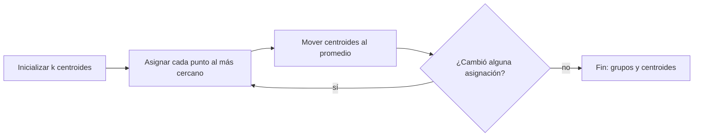

# Clustering (k-means)

Parte de: [[21-IA-Machine-Learning/03 Machine learning clásico/_Índice Machine learning clásico|Machine learning clásico]]

> [!info] Cómo avanzar
> `progreso`: **pendiente** → **viendo** (estudiando) → **visto** (contestaste la autoevaluación sin abrir las respuestas) → **dominado** (hiciste el laboratorio o lo aplicaste de verdad).

## Contenido

### Qué es
k-means es el algoritmo de **clustering** más usado: divide los datos en **k grupos** de forma que cada punto quede en el grupo cuyo **centro (centroide)** está más cerca. Es [[Aprendizaje no supervisado]]: no necesita etiquetas. Se usa para segmentar clientes (por frecuencia y monto de compra), agrupar documentos por tema a partir de embeddings, comprimir colores de una imagen o crear features ("a qué segmento pertenece") para otro modelo.

### Cómo funciona
**Algoritmo de Lloyd**, dos pasos que se repiten:
1. **Inicializa** k centroides (al azar, o mejor con *k-means++*, que los separa entre sí).
2. **Asignación**: cada punto va al centroide más cercano (distancia euclidiana).
3. **Actualización**: cada centroide se mueve al **promedio** de los puntos que le tocaron.
4. Repite 2 y 3 hasta que las asignaciones ya no cambian.

Lo que minimiza es la **inercia**: la suma de distancias al cuadrado de cada punto a su centroide. Cada paso la baja o la deja igual, así que siempre converge, pero **a un mínimo local** que depende del arranque; por eso se corre varias veces con distintos inicios (`n_init`) y se queda la mejor.

**Traza a mano.** Datos `[1, 2, 10, 11]`, k = 2, centroides iniciales 1 y 2:
- Iteración 1: el 1 va al centroide 1; el 2, 10 y 11 al centroide 2. Nuevos centroides: 1 y (2+10+11)/3 ≈ 7.67.
- Iteración 2: el 2 ahora está más cerca de 1 (distancia 1) que de 7.67, así que cambia. Grupos {1, 2} y {10, 11}; centroides 1.5 y 10.5.
- Iteración 3: nadie cambia → convergió. Inercia = 0.25 + 0.25 + 0.25 + 0.25 = **1.0**.



**Cómo elegir k.**
- **Método del codo**: grafica la inercia contra k; la inercia siempre baja al aumentar k, pero busca el punto donde deja de bajar mucho (el "codo").
- **Coeficiente de silueta**: para cada punto compara su cercanía a su grupo contra el grupo vecino; el promedio va de −1 a 1, y conviene el k que lo maximiza.
- **Criterio de negocio**: 4 segmentos que marketing pueda atender valen más que 11 matemáticamente óptimos.

**Cuándo falla.** k-means asume grupos **compactos, más o menos esféricos y de tamaño parecido**, y usa distancia euclidiana:
- Grupos alargados, en forma de anillo o luna → los corta mal. DBSCAN o clustering espectral funcionan mejor.
- Grupos de densidades o tamaños muy distintos → tiende a partir el grande.
- Features sin escalar → manda la de números más grandes.
- Outliers → jalan los centroides (el promedio es sensible).
- Datos categóricos → la "media" no tiene sentido; hay variantes como k-modes.
- Hay que fijar k de antemano.

### Ejemplo

```python
import numpy as np
from sklearn.cluster import KMeans
from sklearn.datasets import make_blobs, make_moons
from sklearn.preprocessing import StandardScaler
from sklearn.metrics import silhouette_score, adjusted_rand_score

# Traza del ejercicio a mano
X1 = np.array([[1], [2], [10], [11]])
km = KMeans(n_clusters=2, init=np.array([[1], [2]]), n_init=1).fit(X1)
print(km.labels_, km.cluster_centers_.ravel(), km.inertia_)   # [0 0 1 1] [ 1.5 10.5] 1.0

# Elegir k en datos con 4 grupos reales
X, _ = make_blobs(n_samples=800, centers=4, cluster_std=1.2, random_state=3)
X = StandardScaler().fit_transform(X)
for k in range(2, 7):
    m = KMeans(n_clusters=k, n_init=10, random_state=0).fit(X)
    print(f"k={k}  inercia={m.inertia_:7.1f}  silueta={silhouette_score(X, m.labels_):.3f}")

# Donde falla: formas no esféricas
Xm, ym = make_moons(n_samples=600, noise=0.05, random_state=0)
print("ARI en lunas:", round(adjusted_rand_score(ym, KMeans(2, n_init=10, random_state=0).fit_predict(Xm)), 2))
```

En los datos con 4 grupos, la silueta alcanza su máximo en k = 4. En las "lunas" el ARI queda lejos de 1: k-means corta las formas con una recta.

**En .NET.** [[ML.NET]] ofrece `mlContext.Clustering.Trainers.KMeans(featureColumnName: "Features", numberOfClusters: 4)`; la predicción devuelve `PredictedLabel` (el grupo) y las distancias a cada centroide. Normaliza antes con `NormalizeMeanVariance`. Es un caso práctico para segmentar clientes de Pochteca.Nomisma a partir de un resumen por cliente consultado en Postgres.

### Cuándo usarlo y cuándo no
Úsalo como primera opción de clustering cuando tienes features numéricas escaladas, esperas grupos razonablemente compactos y necesitas algo rápido que escale a millones de filas (`MiniBatchKMeans`). Si no sabes cuántos grupos hay, si los grupos tienen formas raras o hay mucho ruido, prueba DBSCAN/HDBSCAN o modelos de mezclas gaussianas (`GaussianMixture`), que además dan probabilidades de pertenencia.

### Errores comunes
- **No escalar** las features antes.
- **Un solo arranque** (`n_init=1`) con inicio aleatorio: puedes quedarte en un mínimo local malo.
- **Elegir k solo por inercia**: siempre baja; combina codo, silueta y negocio.
- **Interpretar los grupos como verdades** sin revisar su estabilidad con otras semillas.

### Para profundizar
- [scikit-learn: k-means](https://scikit-learn.org/stable/modules/clustering.html#k-means)
- [scikit-learn: análisis de silueta para elegir k](https://scikit-learn.org/stable/auto_examples/cluster/plot_kmeans_silhouette_analysis.html)
- [Microsoft Learn: tutorial de clustering con ML.NET](https://learn.microsoft.com/es-mx/dotnet/machine-learning/tutorials/iris-clustering)

## Ejercicios

Resuélvelos en papel o en la herramienta; la solución está plegada.

> [!question]- Datos 1D `[1, 2, 10, 11]`, *k* = 2, centroides iniciales `1` y `2`. Haz las iteraciones hasta converger.
> Iter. 1: `1→c1`; `2, 10, 11→c2`. Centroides: `c1 = 1`, `c2 = 7.667`.
> Iter. 2: `1, 2→c1`; `10, 11→c2`. Centroides: `1.5` y `10.5`.
> Iter. 3: no cambian las asignaciones → convergió.

> [!question]- Calcula la inercia final (suma de distancias al cuadrado).
> `0.25 + 0.25 + 0.25 + 0.25 = 1.0`

> [!question]- Escríbelo en scikit-learn.
> ```python
> from sklearn.cluster import KMeans
> import numpy as np
> km = KMeans(n_clusters=2, n_init=10, random_state=0).fit(np.array([[1],[2],[10],[11]]))
> km.cluster_centers_, km.inertia_   # [[1.5],[10.5]], 1.0
> ```

## Autoevaluación

Contesta primero en voz alta o en papel; luego despliega la respuesta.

> [!question]- ¿Cómo funciona k-means?
> 1) Elige *k* centroides. 2) Asigna cada punto al centroide más cercano. 3) Recalcula cada centroide como la media de sus puntos. Repite hasta que no cambie.

> [!question]- ¿Cómo eliges *k*?
> Método del codo (inercia vs *k*), coeficiente silhouette y, sobre todo, si los grupos tienen sentido para el problema.

> [!question]- ¿Cuándo falla k-means?
> Con grupos no esféricos, de tamaños o densidades muy distintas, o con outliers. Alternativas: DBSCAN, mezclas gaussianas.

