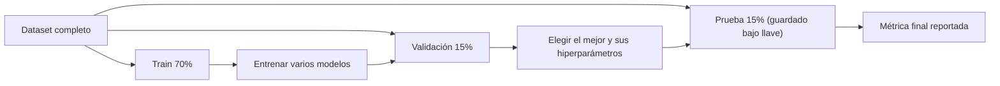

# Datos de entrenamiento, validación y prueba

Parte de: [[21-IA-Machine-Learning/03 Machine learning clásico/_Índice Machine learning clásico|Machine learning clásico]]

> [!info] Cómo avanzar
> `progreso`: **pendiente** → **viendo** (estudiando) → **visto** (contestaste la autoevaluación sin abrir las respuestas) → **dominado** (hiciste el laboratorio o lo aplicaste de verdad).

## Contenido

### Qué es
Para saber si un modelo **generaliza** necesitas medirlo con datos que no vio al aprender. Por eso el dataset se divide en tres conjuntos con papeles distintos:

- **Entrenamiento (train)**: con él el modelo ajusta sus parámetros.
- **Validación**: con él eliges entre modelos y ajustas **hiperparámetros** (profundidad de un árbol, fuerza de regularización, umbral). Es tu "examen de práctica".
- **Prueba (test)**: se usa **una sola vez al final** para estimar cómo le irá en producción. Es el "examen final" que nadie debe ver antes.

Una división típica es 70/15/15 o 80/10/10; con 10,000 filas, 70/15/15 da 7,000, 1,500 y 1,500.

### Cómo funciona



**Por qué no basta con train y test.** Si pruebas 50 configuraciones y escoges la que mejor sale en test, ya "entrenaste" tu decisión con test: la métrica queda optimista porque elegiste justo la configuración que tuvo suerte con esos datos. Es una fuga sutil. Validación absorbe esas decisiones y test queda limpio. Con pocos datos, en lugar de un conjunto fijo de validación se usa [[Validación cruzada]] sobre train.

**Estratificar.** En clasificación con clases desbalanceadas, una división aleatoria puede dejar proporciones distintas de positivos en cada conjunto (o casi ninguno en test). `stratify=y` garantiza la misma proporción en todos. Con 2,000 filas y 5 % de positivos (100), un test estratificado de 20 % (400 filas) tendrá 20 positivos.

**Dividir por tiempo.** Si los datos tienen orden temporal (ventas, demanda, fraude) y el modelo predecirá el futuro, **no mezcles al azar**: entrena con el pasado y prueba con el periodo más reciente. Si mezclas, el modelo "ve el futuro" (patrones de la semana siguiente) y la métrica no refleja la realidad. También divide **por grupo** cuando hay varias filas de la misma entidad (varias compras del mismo cliente): todas sus filas deben ir al mismo lado (`GroupShuffleSplit`), o el modelo memoriza al cliente.

**Fuga por preprocesamiento.** Escalar, imputar o seleccionar features usando **todo** el dataset antes de dividir hace que la media, la mediana o las features elegidas incluyan información de test. La solución: **dividir primero** y ajustar (`fit`) cualquier transformación solo con train; luego aplicarla (`transform`) a validación y test. Un `Pipeline` de scikit-learn lo hace automáticamente.

### Ejemplo

```python
import numpy as np
from sklearn.datasets import make_classification
from sklearn.model_selection import train_test_split
from sklearn.pipeline import make_pipeline
from sklearn.preprocessing import StandardScaler
from sklearn.linear_model import LogisticRegression

X, y = make_classification(n_samples=2_000, weights=[0.95], flip_y=0, class_sep=0.5, random_state=0)
print("positivos totales:", y.sum())                       # 100 (5 %)

# 80/20 estratificado
X_tr, X_te, y_tr, y_te = train_test_split(X, y, test_size=0.2, stratify=y, random_state=42)
print("positivos en test:", y_te.sum(), "de", len(y_te))   # 20 de 400

# Train / validación / prueba 70/15/15 en dos pasos
X_tmp, X_test, y_tmp, y_test = train_test_split(X, y, test_size=0.15, stratify=y, random_state=0)
X_train, X_val, y_train, y_val = train_test_split(X_tmp, y_tmp, test_size=0.15 / 0.85, stratify=y_tmp, random_state=0)
print(len(X_train), len(X_val), len(X_test))               # 1400 300 300

# Elegir C con validación; el escalador se ajusta SOLO con train dentro del pipeline
mejor = max((make_pipeline(StandardScaler(), LogisticRegression(C=c)).fit(X_train, y_train).score(X_val, y_val), c)
            for c in (0.01, 0.1, 1, 10))
print("mejor C en validación:", mejor[1])
final = make_pipeline(StandardScaler(), LogisticRegression(C=mejor[1])).fit(X_tmp, y_tmp)
print("exactitud final en test:", round(final.score(X_test, y_test), 3))
```

Fíjate en el orden: elegimos con validación, reentrenamos con train + validación y solo entonces tocamos test, una vez.

**En .NET.** [[ML.NET]] ofrece `mlContext.Data.TrainTestSplit(datos, testFraction: 0.2, samplingKeyColumnName: "ClienteId")`; la columna de muestreo sirve para que filas relacionadas caigan del mismo lado. Las transformaciones del pipeline se ajustan al llamar `Fit` con el conjunto de entrenamiento, con la misma lógica anti-fuga.

### Cuándo usarlo y cuándo no
Siempre aparta un test que no toques hasta el final. Si tienes pocos datos (cientos de filas), usa validación cruzada sobre train en lugar de un conjunto de validación fijo. Si los datos son temporales, usa cortes por fecha. Si hay entidades repetidas, divide por grupo.

### Errores comunes
- **Ajustar hiperparámetros mirando test**: la métrica final queda inflada.
- **Escalar o imputar antes de dividir**: fuga de información; usa pipelines.
- **Mezclar al azar datos temporales**: el modelo ve el futuro.
- **No estratificar con clases raras**: test sin positivos suficientes para medir nada.
- **Filas del mismo cliente en ambos lados**: el modelo memoriza en vez de generalizar.

### Para profundizar
- [scikit-learn: train_test_split](https://scikit-learn.org/stable/modules/generated/sklearn.model_selection.train_test_split.html)
- [scikit-learn: errores comunes y fuga de datos](https://scikit-learn.org/stable/common_pitfalls.html)
- [Google ML Crash Course: dividir el dataset](https://developers.google.com/machine-learning/crash-course/overfitting/dividing-datasets)

## Ejercicios

Resuélvelos en papel o en la herramienta; la solución está plegada.

> [!question]- Tienes 10 000 filas y divides 70/15/15. ¿Cuántas filas tiene cada conjunto?
> 7 000 entrenamiento, 1 500 validación, 1 500 prueba.

> [!question]- Escribe la división 80/20 estratificada con scikit-learn.
> ```python
> from sklearn.model_selection import train_test_split
> X_tr, X_te, y_tr, y_te = train_test_split(X, y, test_size=0.2, stratify=y, random_state=42)
> ```

> [!question]- Clase positiva = 5 % de 2 000 filas. Con 20 % de prueba estratificada, ¿cuántos positivos hay en prueba?
> Prueba = 400 filas; 5 % → 20 positivos.

## Autoevaluación

Contesta primero en voz alta o en papel; luego despliega la respuesta.

> [!question]- ¿Para qué sirve cada conjunto?
> Entrenamiento: ajustar parámetros. Validación: elegir hiperparámetros y modelo. Prueba: medir una sola vez al final el desempeño esperado en datos nuevos.

> [!question]- ¿Qué pasa si ajustas hiperparámetros mirando el conjunto de prueba?
> Lo sobreajustas indirectamente: la métrica final queda optimista y ya no estima el desempeño real.

> [!question]- ¿Cuándo usas `stratify` o una división por tiempo?
> `stratify=y` con clases desbalanceadas para conservar proporciones. Con series de tiempo, divide por fecha (entrenar con pasado, probar con futuro), nunca al azar.

> [!question]- Error común: escalar o imputar con todo el dataset antes de dividir. ¿Problema?
> Fuga de información del conjunto de prueba. Ajusta el escalador solo con entrenamiento; un `Pipeline` de scikit-learn lo hace bien solo.

## Práctica

- [[Lab 2 - Regresión y clasificación con scikit-learn]]

