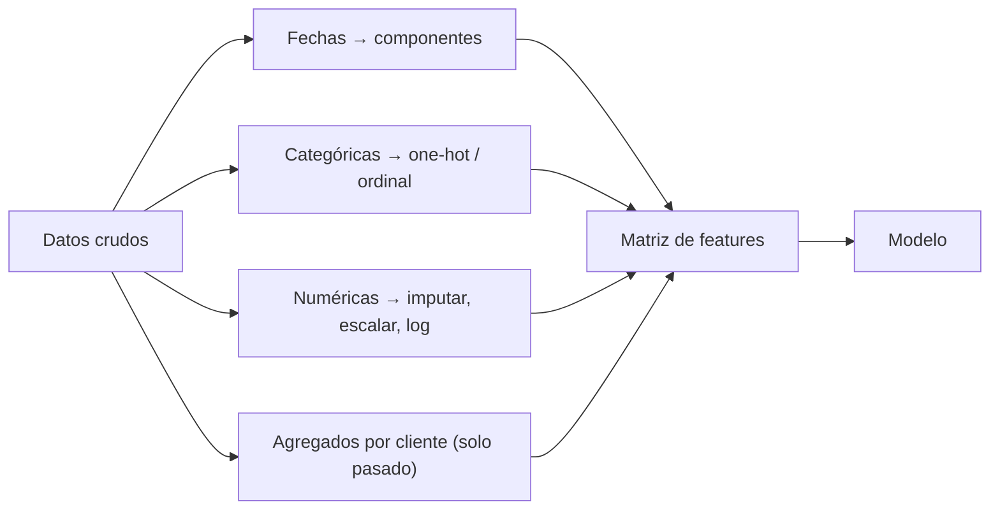

# Feature engineering

Parte de: [[21-IA-Machine-Learning/03 Machine learning clásico/_Índice Machine learning clásico|Machine learning clásico]]

> [!info] Cómo avanzar
> `progreso`: **pendiente** → **viendo** (estudiando) → **visto** (contestaste la autoevaluación sin abrir las respuestas) → **dominado** (hiciste el laboratorio o lo aplicaste de verdad).

## Contenido

### Qué es
Feature engineering (ingeniería de características) es **transformar los datos crudos en entradas que el modelo pueda aprovechar**: extraer el día de la semana de una fecha, convertir una categoría en columnas numéricas, escalar valores, combinar dos columnas en una razón (`deuda / ingreso`), agregar el historial de un cliente. En datos tabulares, unas buenas features suelen mejorar más el resultado que cambiar de algoritmo, porque el modelo solo puede aprender de lo que le das.

### Cómo funciona
**Transformaciones típicas:**

1. **Fechas y tiempo.** Una fecha cruda (`2026-11-09`) no le dice mucho a un modelo. Extrae día de la semana, mes, hora, si es quincena, fin de semana o día festivo, y "días desde el último evento". Para variables cíclicas (hora, mes), el seno y coseno evitan que el modelo crea que diciembre (12) está lejos de enero (1).
2. **Variables categóricas.** Los modelos necesitan números.
   - **One-hot**: una columna 0/1 por categoría (`color_rojo`, `color_azul`). Correcta para categorías sin orden; con cientos de valores genera muchas columnas.
   - **Ordinal**: un entero por categoría; solo tiene sentido si hay orden real (`bajo < medio < alto`) o con árboles.
   - **Target encoding**: reemplazar cada categoría por el promedio de la etiqueta en esa categoría; poderoso con muchas categorías, pero hay que calcularlo dentro de la validación cruzada para no filtrar la etiqueta.
3. **Escalado numérico.**
   - **Min-max**: `(x − min) / (max − min)` lleva a [0, 1]. Para `[10, 20, 30]` → `[0, 0.5, 1]`.
   - **Estandarización**: `(x − media) / desviación`. Importa en modelos basados en distancia o gradiente (k-NN, SVM, logística, redes, PCA); a los árboles no les afecta.
   - **Logaritmo** para variables muy sesgadas (montos, ingresos).
4. **Combinaciones y agregados.** Razones, diferencias, interacciones, y agregados por entidad (compras de los últimos 30 días, ticket promedio). Aquí es donde el conocimiento del negocio vale más.
5. **Texto.** Conteos o TF-IDF de palabras, o embeddings de un modelo de lenguaje.
6. **Nulos.** Imputar (mediana, moda) y, a veces, agregar una columna "venía vacío", porque la ausencia puede ser informativa.



**La regla de oro: solo información disponible al predecir.** Una feature que usa datos que **no existirán en el momento de la predicción** es fuga (*leakage*): el modelo luce excelente en evaluación y falla en producción. Ejemplos: usar "fecha de cierre del ticket" para predecir si se escalará, el "monto total del mes" para predecir una compra a mitad de mes, o un promedio por cliente calculado incluyendo la transacción que quieres predecir. Pregunta para cada feature: "¿a las 10:00 del día en que llamo al modelo, ya conozco este valor?". Ver [[Aprendizaje supervisado]].

**Ajustar transformaciones solo con entrenamiento.** Los mínimos, máximos, medias, categorías conocidas y medianas se aprenden en train y se aplican igual a validación, prueba y producción. Por eso se meten en un `Pipeline` / `ColumnTransformer` ([[scikit-learn]]); y el pipeline debe saber qué hacer con una categoría nunca vista (`handle_unknown="ignore"`).

### Ejemplo

```python
import numpy as np
import pandas as pd
from sklearn.preprocessing import OneHotEncoder, MinMaxScaler

df = pd.DataFrame({
    "fecha": pd.to_datetime(["2026-11-09", "2026-11-14", "2026-12-25"]),
    "color": ["rojo", "azul", "rojo"],
    "monto": [10, 20, 30],
})

# Fechas -> componentes
df["dia_semana"] = df["fecha"].dt.dayofweek          # 0 = lunes
df["nombre_dia"] = df["fecha"].dt.day_name()
df["mes"] = df["fecha"].dt.month
df["fin_de_semana"] = (df["dia_semana"] >= 5).astype(int)
df["mes_sin"] = np.sin(2 * np.pi * df["mes"] / 12)    # codificación cíclica
print(df.loc[:, ["fecha", "dia_semana", "nombre_dia", "mes", "fin_de_semana"]])

# One-hot: con pandas (rápido para explorar) y con scikit-learn (para producción)
print(pd.get_dummies(df["color"], prefix="color", dtype=int))
ohe = OneHotEncoder(handle_unknown="ignore", sparse_output=False).fit(df.loc[:, ["color"]])
print(ohe.get_feature_names_out(), ohe.transform(pd.DataFrame({"color": ["verde"]})))   # categoría nueva -> ceros

# Min-max a [0, 1]
print(MinMaxScaler().fit_transform(df.loc[:, ["monto"]]).ravel())       # [0.  0.5 1. ]

# Agregado sin fuga: promedio de compras ANTERIORES del cliente (shift excluye la fila actual)
compras = pd.DataFrame({"cliente": [1, 1, 1, 2, 2], "monto": [100, 300, 200, 50, 70]})
compras["prom_previo"] = compras.groupby("cliente")["monto"].transform(lambda s: s.shift().expanding().mean())
print(compras)
```

El `shift()` es la diferencia entre una feature legítima y una fuga: el promedio de cada fila usa solo compras anteriores.

**En .NET.** [[ML.NET]] tiene las mismas piezas como transformaciones del pipeline: `Transforms.Categorical.OneHotEncoding`, `Transforms.NormalizeMinMax` / `NormalizeMeanVariance`, `Transforms.ReplaceMissingValues`, `Transforms.Text.FeaturizeText` y `Transforms.Concatenate("Features", ...)`. Las features por cliente (ventanas de 30 días) suelen calcularse mejor en SQL Server con funciones de ventana, en un `.sql` con su interfaz, respetando la fecha de corte.

### Cuándo usarlo y cuándo no
Invierte en features cuando trabajas con datos tabulares y modelos clásicos: es donde está la mayor ganancia. Empieza por las obvias desde el negocio, mide su aporte con validación cruzada y descarta las que no ayudan. En imágenes, audio y texto, las redes neuronales aprenden sus propias representaciones y el feature engineering manual pesa mucho menos.

### Errores comunes
- **Features con información del futuro**: fuga; revisa la fecha de corte de cada una.
- **Ajustar escaladores o codificadores con todo el dataset**: usa pipelines.
- **One-hot con miles de categorías** sin agrupar las raras ("otros").
- **Codificación ordinal en categorías sin orden** para modelos lineales: inventa una relación falsa.
- **No manejar categorías nuevas** en producción: el modelo truena con un valor nunca visto.

### Para profundizar
- [scikit-learn: preprocesamiento de datos](https://scikit-learn.org/stable/modules/preprocessing.html)
- [scikit-learn: ColumnTransformer para datos heterogéneos](https://scikit-learn.org/stable/modules/compose.html#columntransformer-for-heterogeneous-data)
- [Microsoft Learn: transformaciones de datos en ML.NET](https://learn.microsoft.com/es-mx/dotnet/machine-learning/resources/transforms)

## Ejercicios

Resuélvelos en papel o en la herramienta; la solución está plegada.

> [!question]- De una columna `fecha`, extrae día de la semana y mes con pandas.
> ```python
> df['fecha'] = pd.to_datetime(df['fecha'])
> df['dia_semana'] = df['fecha'].dt.dayofweek
> df['mes'] = df['fecha'].dt.month
> ```

> [!question]- Codifica `color` con one-hot.
> ```python
> pd.get_dummies(df, columns=['color'])
> # o OneHotEncoder(handle_unknown='ignore') dentro de un Pipeline
> ```

> [!question]- Escala `[10, 20, 30]` a [0, 1] con min-max.
> `(x - 10)/(30 - 10)` → `[0, 0.5, 1]`

## Autoevaluación

Contesta primero en voz alta o en papel; luego despliega la respuesta.

> [!question]- ¿Qué es feature engineering?
> Transformar datos crudos en variables útiles para el modelo: escalar, codificar categorías, extraer partes de fechas, crear razones o agregados.

> [!question]- ¿Cómo codificas una variable categórica?
> One-hot para pocas categorías sin orden; ordinal si hay orden real; target encoding o embeddings con muchas categorías (con cuidado de no filtrar la etiqueta).

> [!question]- Error común: crear una feature con datos que no existirán al predecir.
> Leakage: p. ej. "fecha de cancelación" para predecir cancelación. Pregunta siempre: ¿tendré este dato en el momento de la predicción?

