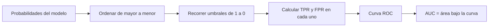

# Curva ROC y AUC

Parte de: [[Métricas de clasificación y regresión]]

> [!info] Cómo avanzar
> `progreso`: **pendiente** → **viendo** (estudiando) → **visto** (contestaste la autoevaluación sin abrir las respuestas) → **dominado** (hiciste el laboratorio o lo aplicaste de verdad).

## Contenido

### Qué es
La **curva ROC** (*receiver operating characteristic*) muestra cómo se comporta un clasificador **en todos los umbrales posibles a la vez**. En el eje Y grafica la **tasa de verdaderos positivos** (TPR, que es el recall: `TP/(TP+FN)`) y en el eje X la **tasa de falsos positivos** (FPR: `FP/(FP+TN)`, qué fracción de los negativos se marcaron por error). El **AUC** (*area under the curve*) es el área bajo esa curva: un solo número entre 0 y 1 que resume qué tan bien **ordena** el modelo los casos positivos por encima de los negativos, sin tener que elegir un umbral.

### Cómo funciona
**Construcción.** El modelo asigna a cada ejemplo una probabilidad o puntaje. Ordenas los ejemplos de mayor a menor puntaje y vas bajando el umbral desde "nadie es positivo" (punto (0, 0)) hasta "todos son positivos" (punto (1, 1)). En cada umbral calculas TPR y FPR, y los unes. Un modelo bueno sube rápido (detecta muchos positivos antes de cometer falsas alarmas) y se pega a la esquina superior izquierda.



**Cómo leer el AUC.**
- **AUC = 0.5**: el modelo no distingue nada; ordena igual que una moneda al aire. La curva es la diagonal.
- **AUC = 1**: separación perfecta; existe un umbral que deja todos los positivos arriba y todos los negativos abajo.
- **AUC < 0.5**: peor que el azar; casi siempre indica un error (etiquetas invertidas, columna equivocada). Invertir la predicción lo arregla, pero busca la causa.
- Interpretación probabilística útil: el AUC es la **probabilidad de que un positivo elegido al azar reciba un puntaje mayor que un negativo elegido al azar**. Por eso solo depende del **orden**, no de que las probabilidades estén calibradas.

**Ventajas.** No depende del umbral, así que sirve para comparar modelos antes de decidir cómo operarlos; y no cambia si multiplicas los puntajes por una constante. Después eliges el punto de operación en la curva según el costo de los errores.

**Cuándo engaña: clases muy desbalanceadas.** Si hay 10 positivos por cada 10,000 negativos, la FPR usa como denominador esos 10,000 negativos: 100 falsas alarmas son solo 1 % de FPR, y la curva ROC se ve espectacular. Pero 100 falsas alarmas contra 10 aciertos es una **precisión pésima** para quien revisa las alertas. En esos casos prefiere la **curva precisión-recall** y su área (*average precision*, AUC-PR), que se enfocan en la clase positiva y sí reflejan el costo de las falsas alarmas ([[Precisión, recall y F1]]). La línea base de AUC-PR es la proporción de positivos (por ejemplo 0.001), no 0.5.

### Ejemplo

```python
import numpy as np
from sklearn.datasets import make_classification
from sklearn.model_selection import train_test_split
from sklearn.linear_model import LogisticRegression
from sklearn.metrics import roc_auc_score, roc_curve, average_precision_score

# Interpretación: probabilidad de que un positivo puntúe más que un negativo
y = np.array([0, 0, 1, 1, 0, 1])
s = np.array([0.1, 0.4, 0.35, 0.8, 0.2, 0.9])
pares = [(p, n) for p in s[y == 1] for n in s[y == 0]]
print(roc_auc_score(y, s), np.mean([p > n for p, n in pares]))      # mismos valores

print(roc_auc_score(y, np.full(6, 0.5)))                              # 0.5: no ordena nada

# Desbalance fuerte: ROC-AUC alto, AUC-PR mucho más modesto
X, yy = make_classification(n_samples=40_000, weights=[0.995], class_sep=1.0, flip_y=0, random_state=0)
X_tr, X_te, y_tr, y_te = train_test_split(X, yy, test_size=0.5, stratify=yy, random_state=0)
proba = LogisticRegression(max_iter=1000).fit(X_tr, y_tr).predict_proba(X_te)[:, 1]
print("positivos en test:", y_te.sum(), "de", len(y_te))
print("ROC-AUC:", round(roc_auc_score(y_te, proba), 3))
print("AUC-PR (average precision):", round(average_precision_score(y_te, proba), 3))

fpr, tpr, umbrales = roc_curve(y_te, proba)
i = np.argmax(tpr >= 0.8)
print(f"para recall 0.8: FPR={fpr[i]:.3f}, umbral={umbrales[i]:.3f}")
```

La primera parte comprueba que el AUC coincide con la fracción de pares positivo-negativo bien ordenados. La segunda muestra la brecha entre ROC-AUC y AUC-PR cuando los positivos son muy raros.

Para graficar: `RocCurveDisplay.from_predictions(y_te, proba)` y `PrecisionRecallDisplay.from_predictions(y_te, proba)` (requieren matplotlib).

**En .NET.** [[ML.NET]] reporta `AreaUnderRocCurve` y `AreaUnderPrecisionRecallCurve` en `BinaryClassificationMetrics`. Si evalúas un modelo de fraude para Pochteca.Nomisma, reporta las dos.

### Cuándo usarlo y cuándo no
Usa ROC-AUC para comparar modelos de clasificación binaria cuando las clases no están extremadamente desbalanceadas y te importa la capacidad de **ordenar** (priorizar casos, rankear riesgo). Prefiere la curva precisión-recall cuando la clase positiva es rara y lo que importa es la calidad de las alertas. Ninguna de las dos reemplaza elegir un umbral y revisar la [[Matriz de confusión]] en el punto de operación.

### Errores comunes
- **Calcular AUC con la clase predicha (0/1)** en lugar de probabilidades: pierdes casi toda la información.
- **Celebrar un ROC-AUC alto con clases muy raras**: revisa AUC-PR y precisión.
- **Pensar que AUC mide calibración**: solo mide orden; un modelo con AUC alto puede dar probabilidades exageradas.
- **Comparar AUC de modelos evaluados en conjuntos distintos.**

### Para profundizar
- [scikit-learn: curva ROC](https://scikit-learn.org/stable/modules/model_evaluation.html#roc-metrics)
- [Google ML Crash Course: ROC y AUC](https://developers.google.com/machine-learning/crash-course/classification/roc-and-auc)
- [scikit-learn: precisión-recall (ejemplo)](https://scikit-learn.org/stable/auto_examples/model_selection/plot_precision_recall.html)

## Autoevaluación

Contesta primero en voz alta o en papel; luego despliega la respuesta.

> [!question]- ¿Qué grafica la curva ROC?
> Tasa de verdaderos positivos (recall) contra tasa de falsos positivos para todos los umbrales posibles.

> [!question]- ¿Qué significa AUC = 0.5 y AUC = 1?
> 0.5: como lanzar una moneda. 1: separa perfectamente. AUC es la probabilidad de que un positivo al azar reciba más puntaje que un negativo al azar.

> [!question]- ¿Cuándo prefieres la curva precisión-recall?
> Con clases muy desbalanceadas: ROC puede verse bien aunque la precisión sea mala, porque los muchos negativos inflan la tasa de verdaderos negativos.

## Práctica

- [[Lab 2 - Regresión y clasificación con scikit-learn]]

